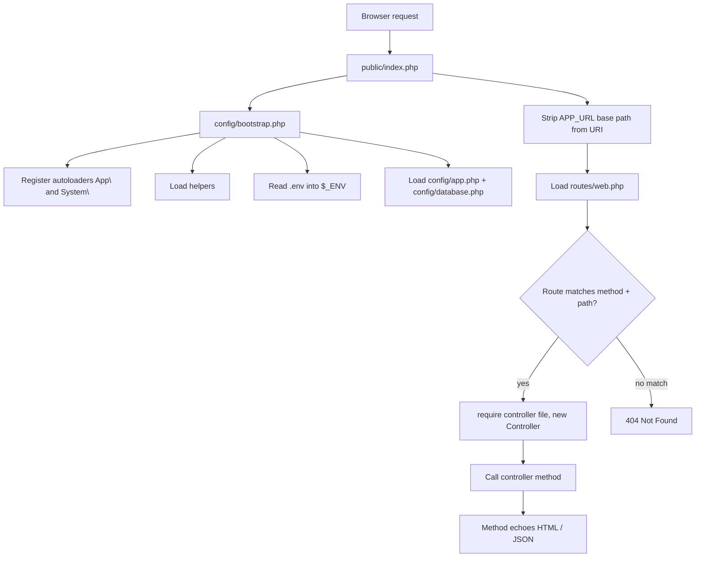

# BongoMvc Documentation

BongoMvc is a small PHP MVC framework that works like a lightweight Laravel. It needs **no Composer and no `vendor/` folder**. Clone it, set `.env`, and run it.

It provides:

- Laravel-style routes (`'GET /path' => [Controller, method]`)
- Controllers with a base `Controller` class
- A Blade-like template engine (`@extends`, `@section`, `@yield`, `@include`, `{{ }}`, `{!! !!}`)
- A PDO query builder (`DB::table(...)->where(...)->get()`) and a basic `Model`
- Helpers: `env()`, `config()`, `view()`, `asset()`, `route()`, `response()`, `redirect()`, `base_path()`, `dd()`
- A small `artisan` CLI with `php artisan serve`

---

## 1. Requirements

| Requirement | Notes |
| --- | --- |
| PHP **8.0+** | The code uses `str_starts_with`, `str_contains`, union types and typed properties |
| `pdo_mysql` extension | Only needed if you use the database layer |
| MySQL / MariaDB | Only needed if you use the database layer |
| Apache with `mod_rewrite` (optional) | Only if you serve through Apache instead of `php artisan serve` |

You do **not** need Composer, Node or any other build step.

---

## 2. Quick start

```bash
# 1. Get the code
git clone <repo-url> BongoMvc
cd BongoMvc

# 2. Create your environment file
cp .env.example .env        # Windows: copy .env.example .env

# 3. Edit .env (app URL, database credentials)

# 4. Start the development server
php artisan serve
```

Open <http://127.0.0.1:8000>.

`php artisan serve` runs PHP's built-in server with `public/` as the document root (`php -S 127.0.0.1:8000 -t public`). Any URL that is not a real file goes to `public/index.php`.

### Running under Apache (XAMPP, Laragon, etc.)

Point the virtual host's `DocumentRoot` at the `public/` folder. `public/.htaccess` already rewrites every request to `index.php`. The root `.htaccess` file is an **example VirtualHost block**, not a working `.htaccess`. Copy it into your Apache vhost config and fix the paths:

```apache
<VirtualHost *:80>
    ServerName bongomvc.local
    DocumentRoot "D:/Laravel/BongoMvc/public"
    <Directory "D:/Laravel/BongoMvc/public">
        AllowOverride All
        Require all granted
    </Directory>
</VirtualHost>
```

> **Important:** `APP_URL` in `.env` must match the URL you browse with. The router removes the path part of `APP_URL` from each request URI. `asset()` and `route()` also build their links from it. For example, with `APP_URL=http://localhost/BongoMvc/public`, a request to `/BongoMvc/public/database` matches the route `/database`.

---

## 3. Directory structure

```
BongoMvc/
├── artisan                  # CLI entry point (php artisan serve / help)
├── .env / .env.example      # Environment variables
├── .htaccess                # Example Apache VirtualHost (not a real .htaccess)
├── config/
│   ├── bootstrap.php        # Boots the framework: autoloaders, .env, config, helpers
│   ├── app.php              # App name, env, url
│   └── database.php         # Database connections
├── public/                  # Web root – the only folder exposed to the browser
│   ├── index.php            # Front controller + router
│   ├── .htaccess            # Rewrites all requests to index.php
│   └── asset/               # CSS / JS (use asset('asset/...'))
├── routes/
│   └── web.php              # Route table
├── app/                     # YOUR application code (namespace App\)
│   ├── Http/Controllers/    # Controllers (App\Http\Controllers)
│   ├── Models/              # Models (App\Models)
│   ├── Services/            # Business logic classes (App\Services)
│   └── Helpers/
│       └── commonHelper.php # Global helper functions
├── resources/
│   └── views/               # Templates (dot notation: admin.master → admin/master.php)
├── system/                  # FRAMEWORK core (namespace System\)
│   ├── Database/            # Connection, DB, QueryBuilder, Model
│   └── View/                # ViewEngine, ViewCompiler, SectionManager, view() helper
└── utility/                 # CLI helpers (Input, Message, SystemOperation) – not autoloaded
```

Rule of thumb: put your code in `app/`, `routes/`, `resources/views/` and `config/`. Change `system/` only when you change the framework itself.

---

## 4. Request lifecycle



Step by step:

1. **`public/index.php`** is the only entry point.
2. It loads **`config/bootstrap.php`**, which:
   - enables full error display (`display_errors = 1`, `E_ALL`);
   - registers two PSR-4 style autoloaders: `App\…` → `app/…` and `System\…` → `system/…`;
   - loads `app/Helpers/commonHelper.php` and `system/View/helpers.php`;
   - parses `.env` line by line into `$_ENV` and `putenv()`;
   - defines `env()`, then loads `config/app.php` and `config/database.php` into `$GLOBALS['config']`.
3. The URI is normalised: the `APP_URL` path is removed and the result is trimmed to `/something`.
4. `routes/web.php` returns an array. The first entry whose HTTP method and exact path match wins.
5. The controller file `app/Http/Controllers/{Name}.php` is required, the class `App\Http\Controllers\{Name}` is instantiated, and the method is called with no arguments.
6. The method writes the response itself, using `echo`, `response()` or `redirect()`.
7. If nothing matched, the response is `404 Not Found`.

---

## 5. Routing

Routes live in [routes/web.php](routes/web.php) and are a plain PHP array:

```php
<?php
return [
    'GET /'                => ['CleanupController', 'dashboard'],
    'POST /cleanup/ajax'   => ['CleanupController', 'ajaxHandler'],
    'GET /database'        => ['DatabaseController', 'index'],
    'POST /database/clean' => ['DatabaseController', 'cleanDatabase'],
    'ANY /ping'            => ['HealthController', 'ping'],
];
```

- **Key:** `"METHOD /path"`. `METHOD` is `GET`, `POST` or `ANY`. A key with no method, such as `'/about'`, is treated as `ANY`.
- **Value:** `[ControllerClassName, methodName]`. Use the short class name only. It is resolved to `App\Http\Controllers\ControllerClassName`.
- Matching is an **exact string match** on the path. Paths must start with `/` and have no trailing slash.
- Not supported yet: route parameters (`/user/{id}`), named routes, route groups and middleware. Read dynamic values from the query string or `$_POST`:

```php
// GET /user?id=5
$id = $_GET['id'] ?? null;
```

---

## 6. Controllers

Controllers live in `app/Http/Controllers/` and extend the base [Controller](app/Http/Controllers/Controller.php).

```php
<?php
namespace App\Http\Controllers;

use System\Database\DB;

class UserController extends Controller
{
    public function index()
    {
        $users = DB::table('users')->orderBy('id', 'DESC')->limit(10)->get();

        echo $this->view('users.index', [
            'title' => 'Users',
            'users' => $users,
        ]);
    }

    public function store()
    {
        DB::table('users')->insert([
            'name'  => $_POST['name'] ?? '',
            'email' => $_POST['email'] ?? '',
        ]);

        redirect(route('/users'));
    }

    public function apiList()
    {
        response(DB::table('users')->asArray()->get()); // JSON + exit
    }
}
```

Register them:

```php
'GET /users'     => ['UserController', 'index'],
'POST /users'    => ['UserController', 'store'],
'GET /api/users' => ['UserController', 'apiList'],
```

What the base controller provides:

| Method | Returns | Purpose |
| --- | --- | --- |
| `$this->view($name, $data = [])` | `string` | Renders a template. You must `echo` the result. |
| `$this->respondSuccess($message, $data = null)` | JSON `string` | `{"status":"success","message":…,"data":…}` |
| `$this->respondError($message)` | JSON `string` | `{"status":"error","message":…}` |

Request data comes from PHP's superglobals (`$_GET`, `$_POST`, `$_FILES`, `$_SERVER`). There is no Request object.

---

## 7. Views and the template engine

Views are `.php` files under `resources/views/`. Use dot notation for the name: `admin.extends.dashboard` → `resources/views/admin/extends/dashboard.php`.

Render a view from a controller with `$this->view(...)`, or from anywhere with the global `view(...)` helper. Both return a string.

### Directives

| Syntax | Meaning |
| --- | --- |
| `@extends('admin.master')` | Use this layout. The child's sections fill the layout's `@yield`s. |
| `@section('name') … @endsection` | Capture a block of HTML into a named section. |
| `@yield('name')` | Print a section's content (used in layouts). |
| `@set('name', 'value')` | Set a section to a short literal string, such as a page title. |
| `@include('partials.alert')` | Render another view inline. It receives the current variables. |
| `{{ $var }}` | Echo with HTML escaping (`htmlspecialchars`). |
| `{!! $html !!}` | Echo raw, unescaped. |
| `<?php … ?>` / `<?= … ?>` | Plain PHP works everywhere. |

### Example

`resources/views/layouts/app.php`

```php
<!DOCTYPE html>
<html>
<head>
    <title>@yield('title')</title>
    <link href="<?= asset('asset/css/app.css') ?>" rel="stylesheet">
</head>
<body>
    @include('partials.nav')
    <main>@yield('content')</main>
    @yield('scripts')
</body>
</html>
```

`resources/views/users/index.php`

```php
@extends('layouts.app')

@set('title', 'Users')

@section('content')
    <h1>{{ $title }}</h1>
    <ul>
        <?php foreach ($users as $user): ?>
            <li>{{ $user->name }} – {{ $user->email }}</li>
        <?php endforeach; ?>
    </ul>
@endsection
```

How rendering works ([system/View/ViewEngine.php](system/View/ViewEngine.php)):

1. The `@extends` line is removed from the child view. The rest is compiled by [ViewCompiler](system/View/ViewCompiler.php), which turns directives into PHP using regular expressions, and run once with `eval()` in an isolated scope. `@section` blocks are captured in [SectionManager](system/View/SectionManager.php).
2. Without `@extends`, that output is returned.
3. With `@extends`, the layout is rendered from its own source. Each `@yield` prints a captured section at runtime, so rendered HTML is never compiled again.

Notes:

- No compiled-view cache is written. `storage/cache/views` is passed to the engine but never used, so every view is compiled on each request.
- Layout variables: the data array is `extract()`ed, so `$title`, `$users` and the rest are available in both the child and the layout.
- The existing `admin/master.php` layout pulls in partials with plain `include base_path(...)`. `@include` works too.

---

## 8. Database layer

Configure the database in `.env`:

```dotenv
DB_CONNECTION=mysql
DB_HOST=127.0.0.1
DB_PORT=3306
DB_DATABASE=my_database
DB_USERNAME=root
DB_PASSWORD=
```

[System\Database\Connection](system/Database/Connection.php) creates one shared PDO instance (a singleton). It is created on first use, with `ERRMODE_EXCEPTION` and `FETCH_ASSOC`. If the connection fails, it throws a `RuntimeException` with the message `Database Connection Failed: …`. Catch it to show a friendly error, as `DashboardController` does.

### Query builder – `System\Database\DB`

```php
use System\Database\DB;

// SELECT
$users = DB::table('users')->get();                         // array of stdClass objects
$admins = DB::table('users')->where('role', 'admin')->get(); // 2-arg form: operator "="
$recent = DB::table('users')
    ->where('created_at', '>=', '2026-01-01')
    ->whereIn('status', ['active', 'pending'])
    ->orderBy('id', 'DESC')
    ->limit(20)
    ->get();

$user = DB::table('users')->where('id', 5)->first();        // object or null
$rows = DB::table('users')->asArray()->get();               // associative arrays

// INSERT / UPDATE / DELETE  (return bool)
DB::table('users')->insert(['name' => 'Rahim', 'email' => 'r@example.com']);
DB::table('users')->where('id', 5)->update(['name' => 'Karim']);
DB::table('users')->where('id', 5)->delete();
DB::table('logs')->truncate();

// Raw SQL with bindings
$rows = DB::raw('SELECT * FROM users WHERE email = ?', ['r@example.com']); // array for SELECT
$ok   = DB::raw('UPDATE users SET active = 0 WHERE id = ?', [5]);           // bool otherwise
```

| Method | Description |
| --- | --- |
| `where($col, $op, $val)` / `where($col, $val)` | Adds an `AND` condition. Values are bound with `?`. |
| `whereIn($col, array $vals)` | `col IN (...)`. An empty array matches nothing. |
| `orderBy($col, 'ASC'\|'DESC')` | Sets a single ORDER BY. A later call replaces the earlier one. |
| `limit($n)` | LIMIT |
| `asArray()` | Return associative arrays instead of objects |
| `get()` | Run the SELECT and return all rows |
| `first()` | `limit(1)`, then return the first row or `null` |
| `insert(array)` / `update(array)` / `delete()` / `truncate()` | Write operations. Each returns `bool`. |

> **Security:** values are always bound safely, but **column names, operators, `orderBy` and table names are inserted into the SQL as-is**. Never pass user input into those arguments.

Not supported yet: `orWhere`, joins, `select()` of specific columns, `count()`/aggregates, pagination, transactions, `lastInsertId`. Use `DB::raw()` or `Connection::getInstance()` (a plain PDO object) for these.

### Models – `System\Database\Model`

```php
<?php
namespace App\Models;

use System\Database\Model;

class Post extends Model
{
    protected static $table = 'posts';   // optional; default = lowercase class name + "s"
}
```

```php
use App\Models\Post;

Post::all();                              // all rows
Post::find(3);                            // WHERE id = 3, first row or null
Post::where('status', 'published')->orderBy('id', 'DESC')->get();
Post::whereIn('id', [1, 2, 3])->get();
Post::create(['title' => 'Hello']);       // INSERT, returns bool
Post::query()->where('id', 3)->update(['title' => 'Hi']);
```

Static calls return query builder results (`stdClass` objects or arrays), **not** model instances. Declare `$table` **without a type** (`protected static $table = 'posts';`), because the parent property has none.

---

## 9. Configuration and environment

### `.env`

`.env` is read by `config/bootstrap.php` and ignored by git. Supported format: `KEY=value`, one per line; lines starting with `#` are comments. `true` / `false` are converted to booleans by `env()`.

| Key | Used for |
| --- | --- |
| `APP_NAME` | `config('app.name')` |
| `APP_ENV` | `config('app.env')` |
| `APP_URL` | Base path stripped by the router; base URL for `asset()` / `route()` |
| `APP_PORT` | Informational only. `artisan serve` always uses port 8000. |
| `DB_*` | Database connection (see section 8) |
| `ADMIN_PATH`, `MERCHANT_PATH` | Used by the sample cleanup app only |

Matching surrounding quotes are removed: `APP_NAME="My App"` gives `My App`.

### Config files

`config/app.php` and `config/database.php` return arrays. Read values with dot notation:

```php
config('app.name');
config('database.connections.mysql.host');
config('app.missing', 'fallback');
```

To add a new config file such as `config/mail.php`, also register it in `$GLOBALS['config']` in [config/bootstrap.php](config/bootstrap.php):

```php
$GLOBALS['config'] = [
    'app'      => require __DIR__ . '/app.php',
    'database' => require __DIR__ . '/database.php',
    'mail'     => require __DIR__ . '/mail.php',
];
```

---

## 10. Helper functions

| Helper | Defined in | Description |
| --- | --- | --- |
| `env($key, $default = null)` | `config/bootstrap.php` | Reads an `.env` value. Converts `true`/`false` to booleans. |
| `config($key, $default = null)` | `app/Helpers/commonHelper.php` | Reads config with dot notation |
| `view($name, $data = [])` | `system/View/helpers.php` | Renders a view and returns the string |
| `asset($path)` | `commonHelper.php` | `APP_URL` + `/` + `$path`, e.g. `asset('asset/css/app.css')` |
| `route($path)` | `commonHelper.php` | `APP_URL` + `/` + `$path` (path-based, not named routes) |
| `response($data, $type = 'json')` | `commonHelper.php` | Sends JSON (or HTML with `'html'`) and **exits** |
| `redirect($url)` | `commonHelper.php` | `Location` header and **exit** |
| `base_path($path = '')` | `commonHelper.php` | Absolute path inside the project |
| `dd(...$vars)` | `commonHelper.php` | Laravel-style pretty dump with caller file/line, then exit |

Add your own helpers to `app/Helpers/commonHelper.php` and wrap each one in `if (!function_exists('name'))`.

---

## 11. `artisan` CLI

```bash
php artisan serve   # start dev server at http://127.0.0.1:8000 (docroot: public/)
php artisan help    # list commands
```

To add a command, add a `case` to the `switch` in [artisan](artisan).

---

## 12. Adding a new page (checklist)

1. **Route:** add `'GET /about' => ['PageController', 'about'],` to `routes/web.php`.
2. **Controller:** create `app/Http/Controllers/PageController.php` with namespace `App\Http\Controllers`, extending `Controller`, with a public `about()` method that `echo`s `$this->view('pages.about', [...])`.
3. **View:** create `resources/views/pages/about.php`. It can `@extends` a layout.
4. **Assets:** put CSS and JS in `public/asset/` and link them with `asset('asset/...')`.
5. **Classes:** put services in `app/Services` (namespace `App\Services`) and models in `app/Models`. The autoloader finds them from their namespace and file name, so the file name must equal the class name.

---

## 13. Starter dashboard

`GET /` and `GET /dashboard` ([DashboardController](app/Http/Controllers/DashboardController.php), view `resources/views/dashboard/index.php`, layout `resources/views/layouts/app.php`) is a read-only page for checking that the framework works end to end. It shows:

- the database connection status, server version and schema;
- the schema's tables, with approximate row counts and sizes, read through the query builder from `information_schema`;
- a self-check list covering routing, `.env`, config, the view engine and the database.

If the database is unreachable, the page still renders and shows the error. It exercises `@extends`, `@section`, `@set`, `@yield`, `@include`, `{{ }}`, `DB::raw()` and `DB::table()`.

## 14. Bundled sample application

The repository ships with an "OC Cleanup Manager" as a working example:

- `CleanupController` (served at `/cleanup`) and `App\Services\OCCleanup` clear view, config, log, session and debugbar files in other Laravel projects, using the paths from `.env`.
- `DatabaseController` and `App\Services\DatabaseCleaner` truncate or reset tables in the configured database.
- `resources/views/admin/*` contains a Bootstrap 5 (CDN) dashboard; `public/asset/js/common.js` sends the AJAX calls.

> These actions **delete data and files**. Point them only at development databases. Remove the sample if you are starting a new app:
> - Delete `CleanupController.php`, `DatabaseController.php` and `app/Services/*`.
> - Delete `resources/views/admin/*` and `public/asset/*`.
> - Delete the sample entries in `routes/web.php`.
> - Delete `ADMIN_PATH` / `MERCHANT_PATH` from `.env`.

`app/Services/CleanupCli.php`, `app/Services/dashboard-controller.php`, `public/asset/js/ajax-cleanup.php` and `utility/` are leftovers from an older standalone CLI version and are not used by the web app.

---

## 15. Known issues and limitations

Found while scanning the code. Rows marked **Fixed** were fixed when the starter dashboard was added. The rest are still open.

| # | Where | Issue |
| --- | --- | --- |
| 1 | **Fixed.** [app/Models/User.php](app/Models/User.php) | `protected static string $table` redeclares the parent's **untyped** `$table` with a type. PHP throws a fatal error as soon as `User` is loaded. Fix: `protected static $table = 'users';` |
| 2 | [routes/web.php](routes/web.php) | `POST /cleanup/run` points to `CleanupController::runAction`, which does not exist, so it returns HTTP 500. |
| 3 | [CleanupController::dashboard](app/Http/Controllers/CleanupController.php) | It runs an unused query (`users` where `id = 12`). The home page therefore fails if the database is not set up. |
| 4 | **Fixed.** [config/bootstrap.php](config/bootstrap.php) | `.env` values keep their surrounding quotes. |
| 5 | [system/View/ViewEngine.php](system/View/ViewEngine.php) | A view without a layout is evaluated twice, so its PHP side effects run twice. No compiled cache is written. |
| 6 | [system/Database/QueryBuilder.php](system/Database/QueryBuilder.php) | Identifiers and `orderBy` are not escaped. There is no `orWhere`, `select`, `join` or `count`. |
| 7 | Router | No route parameters, middleware, CSRF protection or method spoofing (`PUT`/`DELETE`). The route is matched by exact path only. |
| 8 | [public/index.php](public/index.php) | A second `App\` autoloader is registered *after* dispatch. It is redundant because bootstrap already registers one. |
| 9 | Helpers | `config()` and `route()` are defined in both `commonHelper.php` and `bootstrap.php`. The `commonHelper.php` versions win because they load first. |
| 10 | Errors | `display_errors` is always on. Turn it off for production, for example based on `APP_ENV`. |
| 11 | `utility/` | The `utility\` namespace is not autoloaded. |
| 12 | `artisan serve` | The host and port are hard-coded (`127.0.0.1:8000`). `APP_PORT` is ignored. |

### `system/` folder review

These were confirmed by running the code on PHP 8.3.

| # | Severity | Where | Issue | Suggested fix |
| --- | --- | --- | --- | --- |
| 13 | **Fixed.** **Critical (security)** | `ViewEngine::render()`, `@extends` branch | Section HTML has already been rendered when it is pasted into the layout, and then it is **compiled and `eval`'d a second time**. If a user submits the text `{{ phpversion() }}` and it is shown inside a section, it is executed as PHP. `htmlspecialchars` does not escape `{`, so `{{ $name }}` does not protect against this. The result is remote code execution. | Compile and evaluate the layout first, with `@yield` compiled to `$this->sections->get(...)` (the compiler already does this). Do not `preg_replace` rendered output into the layout source. |
| 14 | **Fixed.** **High** | `@include` → `$this->render('x', get_defined_vars())` | `get_defined_vars()` passes `render()`'s own locals (`$compiledChild`, `$childContent`, `$data`, …). `extract(..., EXTR_OVERWRITE)` then overwrites the partial's locals with them, so the **parent template is rendered again**. This repeats until PHP runs out of memory. | Pass only the user's data. Keep the engine's locals out of the scope that `extract()` writes into, for example by rendering through a separate closure. |
| 15 | **Fixed.** **High** | `Model::where()` | `Model::where()` always forwards 3 arguments, so the 2-argument shorthand in `QueryBuilder::where()` (`func_num_args() === 2`) never applies. `User::where('role', 'admin')` produces the SQL `role admin ?` with a `NULL` binding, which is a syntax error. | In `QueryBuilder::where()`, treat a call as the shorthand when `$value === null && func_num_args() < 3`, or forward with `func_get_args()` in `Model`. |
| 16 | **Fixed.** Medium | `ViewEngine::render()`, no-layout branch | The child view is compiled and `eval`'d twice. The first output is thrown away, so any side effects (queries, counters) run twice. | Keep the first `ob_get_clean()` output and return it. |
| 17 | Medium | `SectionManager` | Sections are never cleared. Rendering two views with the same engine (the `view()` helper keeps a `static` engine) leaks sections from the first view into the second. | Reset the sections at the start of each top-level `render()`. |
| 18 | Medium | `QueryBuilder::update()` / `delete()` | With no `where()`, they update or delete **every row** without warning. | Refuse to run with no `where()` unless an explicit flag is passed. |
| 19 | Medium | `QueryBuilder` | Table names, column names, operators and `orderBy` direction are inserted into the SQL unescaped. | Whitelist the operators and `ASC`/`DESC`. Quote identifiers with backticks. |
| 20 | Low | `QueryBuilder::__construct()` | Connects to the database as soon as a builder is created, even if no query is run. | Connect lazily in `get()`/`insert()`/… |
| 21 | Low | `DB::raw()` | Returns rows only for queries that start with `select`. `SHOW`, `DESCRIBE`, `WITH …` and `(SELECT …)` return `true` instead of rows. | Return `fetchAll()` when `$stmt->columnCount() > 0`. |
| 22 | **Partly fixed (now throws instead of `die()`).** Low | `Connection` | Only MySQL is supported. The `DB_CONNECTION`, `unix_socket` and `collation` settings are ignored. The file reads `config/database.php` directly instead of using `config()`. On failure it calls `die()` with the PDO message. | Build the DSN from the selected connection. Throw an exception instead of `die()`. |
| 23 | Low | `ViewCompiler` | `@set` values containing `'` produce invalid PHP. Nested `@section`s, `@section('x', 'value')`, `{{-- comments --}}`, `@if` and `@foreach` are not supported. Directives are also matched inside `<script>` text. | Extend the compiler as needed. |
| 24 | Low | `Model` | Results are `stdClass` objects or arrays, never model instances, so the `__get` and `toArray` methods are never used. Table names are pluralised by adding `s` (`Category` → `categorys`). There is no `save`, `update` or `delete` on models. | Hydrate model instances in `all()`/`find()`. |
| 25 | Low | `ViewException`, `cachePath` | `ViewException` is never thrown; a missing view throws a plain `Exception`. `$cachePath` is stored but never used. | Throw `ViewException`. Either implement a compiled-view cache or remove the parameter. |
