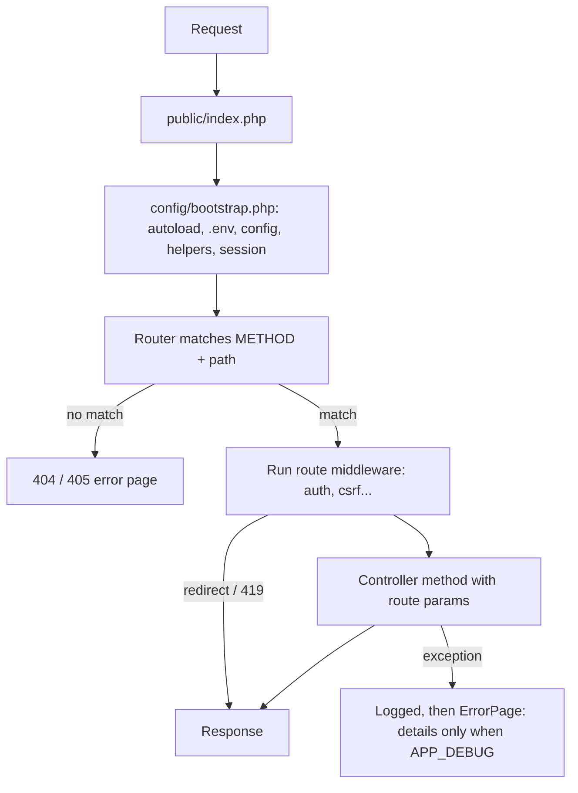

# Bongo PHP Framework: Documentation

Bongo is a lightweight PHP MVC framework with **zero required dependencies**. It needs no Composer and no `vendor/` folder: clone it, set `.env`, and run it. Composer packages and Node tooling are optional. If `vendor/autoload.php` exists, Bongo loads it; otherwise nothing changes.

Built in:

| Area | What you get |
| --- | --- |
| Routing | `Route::get/post/put/patch/delete/any/match`, groups, named routes, multiple route files (`web.php`, `api.php`), method spoofing, 404/405 |
| Middleware | Aliases, groups (`web`, `api`), global stack, parameters (`role:admin`); built-in `auth`, `guest`, `csrf`, `cors`, security headers |
| Views | Own template engine: `@if/@foreach/@forelse`, `@csrf/@method/@error`, `@auth`, `@json`, layouts, `@include`, `@push/@stack`, custom directives, compiled-view cache |
| Database | Query builder (row locks, grouped `orWhere`, joins, `groupBy/having`, aggregates, `pluck/value/exists`, `increment`, `chunk`, pagination), transactions with savepoints, query log, models with relations and eager loading |
| Schema & migrations | PHP migrations with a schema builder; each run is tracked in the database; rollback |
| Sessions | Flash messages, old input, CSRF tokens |
| Validation & storage | 35+ rules (dates, regex, files, `unique`, …), `items.*.field` wildcards, custom messages; multi-disk storage (`Storage::disk('public')`, `Storage::disk('local')`, `Storage::disk('s3')`), streaming file downloads (`Storage::download()`), temporary presigned URLs (`Storage::temporaryUrl()`), custom drivers (`Storage::extend()`), and safe uploads (`$file->store()`, `Storage::url()`) |
| Spreadsheets & Documents | Unified import/export for CSV and Excel `.xlsx` (`Spreadsheet::read()`, `Spreadsheet::download()`) with UTF-8 BOM, and printable vector documents/PDFs (`Printable::invoice()`) with flawless Bangla and multilingual typography |
| Hardening | Strict sessions with idle/absolute timeouts, trusted-proxy aware `Request::ip()`/`isSecure()`, optional CSP, `php bongo security:check` deployment checklist |
| Auth & security | Multiple guards (session, JWT) and providers, `auth:api` middleware, own HS256 JWT with refresh and revocation, peppered Argon2id passwords, AES-256-GCM encryption, login throttling |
| Testing | `php bongo test`: unit + HTTP tests on a separate test database |
| Debugging | Internal DevTools DebugBar (`@debugbar`), floating dark toolbar with 7 tabs (Request, Messages, Timeline, Views, Queries with N+1 repetition counters, Models, Cache, OpCache, Memory, and Page Time); `dump()`/`dd()` for browser, CLI and JSON; developer error page with source and stack trace; `php bongo tinker` |
| Mail & events | Built-in SMTP client (TLS/SSL, AUTH), log and file drivers, HTML + text emails; `Event::listen/dispatch`; forgot-password flow with hashed single-use tokens |
| Localization | `__()`, `trans_choice()`, JSON + group translation files, `?lang=` / session / `Accept-Language`, translated validation messages; English and বাংলা included |
| Cache & rate limits | File cache (`Cache::remember`), `throttle:60,1` middleware with rate-limit headers, `RateLimiter` |
| Container & DI | Service container (`app()`, `bind/singleton/instance`, autowiring), controller method injection, route model binding (`edit(Product $product)` → 404 if missing) |
| Generators | `make:command`, `make:controller [--api]`, `make:model [--migration]`, `make:middleware`, `make:request`, `make:policy`, `make:job`, `make:component`, `make:seeder`, `make:notification`, `make:mail`, `make:test [--unit]`, `make:migration` |
| Logging | Built-in daily log files in `storage/logs`, text and structured JSON format (`LOG_FORMAT=json`), levels, secret masking; framework events logged automatically |
| Packages | Zero-dependency package manager: `php bongo add / package:install / package:update / package:remove / package:list / package:publish / package:diff / package:test`, SHA-256 integrity verification, update safety net, app override priority; 24 official packages (`sslcommerz`, `bkash`, `nagad`, `aamarpay`, `stripe`, `paypal`, `two-factor`, `captcha`, `social-login`, `permission`, `sms`, `telegram`, `bangla-tools`, `s3`, `ftp`, `file-manager`, `image`, `zip`, `backup`, `api-tools`, `settings`, `seo`, `activity-log`, `health`) |
| CLI | `php bongo serve / tinker / route:list / make:* / config:cache / config:clear / view:cache / view:clear / cache:clear / migrate / migrate:status / migrate:rollback / make:migration / db:seed / key:generate / log:clear / test`, plus custom console commands auto-discovery |

The core framework ships clean and lightweight (~800 KB starter skeleton on `release`), containing pure authentication, dashboard, and system health status. The complete e-commerce store demo and full application sandbox are maintained in the dedicated official repository [`Solayman/bongo-package-and-feature-test`](https://github.com/Solayman/bongo-package-and-feature-test).

---

## 1. Requirements

| Requirement | Notes |
| --- | --- |
| PHP **8.0+** | Tested on 8.3 |
| Extensions | `pdo_mysql`, `openssl`; `curl` only for `php bongo test` |
| MySQL 5.7+ / 8 or MariaDB 10.3+ | |
| Apache `mod_rewrite` (optional) | Only if not using `php bongo serve` |

---

## 2. Quick start

```bash
git clone https://github.com/Solayman/bongo-php.git && cd bongo-php
cp .env.example .env              # Windows: copy .env.example .env
# edit .env: APP_NAME, APP_URL, DB_* values
php bongo key:generate          # writes APP_KEY to .env
php bongo migrate               # create tables (tracked in the `migrations` table)
php bongo db:seed               # seed initial admin user account
php bongo serve                 # http://127.0.0.1:8000 (options: --port 8000, 8002, -p 8002)
```

* **Welcome Page:** `http://127.0.0.1:8000/`
* **Sign In:** `http://127.0.0.1:8000/login`
* **Dashboard:** `http://127.0.0.1:8000/dashboard`
* **Demo login (seeded):** `admin@example.com` / `password`

### `.env` keys

| Key | Purpose |
| --- | --- |
| `APP_NAME` | Shown in the UI (default `Bongo`) |
| `APP_ENV` | `local`, `testing`, `production` |
| `APP_DEBUG` | `true` shows error details. Defaults to on unless `APP_ENV=production`. |
| `APP_URL` | Base URL. The router strips its path from each request; `url()`/`asset()` build links from it. **Must match how you open the site.** |
| `APP_PORT` | Default port for `php bongo serve` |
| `APP_TIMEZONE` | Timezone for PHP dates, log times and the MySQL session, e.g. `Asia/Dhaka`. Default `UTC`. |
| `APP_KEY` | Secret key for password peppering and encryption. Generated by `key:generate`. **Never commit it, never change it on a live site.** |
| `DB_HOST`, `DB_PORT`, `DB_DATABASE`, `DB_USERNAME`, `DB_PASSWORD` | MySQL connection |
| `DB_TEST_DATABASE` | Database for `php bongo test`. Default `<DB_DATABASE>_test`. |
| `DB_PERSISTENT` | `true` reuses database connections across requests (MySQL, PostgreSQL). See "Performance". Default `false`. |
| `LOG_CHANNEL` | `daily` (default), `single` or `none` |
| `LOG_LEVEL` | Lowest level written. Default `debug`, or `info` in production. |
| `LOG_DAYS` | Days to keep daily log files. Default 14; 0 keeps them forever. |
| `LOG_PATH` | Log directory. Default `storage/logs`. |

Values may be quoted (`APP_NAME="My Shop"`). Real environment variables override `.env`.

### Apache

Point the vhost `DocumentRoot` at `public/`; `public/.htaccess` routes everything to `index.php`.

---

## 3. Directory structure

```
bongo                    CLI entry point (php bongo <command>)
config/
  bootstrap.php          Boots everything: autoload, .env, config, helpers, error logging, session
  app.php                Name, env, debug, url, middleware aliases
  database.php           Connections
  logging.php            Log channel, level, path, retention
public/
  index.php              Front controller: Router + error handling
  asset/                 CSS / JS
routes/web.php           Web routes (sessions + CSRF)
routes/api.php           API routes (/api prefix, CORS, JSON, JWT)
app/                     Application code (namespace App\)
  Http/Controllers/      Controllers
  Http/Middleware/       Authenticate, RedirectIfAuthenticated, VerifyCsrfToken
  Models/                Models
  Helpers/commonHelper.php  App helpers (dd())
database/
  migrations/            PHP migrations (tracked in the `migrations` table)
  seeders/DatabaseSeeder.php
resources/views/         Templates (dot notation: products.index → products/index.php)
resources/lang/          Translations: en/, bn.json, bn/messages.php, ...
storage/logs/            Log files (git-ignored)
system/                  Framework core (namespace System\)
  Auth/                  Auth (guards), SessionGuard, JwtGuard, UserProvider, LoginThrottle, PasswordBroker
  Database/              Connection, DBConnection, DB (transactions, query log), QueryBuilder, Model, HasMany, BelongsTo, Migration, Migrator
  Database/Schema/       Schema, SchemaBuilder, Blueprint, ColumnDefinition, Expression
  Cache/                 Cache, FileStore, RateLimiter
  Console/               Generator (make:*)
  Container/             Container (DI, autowiring, method injection, model binding)
  Debug/                 Dumper (dump/dd), ExceptionPage (debug error page)
  Http/                  Request, Session, UploadedFile, HttpException, ErrorPage
  Http/Middleware/       Cors, SecurityHeaders, StartSession, SetLocale, ThrottleRequests
  Log/                   Logger, Log
  Routing/               Router, Route, RouteDefinition, PendingGroup
  Security/              Key, Hash, Crypt, Jwt
  Events/                Event
  Mail/                  Mail, Message, Mailer (smtp, log, file)
  Storage/               Storage (public uploads)
  Translation/           Translator, Lang
  Support/helpers.php    Framework helpers
  Testing/               TestCase, HttpTestCase, TestResponse, Runner
  Validation/Validator.php
  View/                  ViewEngine (cache, layouts), ViewCompiler (directives), SectionManager (sections, stacks)
tests/
  Unit/                  Framework unit tests
  Feature/               HTTP tests against the running app
```

---

## 4. Request lifecycle



---

## 5. Routing, middleware, CORS and CSRF

### Route files

Route files are listed in `config/app.php`. Each one is loaded inside its own group:

```php
'routes' => [
    'web' => ['file' => 'routes/web.php', 'middleware' => ['web']],
    'api' => ['file' => 'routes/api.php', 'prefix' => '/api', 'middleware' => ['api'], 'name' => 'api.'],
],
```

Add more files (e.g. `routes/admin.php`) the same way.

### Declaring routes

```php
use App\Http\Controllers\ProductController;
use System\Routing\Route;

Route::get('/products', [ProductController::class, 'index'])->name('products.index');
Route::post('/products', [ProductController::class, 'store'])->name('products.store');
Route::get('/products/{id}/edit', [ProductController::class, 'edit'])->name('products.edit')->where('id', '\d+');
Route::put('/products/{id}', [ProductController::class, 'update'])->name('products.update');
Route::patch('/orders/{id}/status', [OrderController::class, 'updateStatus']);
Route::delete('/products/{id}', [ProductController::class, 'destroy'])->name('products.destroy');
Route::options('/ping', fn() => 'pong');
Route::any('/webhook', [WebhookController::class, 'handle']);            // every method
Route::match(['GET', 'POST'], '/search', [SearchController::class, 'run']);

Route::get('/posts/{page?}', [PostController::class, 'index']);         // optional parameter
Route::get('/hello/{name}', fn($name) => "Hello $name");                // closure action
Route::get('/api/status', fn() => ['ok' => true]);                      // returning an array sends JSON
```

- **Actions:** `[Controller::class, 'method']` with an imported class, `['ProductController', 'index']` (short names resolve to `App\Http\Controllers\`), or a closure.
- **Parameters:** values are passed to the method in order: `edit($id)`. `->where('id', '\d+')` restricts a parameter with a regex.
- **Responses:** an action can `echo`, or return a string (HTML) or an array (JSON).
- **`GET` routes also answer `HEAD`.** A matching path with the wrong method returns **405** with an `Allow` header; no match returns **404**.

### Groups

```php
Route::prefix('/admin')->name('admin.')->middleware('auth')->group(function () {
    Route::get('/reports', [ReportController::class, 'index'])->name('reports');   // /admin/reports, "admin.reports"
});

Route::group(['prefix' => '/v1', 'middleware' => ['auth'], 'name' => 'v1.'], function () { /* ... */ });
```

Groups nest: prefixes join, middleware adds up, name prefixes concatenate.

### Named routes and URLs

```php
route('products.edit', ['id' => 5]);                 // http://127.0.0.1:8000/products/5/edit
route('admin.reports', ['year' => 2026, 'q' => 'x']); // unused parameters become ?q=x
route('/plain/path');                                 // a path still works
```

### HTML forms: PUT, PATCH, DELETE

Browsers only send GET and POST, so forms add a hidden `_method` field:

```php
<form method="POST" action="<?= route('products.destroy', ['id' => $product->id]) ?>">
    <?= csrf_field() ?>
    <?= method_field('DELETE') ?>
    <button>Delete</button>
</form>
```

API clients can send real `PUT`/`PATCH`/`DELETE` requests, or a POST with the `X-HTTP-Method-Override` header.

### Middleware

A middleware is a class with `handle(...$params): void`. To stop the request it calls `redirect()`, `abort()` or `response()`; otherwise the request continues.

```php
// config/app.php
'middleware' => [                       // aliases
    'auth'  => App\Http\Middleware\Authenticate::class,
    'guest' => App\Http\Middleware\RedirectIfAuthenticated::class,
    'csrf'  => App\Http\Middleware\VerifyCsrfToken::class,
    'cors'  => System\Http\Middleware\Cors::class,
],
'middleware_groups' => [                // named sets
    'web' => ['session', 'locale', 'csrf'],
    'api' => ['cors', 'throttle:60,1'],
],
'middleware_global' => [                // every request, before routing
    System\Http\Middleware\SecurityHeaders::class,
],
```

On routes:
- **Attach:** `->middleware('auth')`, `->middleware('auth', 'csrf')`, or a class name directly.
- **Parameters:** `->middleware('role:admin,editor')` calls `handle('admin', 'editor')`.
- **Skip:** `->withoutMiddleware('csrf')` drops one that a group added.

`php bongo route:list [filter]` prints every route with its methods, name, action and the middleware that really runs:

```
Method  Path                Name              Action                     Middleware
GET     /products/{id}/edit products.edit     ProductController@edit     VerifyCsrfToken, Authenticate
DELETE  /products/{id}      products.destroy  ProductController@destroy  VerifyCsrfToken, Authenticate
GET     /api/health         api.health        Closure                    Cors
```

### CSRF protection

The `web` group runs `csrf` on every route:
- Any request that isn't GET, HEAD or OPTIONS must carry the session's token, either as the `_token` form field (`csrf_field()`) or the `X-CSRF-TOKEN` header.
- Missing or wrong tokens get **419** and are logged as a warning.
- For JavaScript, put `<meta name="csrf-token" content="<?= e(csrf_token()) ?>">` in the page and send it as `X-CSRF-TOKEN`.

API routes (`api` group) have no CSRF check because they don't use the session.

### CORS

The `api` group runs `cors` with the settings in `config/cors.php`:

| Setting | Default | Meaning |
| --- | --- | --- |
| `allowed_origins` | `*` (`CORS_ALLOWED_ORIGINS`, comma-separated) | Which sites may call the API from a browser |
| `allowed_methods` | GET, POST, PUT, PATCH, DELETE, OPTIONS | Methods announced to the browser |
| `allowed_headers` | Content-Type, Authorization, X-Requested-With, X-CSRF-TOKEN, Accept | Request headers the browser may send |
| `exposed_headers` | none | Response headers JavaScript may read |
| `supports_credentials` | `false` (`CORS_CREDENTIALS`) | Allow cookies or `Authorization` across origins. The origin is then echoed back, because browsers reject `*` with credentials. |
| `max_age` | 600 | Seconds a browser may cache the preflight answer |

`OPTIONS` preflight requests are answered automatically with **204** and the CORS headers. Origins that aren't allowed get no CORS headers, so the browser blocks them.

### Security headers

`SecurityHeaders` runs on every response:
- `X-Content-Type-Options: nosniff`, `X-Frame-Options: SAMEORIGIN`, `Referrer-Policy: strict-origin-when-cross-origin`, and a restrictive `Permissions-Policy`.
- `Strict-Transport-Security` when the site runs over HTTPS.
- `X-Powered-By` is removed.

### Errors for API clients

When a request wants JSON (`Accept: application/json`, an AJAX header, or any `/api/...` path), errors are JSON instead of HTML:

```json
{"error": {"status": 404, "message": "Page Not Found"}}
```

### Legacy array routes

Route files may still `return` an array, so existing projects keep working:

```php
return [
    'GET /products'      => ['ProductController', 'index', ['auth']],
    'GET|POST /search'   => ['SearchController', 'run'],
];
```

---

## 6. Controllers, requests, validation

```php
namespace App\Http\Controllers;

use App\Models\Product;
use System\Http\Request;

class ProductController extends Controller
{
    public function index(Request $request)
    {
        $products = Product::query()->where('status', 'active')->orderBy('id', 'DESC')->paginate(10);
        return $this->view('products.index', ['products' => $products, 'q' => $request->q]);
    }

    public function store(Request $request)
    {
        // On failure: errors + old input are flashed and the user is sent back
        $data = $request->validate([
            'name'  => 'required|string|max:150',
            'sku'   => 'required|max:50|unique:products,sku',
            'price' => 'required|numeric|min:0',
        ]);

        Product::create($data);
        flash('success', 'Product created.');
        redirect(url('/products'));
    }

    public function edit($id)
    {
        $product = Product::findOrFail($id);   // 404 page when it doesn't exist
        // ...
    }
}
```

**What an action can return:** a string (HTML), an array or `JsonSerializable` (JSON), or an object with a `send()` method, which then sends itself with its own status code and headers (for example `Storage::download()` or a package's JSON response class). An action may also echo, or end with `redirect()` / `back()`.

### The request

Ask for the request as a parameter, and it's passed in. Route parameters can come before or after it:

```php
use System\Http\Request;

public function index(Request $request)
{
    $search = $request->q;                      // ?q=mug → "mug"; missing or "" → null
    $perPage = (int) ($request->per_page ?? 15); // a default with ??
}

public function store(Request $request)
{
    $data = $request->validate(['name' => 'required|string|max:100']);   // back with errors on failure
    Category::create($data);
}

public function update(Request $request, $id) { ... }
```

**Fields are properties:** `$request->name` reads a field from the query string, form or JSON body, or an uploaded file of that name. On `/categories/{id}`, `$request->id` is the id in the URL. A route parameter always wins over a field with the same name, so a client can't swap the record by sending `?id=9`.

| Method | |
| --- | --- |
| `$request->name` · `isset($request->name)` | A field (or upload, or route parameter); `null` when missing or `""` |
| `$request->validate($rules, $messages, $attributes)` | The validated fields; failure goes back with errors (422 JSON for APIs) |
| `$request->all()` · `input('name', $default)` · `only([...])` · `except([...])` · `query('page')` | Input: query string, form and JSON body. Strings are trimmed, and `input()` treats `""` as missing. |
| `$request->has('name')` · `has(['a', 'b'])` · `filled('name')` · `missing('name')` | Sent at all · sent with a value · not sent |
| `$request->boolean('active')` · `integer('qty', 1)` | Checkbox (`on`, `1`, `true`, `yes`) and whole-number input |
| `$request->file('photo')` · `files('photos')` · `hasFile('photo')` | Uploads |
| `$request->route('id')` · `user()` · `user('customer')` | Route parameter · signed-in user |
| `$request->method()` · `isMethod('post')` · `path()` · `url()` · `fullUrl()` · `ip()` · `header('X')` · `wantsJson()` | About the request |

Every method also works statically, anywhere: `Request::input('name')`.

**`dd($request)`** shows the method, full URL, input (passwords and tokens masked), uploads, route parameters, IP and headers (cookies and `Authorization` left out).

### Route model binding and dependency injection

Controller methods (and closure routes) can ask for what they need. The router fills the parameters:

```php
// routes/web.php
Route::get('/products/{product}/edit', [ProductController::class, 'edit']);

// app/Http/Controllers/ProductController.php
public function edit(Product $product, Request $request, ReportBuilder $reports)
{
    // $product  = Product::findOrFail($productIdFromUrl), or a 404 page "Product not found"
    // $request  = System\Http\Request
    // $reports  = built by the container (its constructor dependencies too)
}
```

| Parameter | Filled with |
| --- | --- |
| Same name as a route parameter (`$id` for `{id}`) | That value. `int`/`float` types convert numeric strings automatically. |
| A `Model` type (`Product $product`) | The model whose id is in the route (matched by name, otherwise the next route value). **404** if missing. Use `?Product $product = null` to allow none. |
| Any other class | Built by the container |
| Not in the route | Its default value, or `null` if nullable |

Plain `edit($id)` methods keep working exactly as before.

### The application boot file

`app/bootstrap.php` (if present) runs on every request and command, after config and helpers. Register event listeners, view directives and container bindings there:

```php
Event::listen('order.placed', [SendOrderConfirmation::class, 'handle']);
ViewCompiler::directive('money', fn($args) => "<?php echo money($args); ?>");
app()->singleton(Cart::class);
```

### Service container

```php
app()->singleton(Mailer::class, fn() => new Mailer(config('mail')));   // one shared instance
app()->bind(PaymentGateway::class, FakeGateway::class);                // interface → implementation
app()->instance('settings', $settings);                               // an existing object

$mailer  = app(Mailer::class);
$builder = app(ReportBuilder::class);         // autowired: constructor dependencies are resolved too
app()->call([$service, 'run'], ['id' => 5]);  // call a method with injection
```

Classes with constructor dependencies are built automatically. Interfaces and abstract classes need a `bind()`. Circular dependencies are reported clearly.

### Validation

`$request->validate($rules)` in an action checks the request (fields and uploaded files).
- **On failure:** browsers are sent back with the errors and their old input; API clients get **422** JSON.
- **On success:** it returns only the validated fields.

```php
$data = $request->validate([
    'name'        => 'required|string|max:150',
    'email'       => 'required|email|unique:users,email',
    'website'     => 'nullable|url',
    'starts_at'   => 'required|date|after:today',
    'ends_at'     => 'required|date|after:starts_at',      // compare with another field
    'code'        => ['required', 'regex:/^[A-Z]{2}-\d+$/'], // use an array when a rule contains "|"
    'photo'       => 'nullable|image|max:2048',             // KB
    'items'       => 'required|array|min:1',
    'items.*.qty' => 'required|integer|between:1,99',       // every element of a list
]);
```

Outside controllers: `System\Validation\Validator::make($data, $rules, $messages, $attributes)` returns `field => first error`.

| Rules | |
| --- | --- |
| Presence | `required`, `nullable`, `sometimes` (validate only if the field was sent), `accepted` (a checkbox that must be ticked: `1`, `on`, `yes`, `true`) |
| Required when… | `required_if:field,a,b` · `required_unless:field,a,b` · `required_with:a,b` (any of them is filled) · `required_with_all:a,b` · `required_without:a,b` (any of them is empty) · `required_without_all:a,b` |
| Types | `string`, `numeric`, `integer`, `boolean`, `array`, `email`, `url`, `date` |
| Size | `min:n`, `max:n`, `between:a,b`. These compare the value (with `numeric`/`integer`), the item count (arrays), kilobytes (files), or otherwise the length. |
| Format | `digits:n`, `alpha`, `alpha_num`, `alpha_dash`, `regex:pattern`, `starts_with:a,b`, `ends_with:a,b` |
| Choices | `in:a,b,c`, `not_in:a,b` |
| Comparisons | `same:field`, `different:field`, `confirmed` (needs `<field>_confirmation`), `before:date|field`, `after:date|field` |
| Database | `unique:table,column[,ignoreId]`, `exists:table,column` |
| Files | `file`, `image`, `mimes:jpg,png,pdf` |

**Conditional rules:**

```php
'company'               => 'required_if:type,business,ngo',          // only for businesses and NGOs
'phone'                 => 'required_without:email',                 // phone or email, at least one
'password_confirmation' => 'required_with:password',
'items.*.qty'           => 'required_with:items.*.name|nullable|integer|min:1',   // "*" = the same row
'terms'                 => 'accepted',
```

**Custom rules:** a closure, or a class for rules you reuse. Like every rule except `required*` and `accepted`, a custom rule only runs when the field has a value:

```php
'seats' => ['required', 'integer', function (string $attribute, $value, callable $fail, array $data) {
    if ($value % 2 !== 0) $fail('The :attribute must be even.');
}],

// app/Rules/Uppercase.php
class Uppercase implements System\Validation\Rule
{
    public function passes(string $attribute, mixed $value, array $data): bool { return strtoupper($value) === $value; }
    public function message(): string { return 'The :attribute must be uppercase.'; }
}
'code' => ['required', new Uppercase()],
```

**Custom messages and names:**

```php
Validator::make($data, $rules,
    ['email.required' => 'We need your :attribute to send the receipt.', 'min' => ':attribute is too small'],
    ['qty' => 'quantity']);   // "The quantity must be at least 1."
```

### Form requests

When a form has many rules, or the same rules are used for create and edit, put them in a form request class. `php bongo make:request ProductRequest` creates `app/Http/Requests/ProductRequest.php`:

```php
namespace App\Http\Requests;

use System\Http\FormRequest;

class ProductRequest extends FormRequest
{
    public function authorize(): bool
    {
        return auth()?->role === 'admin';            // false → 403
    }

    public function rules(): array
    {
        $id = $this->route('product');               // /products/{product}: ignore this product's own SKU
        return [
            'name' => 'required|string|max:150',
            'sku'  => 'required|unique:products,sku' . ($id ? ",$id" : ''),
            'image' => 'nullable|image|max:2048',
        ];
    }

    public function messages(): array   { return ['sku.unique' => 'That SKU is already used.']; }   // optional
    public function attributes(): array { return ['category_id' => 'category']; }               // optional

    protected function prepare(array $data): array   // optional: adjust input before validation
    {
        $data['category_id'] = ($data['category_id'] ?? null) ?: null;
        return $data;
    }
}
```

Type-hint it in an action. It is checked before the action runs, so the action only ever sees valid input:

```php
public function store(ProductRequest $request)
{
    Product::create($request->validated());
}

public function update(Product $product, ProductRequest $request) { ... }
```

| Method | Returns |
| --- | --- |
| `$request->validated()` · `validated('name')` | Only the fields that have rules, after `prepare()` |
| `$request->only(['name', 'sku'])` | Some validated fields |
| `$request->has('image')` | The validated field is present and not empty |
| `$request->file('image')` | The validated upload, or `null` |
| `$request->input('x')` | Any input, validated or not |
| `$request->route('product')` | A route parameter (also `Request::route('product')` anywhere) |

On failure the result is the same as `$this->validate()`: the browser goes back with the errors and the old input, and API clients get a 422 JSON response.

### File uploads

```php
use System\Http\Request;
use System\Storage\Storage;

// Store to default 'public' disk (in public/storage)
$data = $request->validate(['photo' => 'required|image|max:2048']);
$path = $data['photo']->store('products');             // "products/3f9c…e1.jpg"
$product->update(['image' => $path]);

// Store confidential documents to private 'local' disk (in storage/app, outside web root)
$docPath = $request->file('tax_doc')->store('receipts', 'local');

// URL & Download
Storage::url($path);                                   // http://…/storage/products/3f9c…e1.jpg
return Storage::disk('local')->download($docPath, 'my-tax-doc.pdf'); // Streams download with safe headers

// File operations on any disk (default is 'public')
Storage::disk('local')->put('reports/summary.csv', $csvContent);
$content = Storage::disk('local')->get('reports/summary.csv');
$exists  = Storage::disk('local')->exists('reports/summary.csv');
$size    = Storage::disk('local')->size('reports/summary.csv');
Storage::disk('local')->delete('reports/summary.csv');

// Directory listing & cleanup
$files = Storage::disk('public')->files('products');        // Immediate files
$all   = Storage::disk('local')->allFiles('reports');       // Recursive files
// Temporary presigned URLs (supported on S3 / compatible object storage)
$url = Storage::disk('s3')->temporaryUrl('invoices/inv-101.pdf', 3600); // Valid for 1 hour

// Runtime custom disk driver extensions
Storage::extend('sftp', function ($app, $config) {
    return new SftpDisk($config);
});
```

Uploads and storage are safe by default:
- **Multi-disk isolation:** Configure disks in `config/storage.php`. Built-in disks: `'public'` mounts at `public/storage` (accessible via web URL), `'local'` mounts at `storage/app` (strictly private, outside the web root), and `'s3'` (enabled via the official `s3` package or custom S3 adapter).
- **Custom Disks & Presigned URLs:** Register custom storage engines at runtime via `Storage::extend('driver', fn($app, $config) => ...)`. Generate temporary signed links for private cloud objects via `Storage::temporaryUrl($path, $expirationSeconds)`.
- **The real content type is checked** (with `fileinfo`), so a PHP script renamed to `cat.jpg` fails `image` and `mimes`.
- **Stored names are random** (32 hex characters), and the extension comes from the content type, never from the browser's file name.
- **Only known types are stored:** images, pdf, txt, csv, zip, json, docx and xlsx. Anything else is refused.
- **Paths can't leave the storage folder:** path traversal attempts (e.g. `../`) are rejected with an `InvalidArgumentException`, and `public/storage/.htaccess` stops Apache from running scripts there.
- **Streaming downloads:** `Storage::download($path, $filename)` emits proper `Content-Disposition`, `Content-Length`, and `Content-Type` headers and streams the file chunked via `readfile()`.
- Forms need `enctype="multipart/form-data"`.

**Several files in one field:** `<input type="file" name="photos[]" multiple>`

```php
$request->validate([
    'photos'   => 'required|array|max:5',                          // 1 to 5 files
    'photos.*' => 'image|max:2048|dimensions:min_width=400',        // every file
]);

foreach ($request->files('photos') as $photo) {   // a list of UploadedFile; empty slots are skipped
    $paths[] = $photo->store('gallery');
}
```

`$request->files()` without a key returns every field, with lists for multi-file fields. `$request->file('x')` is for single-file fields.

| File rule | |
| --- | --- |
| `file` · `image` | An uploaded file · a real jpg, png, gif or webp |
| `mimes:jpg,png,pdf` | By extension, taken from the real content |
| `mimetypes:image/*,application/pdf` | By content type; `image/*` matches any image |
| `max:2048` · `min:10` | Size in KB |
| `dimensions:min_width=…,max_width=…,min_height=…,max_height=…,width=…,height=…,ratio=16/9` | Image size in pixels |

**Try it:** **System status → Upload test** validates up to 5 images and reports each file's type, size and dimensions. Nothing is stored.

---

## 6a. Spreadsheets & Documents

Bongo provides a unified, zero-dependency data suite for daily business operations: import/export of spreadsheets (CSV and Excel `.xlsx`) and printable invoices/reports with **flawless Bengali and multilingual typography**.

### Unified Spreadsheet Engine (`System\Data\Spreadsheet`)

No more dealing with different classes or installing bloated 40MB packages like PhpSpreadsheet. `Spreadsheet` handles both **CSV and genuine Microsoft Excel (`.xlsx`)** workbooks using PHP's native `ZipArchive` and streams.

#### 1. Unified Download / Export
Specify `.xlsx` or `.csv` in the filename, and Bongo automatically generates the corresponding format:

```php
use System\Data\Spreadsheet;

// Export as genuine styled Excel (.xlsx) workbook with bold headers
return Spreadsheet::download(
    rows: Product::all(),
    filename: 'inventory-2026.xlsx',
    columns: [
        'sku'   => 'SKU Code',
        'name'  => 'Product Name',
        'price' => 'Unit Price ($)',
        'stock' => 'Units in Stock',
    ]
);

// Export as CSV (automatically injects UTF-8 BOM so Excel opens Bangla text without mojibake)
return Spreadsheet::download($orders, 'sales.csv');
```

#### 2. Unified Read / Import
Pass any uploaded file or path—Bongo inspects the file extension and magic bytes to parse rows into normalized associative arrays:

```php
// Handles BOTH .xlsx and .csv files transparently:
$rows = Spreadsheet::read($request->file('import_file'));

foreach ($rows as $row) {
    Product::updateOrCreate(['sku' => $row['SKU Code']], [
        'name'  => $row['Product Name'],
        'price' => (float) $row['Unit Price ($)'],
        'stock' => (int) $row['Units in Stock'],
    ]);
}
```

---

### Printable Invoices & Vector PDFs (`System\Data\Printable`)

Traditional PHP PDF libraries (DomPDF, FPDF) famously break Indic scripts (Bengali, Hindi, etc.) because they lack OpenType complex text shaping (conjuncts like `ক্ষ` split and vowel marks like `কি` appear backwards).

Bongo solves this with `Printable`:
- **Flawless Typography**: Emits print-ready HTML5 with standard `@media print` rules, rendering Bengali fonts (**Kalpurush, SolaimanLipi, Noto Sans Bengali**) with correct ligatures, because a real browser engine shapes the text.
- **One-Click Native PDF**: Displays an action bar with a **Print / Save as PDF** button (`window.print()`).
- **Optional Headless PDF Bridge**: If Google Chrome, Microsoft Edge, Chromium, or `wkhtmltopdf` is installed on the server, Bongo compiles binary `.pdf` files automatically for email attachments (`$doc->toPdf($path)`).

```php
use System\Data\Printable;

$invoice = Printable::invoice('INV-2026-001')
    ->badge('PAID', '#10b981')
    ->company([
        'name'    => 'নোভা টেকনোলজিস (Nova Tech Ltd)',
        'address' => 'গুলশান-২, ঢাকা-১২১২, বাংলাদেশ',
        'phone'   => '+880 1700-123456',
        'email'   => 'billing@novatech.xyz',
    ])
    ->customer([
        'name'    => 'মোঃ সোলায়মান আলী',
        'address' => 'মিরপুর, ঢাকা',
    ])
    ->meta([
        'চালান তারিখ (Date)' => date('Y-m-d'),
        'পেমেন্ট মেথড'        => 'bKash / কার্ড',
    ])
    ->table(
        headers: ['বিবরণ (Item)', 'পরিমাণ (Qty)', 'দর (Price)', 'মোট (Total)'],
        rows: [
            ['ক্লাউড হোস্টিং (Cloud VPS)', '১', '৳ ২,৫০০', '৳ ২,৫০০'],
            ['ডোমেইন রেজিস্ট্রেশন (Domain)', '১', '৳ ১,২০০', '৳ ১,২০০'],
        ],
        widths: [50, 15, 15, 20],
        aligns: ['left', 'center', 'right', 'right']
    )
    ->totals([
        'সর্বমোট (Subtotal)' => '৳ ৩,৭০০',
        'ভ্যাট (VAT 5%)'     => '৳ ১৮৫',
        'প্রদেয় (Grand Total)' => '৳ ৩,৮৮৫',
    ])
    ->notes([
        'পণ্য ক্রয়ের জন্য ধন্যবাদ।',
        'For inquiries, contact support@novatech.xyz',
    ])
    ->autoPrint(false);

// Return in controller:
return response($invoice->render());

// Or compile directly to binary PDF on server:
$invoice->toPdf(storage_path('app/invoices/inv-001.pdf'));
```

---

## 7. Views (template engine)

Templates are `.php` files in `resources/views`, named with dots: `products.index` → `resources/views/products/index.php`. Plain PHP always works; the directives below are shorter and safer.

A controller action returns its view. If you leave out the name, the conventional view for the action is used:

```php
return $this->view('products.form', ['product' => $product]);  // explicit name
return $this->view(data: ['products' => $products]);           // ProductController::index → products.index
// Shop\CatalogController::show → shop.catalogs.show, OrderItemController::bulkEdit → order_items.bulk-edit
```

```php
@extends('layouts.admin')
@section('title', 'Products')

@section('content')
    @forelse($products as $product)
        <p>{{ $product->name }}: {{ money($product->price) }}</p>
    @empty
        <p>No products yet.</p>
    @endforelse

    <form method="POST" action="{{ route('products.store') }}">
        @csrf
        <input name="name" value="{{ old('name') }}" class="@error('name') is-invalid @enderror">
        @error('name') <div class="invalid-feedback">{{ $message }}</div> @enderror
    </form>
@endsection

@push('scripts')
    <script>const products = @json($products);</script>
@endpush
```

### Output

| Syntax | Meaning |
| --- | --- |
| `{{ $value }}` | Escaped output (HTML-safe). `null` prints nothing. |
| `{!! $html !!}` | Raw output: trusted HTML only. For untrusted rich text, sanitize with `{!! clean_html($post->content) !!}`. |
| `{{-- note --}}` | Comment, removed from the output |
| `@{{ value }}` | Prints `{{ value }}` literally (for Vue/Alpine) |
| `@@if` | Prints `@if` literally |
| `@json($data)` | JSON that is safe inside `<script>` (`<`, `>`, `&`, quotes escaped) |

### Control flow

| Directive | |
| --- | --- |
| `@if(...)` `@elseif(...)` `@else` `@endif` | Conditions |
| `@unless(...)` `@endunless` | If not |
| `@isset($x)` `@endisset` · `@empty($x)` `@endempty` | Set / empty checks |
| `@foreach(...)` `@endforeach` · `@for(...)` `@endfor` · `@while(...)` `@endwhile` | Loops |
| `@forelse($items as $item)` … `@empty` … `@endforelse` | Loop with a "no items" part |
| `@break` `@continue`, or `@break($i > 5)` `@continue($skip)` | Inside loops |
| `@php ... @endphp` · `@php($total = 0)` | A block or one statement of PHP |

Inside `@foreach` and `@forelse`, `$loop` describes the current pass:

| `$loop->…` | |
| --- | --- |
| `index` / `iteration` | 0, 1, 2 … / 1, 2, 3 … |
| `first` / `last` | First or last pass |
| `odd` / `even` | By iteration, for striped rows |
| `count` / `remaining` | Total items / items still to come |
| `depth` / `parent` | Nesting level (1 = outer loop) / the outer loop's `$loop` |

```php
@foreach($tags as $tag)
    {{ $tag->name }}@if(!$loop->last), @endif
@endforeach
```

For items that cannot be counted (a generator), `count`, `remaining` and `last` are `null`.

### Forms and auth

| Directive | Output |
| --- | --- |
| `@csrf` | Hidden `_token` field |
| `@method('PUT')` | Hidden `_method` field, so a form can send PUT/PATCH/DELETE |
| `@error('field')` … `{{ $message }}` … `@enderror` | Shown when the field failed validation |
| `@auth` … `@endauth` · `@guest` … `@endguest` | Signed in / signed out (default guard) |
| `@auth('customer')` · `@guest('customer')` | The same check for a named guard, e.g. shop customers |

### Layouts, sections, partials, stacks

| Directive | |
| --- | --- |
| `@extends('layouts.admin')` | Render inside a layout. Layouts can extend other layouts. |
| `@section('name')` … `@endsection` · `@section('title', $text)` | Fill a section with HTML, or set it to plain text (`@set('title', $text)` also works). A plain-text value is escaped, so `@section('title', $product->name)` is safe. |
| `@yield('name')` · `@yield('title', 'Default')` | Print a section, with an optional default |
| `@include('partials.box')` · `@include('partials.box', ['label' => 'X'])` | Render a partial with the current variables plus extras |
| `@push('scripts')` … `@endpush` · `@stack('scripts')` | Collect scripts/styles from any view, print them in the layout |

Each page starts with fresh sections and stacks. Rendering two views in one request never mixes their content.

### Components

A component is a reusable piece of UI that can wrap content. Create `resources/views/components/alert.php`:

```php
<div class="alert alert-{{ $type ?? 'info' }}">{{ $slot }}</div>
```

Use it in any view:

```php
<x-alert type="danger">Could not save <b>{{ $product->name }}</b>.</x-alert>
<x-badge text="New" :count="$cart->count()" />      {{-- no content: close with /> --}}
<x-forms.input name="email" max-length="50" disabled />   {{-- components/forms/input.php --}}
```

| In the tag | In the component |
| --- | --- |
| `type="danger"` | `$type` is the text `"danger"` |
| `:count="$cart->count()"` | `$count` is the PHP value (a `:` before the name) |
| `disabled` | `$disabled` is `true` |
| `max-length="50"` | `$maxLength` (dashes become camelCase) |
| the content between the tags | `{{ $slot }}`, printed as HTML. `$slot->isEmpty()` tells you if there was none. |
| all attributes | `$attributes`, as an array |

Components can contain other components and any directive. A component only sees its own attributes, not the page's variables, so it works the same everywhere. The shop's flash messages use `resources/views/components/alert.php`: `<x-alert type="success" dismissible>Saved!</x-alert>`.

### More helpers

| Directive | |
| --- | --- |
| `@switch($status)` `@case('paid')` … `@break` `@default` … `@endswitch` | Several cases can share one body |
| `@checked($on)` · `@selected($id === 2)` · `@disabled(!$ok)` · `@readonly(...)` · `@required(...)` | Prints the attribute when the condition is true |
| `@class(['btn', 'btn-primary' => $active, 'd-none' => !$show])` | `class="btn btn-primary"`: number keys always, named keys when true; escaped |
| `@includeIf('partials.promo')` · `@includeWhen($cond, 'view', [...])` · `@includeUnless(...)` | Conditional partials |
| `@includeFirst(['shop.custom-banner', 'partials.banner'])` | The first view that exists |
| `@each('partials.card', $items, 'item', 'partials.empty')` | One view per item; the last argument (optional) is shown when there are none, or `'raw|No items'` |
| `@hasSection('aside')` … `@endif` · `@sectionMissing('aside')` … `@endif` | In layouts: was a section filled? |
| `@once` … `@endonce` | Printed once per page, even from a partial that is included many times |
| `@env('local')` / `@env(['local', 'testing'])` … `@endenv` · `@production` … `@endproduction` | By `APP_ENV` |
| `@dump($order)` | Like `dump()` |

**Shared data:** give every view a variable, in `app/bootstrap.php`:

```php
use System\View\ViewEngine;

ViewEngine::share('siteName', 'Bongo Shop');
ViewEngine::share('cartCount', fn() => app(App\Services\Cart::class)->count());   // runs once per page
```

Data passed to `$this->view()` wins over shared values.

### Custom directives

```php
// e.g. in config/bootstrap.php or a service file
System\View\ViewCompiler::directive('money', fn($args) => "<?php echo money($args); ?>");
// template:  @money($order->total)
```

### Compiled-view cache

The first render compiles a template to plain PHP in `storage/cache/views`. Later renders `include` that file, so there is no parsing and PHP's opcache can keep it in memory.
- A template is recompiled automatically when its modification time or size changes, and the old compiled copy is deleted.
- `php bongo view:clear` empties the cache.
- `php bongo view:cache` compiles every template ahead of time and checks each one with `php -l`. Run it when you deploy: no visitor pays the first compile, and a broken template fails the deploy (exit code 1, with the view name) instead of showing a 500.
- Within one page, each template is located and checked once. An `@include` inside a `@foreach` over 100 rows costs one file lookup, not 100. Long-running processes such as `queue:work` still pick up edited templates on their next render.
- `VIEW_CACHE=false` turns caching off (only useful when debugging the compiler).
- User data is never compiled as template code: `{{ $name }}` with the value `{{ phpversion() }}` prints that text.

### Faster requests in production: `config:cache` and `route:cache`

Every request normally reads all `config/*.php` and route files. On a live server, compile and cache them for maximum throughput:

```bash
php bongo config:cache    # run on every deploy, after changing config/ or .env
php bongo config:clear    # back to reading config/*.php (e.g. while developing)
php bongo route:cache     # compile all registered routes into storage/cache/routes.php
php bongo route:clear     # back to reading routes/ on each request
php bongo view:cache      # precompile and lint all templates ahead of time
```

`config:cache` speeds up framework initialization by about **36%** (17.3 ms → 11.1 ms), while `route:cache` skips regex and route compilation for instant path dispatching.

A typical deploy: `php bongo migrate`, `php bongo config:cache`, `php bongo route:cache`, `php bongo view:cache`.

### Performance: measure, OpCache, preloading, persistent connections

**Measure first.** `php bongo benchmark` starts its own server and reports the median and p95 time, requests per second, memory and HTTP status per URL, with OpCache off and on:

```bash
php bongo benchmark                                   # "/" and "/api/health"
php bongo benchmark --url=/shop --url=/login --requests=500 --opcache=on
```

A 429 status means the rate limiter answered, not the page. Raise the limit while measuring (`API_RATE_LIMIT=100000`). In Git Bash, start the command with `MSYS_NO_PATHCONV=1`, otherwise `--url=/api/...` is rewritten to a Windows path.

Measured on Windows (PHP 8.3, built-in server, PostgreSQL, `config:cache` + `route:cache` + `view:cache`, 200 requests one at a time):

| URL | OpCache off | OpCache on | OpCache on + `DB_PERSISTENT=true` | Memory |
|---|---:|---:|---:|---:|
| `/login` (HTML, session, CSRF) | 28.3 ms | 6.8 ms | | 0.69 MB |
| `/api/health` (JSON, rate limiter) | 26.2 ms | 13.0 ms | 12.5 ms | 0.67 MB |
| `/shop` (3 queries) | 119.7 ms | 85.7 ms | **13.4 ms** | 0.83 MB |

**1. Turn on OpCache** (the biggest win, about 2–4× here). In php.ini: `opcache.enable=1`. On production also `opcache.validate_timestamps=0` and restart PHP-FPM after each deploy.

**2. Preloading (Linux/macOS only).** `system/preload.php` compiles the framework once when PHP-FPM starts:

```ini
opcache.preload=/var/www/your-app/system/preload.php
opcache.preload_user=www-data
```

PHP does not support preloading on Windows, so its gain has not been measured here. Restart PHP-FPM after deploying a new framework version.

**3. Persistent database connections.** Every request normally opens a new database connection. `DB_PERSISTENT=true` keeps it open between requests (MySQL and PostgreSQL). It matters most for PostgreSQL, where connecting is slow: on the Windows test machine a connection took about 60 ms, which is why `/shop` fell from 85.7 ms to 13.4 ms. A reused connection never carries an unfinished transaction: it is rolled back first. Each PHP-FPM worker keeps one connection, so keep `pm.max_children` below the database's `max_connections`.

**4. Windows development machines.** Microsoft Defender scans each cache file the rate limiter writes, which adds about 10 ms to every throttled request (`/api/health` above). Exclude the project folder from real-time scanning, or use `CACHE_DRIVER=redis`. Linux servers are not affected.

### Browser caching: `cache_for()`

Let the browser keep a response, and answer `304 Not Modified` (no body) while it has not changed:

```php
public function show(Product $product)
{
    cache_for(300, etag: $product->updated_at);   // reuse 5 minutes, then ask "changed?"
    return view('products.show', compact('product'));
}

cache_for(3600, public: true);   // CDNs may cache it too: only for pages that are the same for everyone
```

- Default is `private` (browser only), so a signed-in page is never stored in a shared cache.
- With an ETag, the next request sends `If-None-Match`; if it matches, the request ends with 304 and the page is not sent again.
- Call it in the controller before returning. Do not use it on pages that show flash messages or forms with CSRF tokens that must be fresh.

Custom error pages: `resources/views/errors/{404,405,419,...}.php`.

---

## 8. Database

### MySQL, PostgreSQL, or SQLite

MySQL is the default. PostgreSQL (`pgsql`) is supported natively for high-concurrency enterprise workloads. For a small app, a demo or tests without a database server, use SQLite: the whole database is one file.

```ini
# .env for PostgreSQL
DB_CONNECTION=pgsql
DB_HOST=127.0.0.1
DB_PORT=5432
DB_DATABASE=bongo
DB_USERNAME=postgres
DB_PASSWORD=secret
DB_SCHEMA=public      # optional, default is public
DB_SSLMODE=prefer     # optional, prefer/require/disable

# .env for SQLite
DB_CONNECTION=sqlite
DB_SQLITE_PATH=D:/projects/shop/database/database.sqlite   # optional, this is the default place
```

PHP needs the appropriate PDO driver enabled (`pdo_mysql`, `pdo_pgsql`, or `pdo_sqlite` in php.ini). Then run `php bongo migrate` as usual. Migrations, models and the query builder are identical across all three engines.

| Feature | MySQL | PostgreSQL (`pgsql`) | SQLite |
|---|---|---|---|
| Auto-increment PK | `BIGINT UNSIGNED AUTO_INCREMENT` | `BIGSERIAL PRIMARY KEY` | `INTEGER PRIMARY KEY AUTOINCREMENT` |
| Identifier Quoting | Backticks `` `col` `` | Double quotes `"col"` | Backticks / Quotes |
| `->after('column')` | Places the new column | Ignored (columns append to table) | Ignored (new columns go last) |
| `$table->dropForeign()` | Works | Works (`DROP CONSTRAINT`) | Not supported (copy table instead) |
| `lockForUpdate()` / `sharedLock()` | `FOR UPDATE` / `LOCK IN SHARE MODE` | `FOR UPDATE` / `FOR SHARE` | Ignored (write locks whole database) |
| `upsert()` | `ON DUPLICATE KEY UPDATE` | `ON CONFLICT (...) DO UPDATE` | `ON CONFLICT (...) DO UPDATE` |
| Truncate Table | `TRUNCATE TABLE` | `TRUNCATE TABLE ... RESTART IDENTITY CASCADE` | `DELETE` + reset sequence |
| Boolean Type | `TINYINT(1)` | Native `BOOLEAN` | `TINYINT(1)` |
| JSON Type | `JSON` | Native `JSONB` | `TEXT` |

`php bongo test` uses `storage/testing/database.sqlite` when `DB_CONNECTION=sqlite`, so your real database file is never touched.

### Simultaneous Multi-Database & Multi-Tenancy

Bongo supports querying and managing multiple databases simultaneously in the same request. Configure any number of named connections in `config/database.php`:

```php
'connections' => [
    'mysql' => [
        'driver'   => 'mysql',
        'host'     => env('DB_HOST', '127.0.0.1'),
        'database' => env('DB_DATABASE', 'bongo'),
        // ...
    ],
    'analytics' => [
        'driver'   => 'pgsql',
        'host'     => env('DB_ANALYTICS_HOST', '127.0.0.1'),
        'database' => 'bongo_analytics',
        // ...
    ],
    'tenant_1' => [
        'driver'   => 'sqlite',
        'database' => storage_path('tenants/tenant_1.sqlite'),
    ],
],
```

#### Querying a Specific Connection
```php
use System\Database\DB;

// Query builder on named connection
$events = DB::connection('analytics')->table('events')->where('type', 'click')->get();

// Raw queries on named connection
$users = DB::connection('tenant_1')->raw('SELECT * FROM users WHERE active = ?', [1]);

// Query logging tracks the exact connection name for every executed statement
DB::enableQueryLog();
// ...
DB::getQueryLog(); // [['connection' => 'analytics', 'sql' => '...', 'bindings' => [...], 'ms' => 1.2], ...]
```

#### Isolated Transactions & Savepoints
Each database connection maintains its own isolated transaction and savepoint lifecycle:
```php
$tenant = DB::connection('tenant_1');

$tenant->transaction(function () use ($tenant) {
    $tenant->table('invoices')->insert([...]);
    $tenant->table('credits')->decrement('balance', 50);
});

// Or manual control on a specific connection
$tenant->beginTransaction();
$tenant->commit();
$tenant->rollBack();
```

#### Model Connection Routing
Models can target a dedicated connection statically, dynamically via `on()`, or on individual instances:
```php
class AuditLog extends Model
{
    // Every query on AuditLog automatically routes to the analytics database
    protected static ?string $connection = 'analytics';
}

// Or dynamically target a connection on any model:
$users = User::on('tenant_1')->where('status', 'active')->get();
$user  = User::on('tenant_1')->create(['name' => 'Alice']);

// Retrieved models remember their source connection for updates/deletes:
$user->name = 'Alice Smith';
$user->save();   // updates on tenant_1

// Relationships across models inherit the parent connection automatically
$orders = $user->orders; // queries orders on tenant_1
```

#### Schema Operations on Specific Connections
```php
use System\Database\Schema\Blueprint;
use System\Database\Schema\Schema;

Schema::connection('analytics')->create('reports', function (Blueprint $table) {
    $table->id();
    $table->string('report_name');
    $table->timestamps();
});

Schema::connection('analytics')->hasTable('reports');
Schema::connection('analytics')->dropIfExists('reports');
```

#### Dynamic Runtime Connections (Multi-Tenant SaaS)
Register or remove tenant databases on the fly without changing config files:
```php
use System\Database\Connection;

Connection::addConnection("tenant_{$id}", [
    'driver'   => 'sqlite',
    'database' => storage_path("tenants/{$id}.sqlite"),
]);

// Query immediately:
$data = DB::connection("tenant_{$id}")->table('settings')->first();

Connection::removeConnection("tenant_{$id}");
```

#### Migrations on Named Connections
Target specific databases using the `--database` CLI flag:
```bash
php bongo migrate --database=analytics
php bongo migrate:status --database=analytics
php bongo migrate:rollback --database=analytics
php bongo migrate:fresh --database=tenant_1 --seed
php bongo db:seed --database=tenant_1
```

### Query builder

```php
use System\Database\DB;

DB::table('products')->get();                                  // stdClass rows
DB::table('products')->where('price', '>', 10)->first();
DB::table('products')
    ->select('products.*', 'categories.name AS category')
    ->leftJoin('categories', 'categories.id', '=', 'products.category_id')
    ->where('status', 'active')
    ->where(fn($q) => $q->where('price', '<', 10)->orWhere('stock', '<', 5))   // ( ... OR ... )
    ->whereIn('category_id', [1, 2])->whereNotIn('id', [7])->whereBetween('price', 5, 50)
    ->orderBy('products.id', 'DESC')
    ->paginate(15);   // ['data', 'total', 'per_page', 'current_page', 'last_page']

DB::table('orders')->select('status', 'COUNT(*) AS n')->groupBy('status')->having('COUNT(*)', '>', 2)->pluck('n', 'status');
DB::table('orders')->where('status', '!=', 'cancelled')->sum('total');   // also count, avg, max, min
DB::table('products')->where('id', 1)->value('name');                   // one value
DB::table('products')->pluck('name', 'id');                             // [id => name]
DB::table('users')->where('email', $email)->exists();                    // or doesntExist()
DB::table('products')->distinct()->select('category_id')->get();

$id = DB::table('categories')->insertGetId(['name' => 'Books', 'slug' => 'books']);
DB::table('categories')->where('id', $id)->update(['name' => 'Novels']);
DB::table('products')->where('id', 5)->decrement('stock', 2);           // atomic; also increment()
DB::table('categories')->where('id', $id)->delete();

DB::table('orders')->orderBy('id')->chunk(500, function (array $rows) { /* ... */ });   // big tables, low memory

DB::raw('SELECT * FROM users WHERE email = ?', [$email]);   // rows for SELECT/SHOW/..., true otherwise
```

Safety rules:
- Values are always bound with `?`.
- Operators and `ASC`/`DESC` are whitelisted.
- `update()`, `delete()`, `increment()` and `decrement()` **refuse to run without a `where()`**. Pass `true` to `update`/`delete` to really affect every row.
- Column and table names are not escaped, so never pass user input as an identifier.

### Row locks

```php
DB::transaction(function () use ($cart) {
    $products = DB::table('products')->whereIn('id', array_keys($cart))->lockForUpdate()->get();   // SELECT ... FOR UPDATE
    // check stock, create the order, decrement stock: no other request can change these rows meanwhile
});
```

`lockForUpdate()` blocks other writers until the transaction ends. `sharedLock()` lets others read but not change the rows.

### Transactions

```php
DB::transaction(function () use ($order, $items) {
    $id = DB::table('orders')->insertGetId($order);
    foreach ($items as $item) {
        DB::table('order_items')->insert($item + ['order_id' => $id]);
        DB::table('products')->where('id', $item['product_id'])->decrement('stock', $item['quantity']);
    }
});   // committed if the function returns, rolled back if it throws
```

Nested `DB::transaction()` calls use savepoints: if an inner one fails, only the inner work is undone. For manual control there are `DB::beginTransaction()`, `DB::commit()` and `DB::rollBack()`.

### Query log

```php
DB::enableQueryLog();
// ... run code ...
DB::getQueryLog();   // [['sql' => 'SELECT ...', 'bindings' => [...], 'ms' => 0.42], ...]
```

With `APP_DEBUG=true`, the query log is on for every web request, and admin pages show a **debug footer** with the query count, query time, page time and memory. Click **Show queries** to see every query. Use it to spot pages that run too many queries.

**N+1 warning.** When the same query runs 3 or more times with different values, usually a relation loaded inside a loop, the debug footer shows **Possible N+1** with the query and how often it ran. JSON and API pages have no footer, so the same warning is written to the log. Fix it by loading the relation up front:

```php
$orders = Order::all();                   // 1 query
foreach ($orders as $o) { $o->customer; } // + 1 query per order: N+1

$orders = Order::with('customer')->get(); // 2 queries in total
```

`debug_stats()['repeated']` returns the same list (`[sql => times]`) for your own tools.

### Models

A model is a table row as an object, with saving, mass-assignment protection, hidden fields, casts and relations:

```php
use System\Database\BelongsTo;
use System\Database\HasMany;
use System\Database\Model;

class Order extends Model
{
    protected static $table = 'orders';                        // default: lowercase class + "s"
    protected array $fillable = ['user_id', 'status', 'total']; // what create()/fill() may set
    protected array $hidden = [];                              // left out of toArray()/JSON
    protected array $casts = ['total' => 'float'];             // int, float, bool, string, array/json

    public function items(): HasMany  { return $this->hasMany(OrderItem::class); }  // order_items.order_id
    public function user(): BelongsTo { return $this->belongsTo(User::class); }     // orders.user_id
}
```

| Relation | Example | Table layout |
| --- | --- | --- |
| `hasMany` | `$order->items` → a list | `order_items.order_id` |
| `belongsTo` | `$item->order` → one model or `null` | `order_items.order_id` |
| `hasOne` | `$user->profile` → one model or `null` | `profiles.user_id` |
| `belongsToMany` | `$product->tags` → a list | a pivot table `product_tag` (`product_id`, `tag_id`): the two singular names in alphabetical order |

```php
public function profile() { return $this->hasOne(Profile::class); }
public function tags()    { return $this->belongsToMany(Tag::class); }            // or belongsToMany(Tag::class, 'my_pivot')

$product->tags()->attach([1, 2]);      // link (already linked ids are skipped)
$product->tags()->detach(2);           // unlink one; detach() unlinks all
$product->tags()->sync([1, 3]);        // keep exactly these: ['attached' => [3], 'detached' => [2]]
Product::with('tags', 'category')->get();   // every relation type can be eager loaded
```

```php
$order = Order::find(5);                 // or findOrFail(5): 404 page if missing
$order->status = 'shipped';
$order->save();                          // UPDATE orders SET status = ? WHERE id = ?  (changed columns only)
$order->update(['status' => 'delivered']);
$order->delete();

$order = Order::create(['user_id' => 3, 'status' => 'pending', 'total' => 0]);   // returns the saved model
Order::destroy([7, 8]);
```

**Counting related rows:** `withCount` adds a `{relation}_count` column, with no SQL to write. It works for `hasMany`, `hasOne` and `belongsToMany`, and skips soft-deleted rows.

```php
$categories = Category::withCount('products')->orderBy('name')->get();
$category->products_count;
Product::withCount('tags', 'reviews')->where('status', 'active')->paginate(20);
```

**Insert or update in one query (`upsert`):** rows whose unique key already exists are updated, and new ones are inserted.

```php
DB::table('products')->upsert([
    ['sku' => 'BG-1', 'price' => 9.5, 'stock' => 10],
    ['sku' => 'BG-2', 'price' => 4.0, 'stock' => 3],
], ['price', 'stock']);   // the columns to change on existing rows (default: all of them)
```

**Model events:** define the method on your model and it runs at that moment. Return `false` from a `…ing` method to cancel.

```php
class Post extends Model
{
    protected function creating() { $this->slug ??= slugify($this->title); }   // before INSERT
    protected function deleting() { if ($this->status === 'locked') return false; }
}
```

The order is `saving` → `creating` or `updating` → *query* → `created` or `updated` → `saved`, plus `deleting` → `deleted`.

**Scopes:** reusable conditions.

```php
public function scopePublished($query) { $query->where('status', 'published'); }
public function scopePopular($query, int $min = 100) { $query->where('views', '>=', $min); }

Post::published()->popular(500)->latest()->get();
```

**Soft deletes:** keep deleted rows, hidden from queries, so they can be restored. Add a `deleted_at` column (`$table->softDeletes();` in the migration), then:

```php
class Note extends Model
{
    protected static bool $softDeletes = true;
}

$note->delete();                  // sets deleted_at; Note::all(), find(), where() ... skip it
$note->trashed();                 // true
$note->restore();                 // back again
$note->forceDelete();             // really removed
Note::withTrashed()->get();       // include deleted rows
Note::onlyTrashed()->get();       // only deleted rows
Note::onlyTrashed()->where('title', 'A')->restore();
```

`Note::destroy([...])` and `->delete()` on a query soft-delete too. An `orWhere()` can't bring deleted rows back.

```php

Order::where('status', 'paid')->latest()->get();   // every query-builder method works, returning models
Order::all();

$order->items;                                     // relation as a property: loaded once, then remembered
$order->items()->where('quantity', '>', 1)->get(); // relation as a query
$order->items()->create([...]);                    // order_id filled in
$order->user->name;

Order::with('items', 'user')->latest()->limit(20)->get();   // eager loading: 3 queries instead of 41
```

- **`isDirty()`, `getDirty()`, `getOriginal()`** show what changed. `refresh()` reloads the row. Saving an unchanged model runs no query.
- **`toArray()`, `toJson()` and `json_encode($model)`** include loaded relations and leave out `$hidden` columns. The `User` model hides `password`, so a user can be returned from an API action as it is.
- **Mass assignment:** `create()` and `fill()` only set `$fillable` columns. If `$fillable` is empty, every column except `$guarded` (default `['id']`) is allowed.

### Migrations

Migrations are PHP files in `database/migrations/`, run in filename order:

```php
<?php

use System\Database\Migration;
use System\Database\Schema\Blueprint;
use System\Database\Schema\Schema;

return new class extends Migration
{
    public function up(): void
    {
        Schema::create('products', function (Blueprint $table) {
            $table->id();
            $table->foreignId('category_id')->nullable()->references('categories')->onDelete('set null');
            $table->string('name', 150);
            $table->string('sku', 50)->unique();
            $table->decimal('price', 10, 2)->default(0);
            $table->enum('status', ['active', 'draft'])->default('active');
            $table->text('description')->nullable();
            $table->timestamps();
        });
    }

    public function down(): void
    {
        Schema::dropIfExists('products');
    }
};
```

**Column types:** `id`, `foreignId`, `string(len)`, `char(len)`, `text`, `longText`, `integer`, `tinyInteger`, `bigInteger`, `decimal(p, s)`, `float`, `boolean`, `enum([...])`, `json`, `date`, `dateTime`, `timestamp`, `timestamps()`.

**Modifiers:** `nullable()`, `default(v)`, `unsigned()`, `unique()`, `index()`, `useCurrent()`, `useCurrentOnUpdate()`, `comment()`, `after('col')`, `references('table', 'col')`, `onDelete('cascade' | 'set null' | 'restrict')`, `onUpdate(...)`.

**Table-level methods:** `index([...])`, `unique([...])`, and, inside `Schema::table()`, `dropColumn`, `dropIndex`, `dropForeign`, `renameColumn`.

**Schema:** `create`, `table` (alter), `drop`, `dropIfExists`, `rename`, `hasTable`, `hasColumn`.

**Tracking.** Every migration that runs is recorded in the `migrations` table with its name, batch number and time. Each `migrate` run is one batch.

```bash
php bongo make:migration create_posts_table   # new file with up()/down() stubs
php bongo migrate                             # run pending migrations as a new batch
php bongo migrate:status                      # Ran / Pending, batch, time for every migration
php bongo migrate:rollback                    # undo the last batch (down(), newest first)
php bongo migrate:rollback --step=2           # undo the last 2 batches
php bongo migrate:fresh --seed                # drop ALL tables, migrate, seed (asks for the DB name)
```

```
Migration                                       Status   Batch  Ran at
2026_10_01_000001_create_users_table            Ran      1      2026-10-02 00:54:13
2026_10_01_000006_create_login_attempts_table   Pending
```

---

## 9. Authentication and security

### Guards and providers

`config/auth.php` defines **guards** (how a request proves who it is) and **providers** (where users come from):

```php
'default' => 'web',

'guards' => [
    'web' => ['driver' => 'session', 'provider' => 'users', 'login_url' => '/login'],  // browser cookie
    'api' => ['driver' => 'jwt',     'provider' => 'users'],                           // Authorization: Bearer <token>
    // 'admin' => ['driver' => 'session', 'provider' => 'admins', 'login_url' => '/admin/login'],
],

'providers' => [
    'users'  => ['table' => 'users'],
    // 'admins' => ['table' => 'users', 'where' => ['role' => 'admin']],   // only these rows can sign in
],
```

```php
use System\Auth\Auth;

Auth::user(); Auth::check(); Auth::id();          // the default guard
Auth::attempt($email, $password); Auth::logout(); // session login / logout on the default guard
Auth::guard('api')->user();                       // a specific guard
Auth::guard('admin')->attempt($email, $password); // several session guards can be signed in at once
auth()->name;                                     // helper (default guard)
auth('customer');                                 // the signed-in user of another guard, or null
```

- **Each session guard keeps its own session key**, so for example an admin login and a customer login don't interfere.
- **Custom drivers:** `Auth::extend('apikey', fn($name, $provider, $config) => new ApiKeyGuard($name, $provider, $config))`.

**Middleware**

| Middleware | Meaning |
| --- | --- |
| `auth` | The default guard must have a user |
| `auth:api` | Must be authenticated by the `api` guard |
| `auth:web,api` | Either guard; the first that succeeds becomes the default for the request |
| `guest` / `guest:admin` | Only for signed-out visitors |

Each guard can set `login_url` (where `auth:<guard>` sends guests) and `home` (where `guest:<guard>` sends signed-in users). Browsers that aren't signed in are redirected to the guard's `login_url`, and the page they wanted is remembered. API clients get **401** JSON with a `WWW-Authenticate: Bearer` header and the reason, e.g. "Token has expired".

### JWT for APIs

The `api` guard uses JSON Web Tokens, implemented in Bongo itself (`System\Security\Jwt`), with no packages:
- **Signing:** HS256 with `JWT_SECRET`, or, if that's empty, a key derived from `APP_KEY`.
- **Rejected tokens:** a bad signature, any other algorithm (including `"alg": "none"`), expired, not valid yet, or from another issuer.
- **Claims:** `sub` (user id), `guard`, `iss`, `iat`, `nbf`, `exp` and a random `jti` per token.
- **Revocation:** logout and refresh add the old `jti` to `jwt_revocations`, so a stolen token stops working once it is logged out.

| Endpoint | Body / header | Response |
| --- | --- | --- |
| `POST /api/auth/login` | `{"email", "password"}` | `{"access_token", "token_type": "Bearer", "expires_in", "user"}`; 401 for wrong credentials, 422 for invalid input, 429 when throttled |
| `GET /api/auth/me` | `Authorization: Bearer <token>` | `{"user": {...}}` (never the password hash) |
| `POST /api/auth/refresh` | `Authorization: Bearer <token>` (may be expired, within `JWT_REFRESH_TTL`) | A new token; the old one is revoked |
| `POST /api/auth/logout` | `Authorization: Bearer <token>` | `{"message": "Token revoked."}` |
| `GET /api/products` | `Authorization: Bearer <token>` | Paginated JSON (example protected resource) |

```bash
TOKEN=$(curl -s -X POST http://127.0.0.1:8000/api/auth/login \
  -H "Content-Type: application/json" -d '{"email":"admin@example.com","password":"password"}' | php -r 'echo json_decode(stream_get_contents(STDIN))->access_token;')
curl http://127.0.0.1:8000/api/auth/me -H "Authorization: Bearer $TOKEN"
```

| `.env` | Default | |
| --- | --- | --- |
| `JWT_TTL` | 60 | Minutes an access token is valid |
| `JWT_REFRESH_TTL` | 20160 (14 days) | Minutes after issue during which a token can be refreshed |
| `JWT_SECRET` | empty → derived from `APP_KEY` | Set it to share tokens with another service |
| `JWT_ISSUER` | `APP_URL` | `iss` claim |

```php
// In your own code
$token = Auth::guard('api')->login($user, ['scope' => 'orders']);  // issue a token with extra claims
$claims = Auth::guard('api')->claims();                            // claims of the current request's token
$claims = System\Security\Jwt::decode($token);                     // verify any token (throws JwtException)
```

API routes are **stateless**. The session starts only on the `web` middleware group, so API responses set no cookie and a browser session never authenticates the API. Validation errors on API routes return **422** JSON: `{"message": "...", "errors": {"email": "..."}}`.

### Passwords and encryption

**Passwords are hashed, never encrypted.** A password can't be turned back into text, by anyone:

```
stored = Argon2id( HMAC-SHA256(password, key derived from APP_KEY) )
```

- A stolen database alone can't be cracked offline; the attacker also needs `APP_KEY`.
- Each hash has its own salt, so two identical passwords give different hashes.
- Old hashes are upgraded automatically on login.
- **Changing `APP_KEY` makes every stored password invalid.** Generate the key once and keep it secret and backed up.

Use `System\Security\Hash::make()` / `Hash::check()` for passwords.

**Encryption, for data you need to read back** (API tokens, personal data). Not for passwords.

```php
use System\Security\Crypt;

$encrypted = Crypt::encrypt('+880 1700 000000');  // AES-256-GCM, fresh IV each time
$plain     = Crypt::decrypt($encrypted);           // needs the same APP_KEY; tampering is detected
```

**Login protection**
- **Brute force:** 5 failed attempts per email + IP lock that pair for 15 minutes (`LoginThrottle`, `login_attempts` table).
- **Account guessing:** the same error message for an unknown email and a wrong password, and the same password-check cost, so response time doesn't reveal which emails exist.
- **Sessions:** the session ID and CSRF token are regenerated on login and logout, and the session ID again after a password change. Cookies are `HttpOnly` and `SameSite=Lax`, plus `Secure` on HTTPS.
- **CSRF:** every state-changing form carries `csrf_field()`, and `csrf` middleware rejects missing or forged tokens with 419.

### Sessions

| `.env` | Default | |
| --- | --- | --- |
| `SESSION_COOKIE` | `bongo_session` | Cookie name (doesn't reveal the language) |
| `SESSION_IDLE_MINUTES` | 120 | Signed-in users are logged out after this long without a request |
| `SESSION_ABSOLUTE_MINUTES` | 720 | A session never lasts longer than this, even when active |
| `SESSION_SAME_SITE` | `Lax` | The cookie isn't sent with cross-site POSTs |

- **Strict mode:** the server refuses session IDs it didn't create, which blocks session fixation, and IDs are never put in URLs.
- **Cookies:** `HttpOnly`, plus `Secure` on HTTPS (including behind a trusted proxy).

### Behind a proxy or load balancer

With Nginx, Cloudflare or a load balancer in front, every request appears to come from the proxy. List its addresses so the real client IP and HTTPS are detected:

```env
TRUSTED_PROXIES=127.0.0.1,10.0.0.5
```

- `Request::ip()` reads `X-Forwarded-For` **only** when the request comes from a trusted proxy. It takes the closest untrusted address, so a client can't fake its IP to dodge rate limits or login lockouts.
- `Request::isSecure()` trusts `X-Forwarded-Proto: https` under the same rule.
- Rate limits, login throttling, logs and secure cookies all use these two methods.

### Content-Security-Policy

Optional and off by default. Set `SECURITY_CSP` to control where scripts, styles and images may load from; it is the strongest defence against XSS. `config/security.php` has a ready-made policy for the admin panel (Bootstrap from jsDelivr). Every response also gets `Cross-Origin-Opener-Policy: same-origin`, besides the headers listed in Routing.

### Deployment checklist

```bash
php bongo security:check     # exits with 1 if anything FAILs, so you can use it in a deploy script
```

| Checks | |
| --- | --- |
| Debug mode | Must be off in production |
| `APP_KEY`, `JWT_SECRET` | Present and long enough |
| HTTPS | `APP_URL` uses https |
| Trusted proxies | `*` is warned about |
| Session timeout, CSP | Settings shown; CSP warned if missing |
| PHP | Version, `display_errors` in production, Argon2id availability |
| Writable folders | `storage/logs`, `storage/cache`, `public/storage` |
| Web root | `.env` must not be inside `public/` |
| Demo login | `admin@example.com` still using `password` |

The same list is on **System status → Deployment checklist**.

In production, also serve the site over **HTTPS**, set `APP_ENV=production`, and keep `.env` outside version control (it's already git-ignored).

---

### Forgot password

`/forgot-password` sends a reset link by email, and `/reset-password/{token}` sets the new password. Both use the framework's `System\Auth\PasswordBroker`:
- **Hashed tokens:** each token is 64 random hex characters, and only its SHA-256 hash is stored, in `password_resets`.
- **Single use, short-lived:** a link works once and expires after `auth.passwords.expire` minutes (default 60).
- **No account discovery:** the same message is shown whether or not the email exists, and no email is sent for unknown addresses.
- **Throttled:** 3 requests per email + IP per 15 minutes, plus `throttle:6,1` on the routes.
- **Clean-up after reset:** the login lockout for that email is cleared, and `auth.password_reset` is dispatched (see Events) and logged.

```php
$broker = new System\Auth\PasswordBroker();
$broker->sendResetLink($email);                       // RESET_LINK_SENT or THROTTLED
$broker->reset($email, $token, $newPassword);         // PASSWORD_RESET or INVALID_TOKEN
```

### Email verification and signed links

New shop customers get an email with a link. Until they click it, checkout and their orders show a **"Verify your email address"** page with a **Send the link again** button.

```php
$user->sendEmailVerification();     // in AccountController::register
$user->hasVerifiedEmail();          // users.email_verified_at is set
$user->markEmailAsVerified();

Route::middleware('verified:customer,shop.verification.notice')->group(...);   // guard, notice page
```

The link is a **signed URL**: any change, or using it after 60 minutes, gives a 403. Use signed URLs for any link that must not be edited:

```php
$link = signed_route('shop.verification.verify', ['id' => $user->id, 'hash' => sha1($user->email)], 60);
Route::get('/email/verify/{id}', ...)->middleware('signed');
```

The signature is an HMAC of the path and query, under a key derived from `APP_KEY`. Run `php bongo migrate` once: it adds `users.email_verified_at`, and marks the accounts that already exist as verified.

### Remember me

Both login pages have a **Remember me** checkbox. When it's ticked, the user stays signed in after closing the browser, for 30 days (`AUTH_REMEMBER_DAYS`):

```php
Auth::attempt($email, $password, $request->boolean('remember'));
Auth::guard('customer')->attempt($email, $password, remember: true);
```

- The cookie is `remember_{guard}` (`remember_web`, `remember_customer`), so the admin and shop logins are remembered separately. It's `HttpOnly` and `SameSite=Lax`, and `Secure` on HTTPS.
- Only a SHA-256 hash of the token is stored, in `users.remember_token`. Run `php bongo migrate` once to add the column. A forged or old cookie is ignored and deleted.
- **Sign out** clears the token, so "remember me" stops working on every device.

### Authorization (who may do what)

Authentication answers "who is this?". Authorization answers "may they do this?".

**Abilities**, defined in `app/bootstrap.php`:

```php
use System\Auth\Gate;

Gate::define('manage-system', fn($user) => $user->role === 'admin');
Gate::define('edit-comment', fn($user, $comment) => $user->id === $comment->user_id);
Gate::define('read-blog', fn(?object $user) => true);      // ?type: guests are asked too
Gate::before(fn($user, $ability) => $user->role === 'owner' ? true : null);   // null = no opinion
```

**Policies** hold the rules for one model. `app/Policies/ProductPolicy.php` is used for `App\Models\Product` automatically; register others with `Gate::policy(Model::class, Policy::class)`. Each ability is a method, and `force-delete` calls `forceDelete()`:

```php
class ProductPolicy
{
    public function update(object $user, Product $product): bool { return $user->role === 'admin'; }

    // Ordered products stay, so order history keeps them
    public function delete(object $user, Product $product): bool
    {
        return $user->role === 'admin' && !DB::table('order_items')->where('product_id', $product->id)->exists();
    }
}
```

**Checking:**

| Where | |
| --- | --- |
| Controller | `$this->authorize('delete', $product);`: 403 when denied (logged as a warning) |
| Anywhere | `can('delete', $product)` · `Gate::allows(...)` · `Gate::denies(...)` · `Gate::forUser($user)->allows(...)` |
| Route | `->middleware('can:manage-system')` (extra parameters name route parameters: `can:update,product`) |
| Template | `@can('delete', $product) … @elsecan('update', $product) … @else … @endcan` · `@cannot(...) … @endcannot` |
| Form request | `public function authorize(): bool { return can('update', ...); }` |

Unknown abilities are denied, and so are guests, unless the callback's user parameter accepts `null`.

**In the shop app:** the System status page and its link need `manage-system`. A product that has been ordered shows a disabled **Delete** button, and a hand-made delete request for it gets a 403.

### Rich-text HTML sanitization and XSS prevention (`HtmlSanitizer`)

When allowing rich-text HTML (e.g. from TinyMCE blog posts, product descriptions, or user submissions), outputting raw HTML via `{!! $html !!}` can introduce Stored Cross-Site Scripting (XSS).

Bongo provides a built-in, zero-dependency HTML sanitizer (`System\Security\HtmlSanitizer`) and global helper `clean_html()`:

```php
// In a controller before saving:
$post->content = clean_html($request->input('content'));

// Or inside a template when rendering:
{!! clean_html($post->content) !!}
```

**Key capabilities:**
- **Zero Composer dependencies**: Uses native PHP `DOMDocument` wrapped in a UTF-8 envelope so non-Latin scripts (such as Bengali and Indic scripts) are preserved exactly without numeric character reference entity corruption.
- **Dangerous element removal**: Completely purges `<script>`, `<iframe>`, `<style>`, `<svg>`, `<math>`, `<object>`, `<embed>`, `<applet>`, `<meta>`, `<link>`, `<form>`, `<input>`, `<button>` and their inner content.
- **Protocol sanitization**: Removes dangerous URL schemes such as `javascript:`, `vbscript:`, and unsafe `data:` protocols from `href`, `src`, and `action` attributes.
- **Event handler stripping**: Automatically removes all inline JavaScript event attributes (`onload`, `onerror`, `onclick`, `onmouseover`, etc.).
- **CSS style validation**: Scrubs expressions, `url(...)`, `-moz-binding`, `@import`, and behavioral hacks from `style` attributes while allowing safe inline visual styling (`color`, `font-size`, `text-align`, etc.).
- **Automatic tab-nabbing protection**: Appends `rel="noopener noreferrer"` to any hyperlink with `target="_blank"`.
- **Customizable whitelist**: Pass allowed tags as a second argument: `clean_html($markup, ['p', 'b', 'i', 'a'])`.

---

## 9a. Mail and events

### Sending email

```php
use System\Mail\Mail;

Mail::to('rahim@example.com', 'Rahim')
    ->cc('boss@example.com')
    ->subject('Your order has shipped')
    ->view('emails.order-shipped', ['order' => $order])   // HTML; a plain-text copy is made automatically
    ->send();

Mail::to($email)->subject('Hi')->text('Plain text only')->send();
```

**Attachments:**

```php
Mail::to($customer->email)
    ->subject('Your invoice')
    ->view('emails.invoice', ['order' => $order])
    ->attach(BASE_PATH . '/storage/invoices/42.pdf')              // a file (any name: ->attach($path, 'Invoice 42.pdf'))
    ->attachData($csv, 'orders.csv', 'text/csv')                  // generated content
    ->send();                                                     // or ->queue(): attachments go along
```

The file type is detected from the content when you don't give one. File names are cleaned, so they can't add mail headers.

**Mailbox, to read the emails you sent while developing:** System status → **Mailbox** lists the newest emails. Open one to see its recipients, its attachments, the HTML version in a sandboxed frame (no scripts), and the plain-text version.
- It shows what the `file` driver saves in `storage/mail`.
- Outside production, the `log` driver (the default) also keeps a copy there, keeping the newest 50.

| `.env` | Default | |
| --- | --- | --- |
| `MAIL_DRIVER` | `log` | `log` writes emails to the log (development), `smtp` sends them for real, `file` writes JSON files to `storage/mail` |
| `MAIL_FROM_ADDRESS`, `MAIL_FROM_NAME` | `no-reply@example.com`, `APP_NAME` | Sender |
| `MAIL_HOST`, `MAIL_PORT` | `localhost`, `587` | SMTP server |
| `MAIL_ENCRYPTION` | `tls` | `tls` (STARTTLS, port 587), `ssl` (port 465), or `none` |
| `MAIL_USERNAME`, `MAIL_PASSWORD` | empty | SMTP login (AUTH LOGIN) |

The SMTP client is built in, with no extensions or packages, and works with Gmail (an app password), Mailgun, SendGrid, Amazon SES, Mailtrap and others.
- Messages are sent as UTF-8 `multipart/alternative`. Bangla names and subjects work.
- Line breaks are stripped from subjects and addresses are validated, so headers can't be injected.
- `php bongo test` uses the `file` driver, and tests read emails with `$this->lastMail()` and `$this->sentMails()`.

### Events

```php
use System\Events\Event;

Event::listen('order.shipped', fn($order) => Mail::to($order->email)->subject('Shipped!')->text('...')->send());
Event::listen(OrderShipped::class, [NotifyWarehouse::class, 'handle']);   // or 'NotifyWarehouse@handle'

Event::dispatch('order.shipped', $order);
Event::dispatch(new OrderShipped($order));   // object events: listeners for its class receive it
```

- Listeners run in order, and one returning `false` stops the rest.
- Listener parameters are filled by the container, so you can also type-hint services.
- The framework dispatches `auth.password_reset_requested` and `auth.password_reset`.

---

## 9b. Localization (English / বাংলা)

### Translating text

```php
__('Sign in')                                        // "সাইন ইন" when the locale is bn
__('Welcome back, :name!', ['name' => $user->name])  // :name, :Name (capitalized), :NAME (upper case)
__('messages.app.tagline')                           // group file: resources/lang/bn/messages.php
trans_choice('{0} No orders|{1} One order|[2,*] :count orders', $count)
trans_choice('apple|apples', $count)                 // simple singular|plural
locale();                                            // "en" or "bn"
```

In templates, write `{{ __('Orders') }}` and `@set('title', __('Products'))`.

Translations live in `resources/lang/` (a project that still has only a root `lang/` folder keeps working):

| File | Keys | Example |
| --- | --- | --- |
| `resources/lang/bn.json` | The English sentence itself | `{"Sign in": "সাইন ইন"}` |
| `resources/lang/bn/messages.php` | Dot-separated group keys | `return ['app' => ['tagline' => '…']];` → `__('messages.app.tagline')` |

If a translation is missing in the current language, the fallback language (`fallback_locale`, English) is used, and then the key itself. So untranslated text still shows in English.

### Choosing the language

`config/app.php`:

```php
'locale'          => env('APP_LOCALE', 'en'),   // default
'fallback_locale' => 'en',
'locales'         => ['en' => 'English', 'bn' => 'বাংলা'],   // what users may pick
```

The `locale` middleware (part of the `web` group) picks the language for each request in this order:
1. `?lang=bn` in the URL, which is remembered in the session.
2. The language saved in the session.
3. The browser's `Accept-Language` header.
4. `APP_LOCALE`.

Unsupported codes are ignored. The admin top bar and the login page have a language switch, and `<html lang="…">` follows the locale.

**Validation messages are translated as well.** Every rule's message is a template such as `"The :attribute must be at least :param characters."`, so `resources/lang/bn.json` translates it once for every field. Field names are translated too (`"email": "ইমেইল"`). To add a language, add its code to `locales` and create `lang/{code}.json`.

---

## 9b-2. Notifications (mail, SMS, Slack)

One class says what to send and how:

```php
use System\Notifications\Notification;

class OrderShipped extends Notification
{
    public function __construct(public object $order) {}

    public function via(object $user): array { return ['mail', 'sms']; }   // also 'slack'

    public function toMail(object $user): \System\Mail\Message
    {
        return Mail::message()->subject("Order {$this->order->order_number} shipped")->view('emails.shipped', ['order' => $this->order]);
    }

    public function toSms(object $user): string { return "Your order {$this->order->order_number} is on its way"; }
}

Notify::send($user, new OrderShipped($order));          // or a list of users
```

| Channel | Goes to | Set up in `config/notifications.php` / `.env` |
| --- | --- | --- |
| `mail` | `$user->email` | the mail settings |
| `sms` | `$user->phone` | `SMS_URL` (your gateway's POST URL), `SMS_TOKEN`, and the gateway's field names and fixed fields |
| `slack` | a channel | `SLACK_WEBHOOK_URL` |

Without `SMS_URL` or `SLACK_WEBHOOK_URL`, messages are written to the log, which is handy while developing. SMS and Slack use the HTTP client, with 2 tries. In tests, `Notify::fake()` records instead of sending, and `Notify::sent()` returns the list.

## 9b-3. Live updates (WebSockets)

Push changes to pages that are already open (a new order on the dashboard, a chat message, a "paid" notice) without reloading. It's built in: pure PHP, with no Node and no extension.

**1. Start the server** (in its own terminal; on a server, keep it running with systemd or Supervisor):

```bash
php bongo websocket:serve            # ws://127.0.0.1:6001
php bongo websocket:serve --origins=http://example.com,https://app.com
```

**2. Send from PHP**, anywhere (controller, job, model event):

```php
use System\Broadcasting\Broadcast;

Broadcast::to('orders')->send('order.created', ['id' => $order->id, 'total' => $order->total]);
broadcast('orders', 'order.created', [...]);            // the same, as a helper
```

If the server isn't running, the broadcast is logged and skipped. Your request never fails because of it.

**3. Listen in the page:**

```html
<script src="{{ asset('asset/js/bongo-socket.js') }}"></script>
<script>
  const socket = BongoSocket.connect('{{ websocket_url() }}');
  socket.on('orders', 'order.created', data => alert('New order #' + data.id));
</script>
```

The script reconnects (and subscribes again) by itself when the server restarts.

**Private channels.** A channel whose name starts with `private-` needs a token, and only your server can make one. Give it only to the right user:

```html
<script>
  socket.subscribe('private-user.{{ auth()->id() }}', '{{ channel_token('private-user.' . auth()->id()) }}');
  socket.on('private-user.{{ auth()->id() }}', 'notice', data => alert(data.text));
</script>
```

```php
Broadcast::to("private-user.{$order->user_id}")->send('notice', ['text' => 'Your order shipped']);
```

| `.env` | Default | |
|---|---|---|
| `BROADCAST_HOST` | `127.0.0.1` | where the server listens (`0.0.0.0` = every interface) |
| `BROADCAST_PORT` | `6001` | |
| `BROADCAST_PUBLIC_URL` | `ws://<APP_URL host>:6001` | what browsers connect to, e.g. `wss://shop.com/ws` behind nginx |
| `BROADCAST_ALLOWED_ORIGINS` | `APP_URL` | pages allowed to connect (comma separated) |

**Security:**
- Broadcasts from the app are signed with `APP_KEY`, so nobody else can send to your users. The app and the server need the same `APP_KEY`.
- Pages from other sites are refused.
- Private channels need a token that expires (1 hour by default).
- For HTTPS sites, put the server behind your web server's proxy as `wss://`.

**Tests:** `Broadcast::fake()` records instead of sending, and `Broadcast::sent()` returns what was broadcast.

## 9c. Calling other APIs (HTTP client)

```php
use System\Http\Http;

$response = Http::withToken($apiKey)->post('https://sms.example.com/send', ['to' => $phone, 'text' => 'Code 1234']);
$response->ok();              // 2xx
$response->status();          // 201
$response->json('data.id');   // a value in the JSON body (dots go deeper)
$response->body();  $response->header('Content-Type');
$response->throw();           // RequestException for 4xx/5xx

Http::get($url, ['page' => 2]);                  // query string
Http::asForm()->post($url, $data);               // form instead of JSON
Http::withHeaders(['X-Shop' => '7'])->timeout(10)->retry(3, 200)->put($url, $data);   // 3 tries on 5xx or no connection
```

Bodies are JSON unless you call `asForm()`. A server that can't be reached throws `ConnectionException`. Only `http`/`https` URLs are allowed. It uses cURL when available, and PHP streams otherwise.

**In tests**, nothing should leave the machine:

```php
Http::fake([
    'sms.example.com/*' => Http::response(['id' => 'msg-7'], 201),
    'pay.example.com/*' => fn($request) => Http::response(['ok' => true]),
]);
// ... code that calls the APIs ...
$sent = Http::sent();     // [['method' => 'POST', 'url' => ..., 'headers' => ..., 'data' => ..., 'body' => ...], ...]
Http::reset();
```

## 10. Cache and rate limiting

### Cache

A file cache in `storage/cache/data` by default. It needs no Redis or Memcached, and works anywhere PHP can write files. Redis is optional (see below).

```php
use System\Cache\Cache;

$stats = Cache::remember('dashboard.stats', 300, fn() => DB::table('orders')->sum('total'));  // computed at most every 5 min
Cache::put('key', $value, 60);       // seconds; null = forever (also Cache::forever())
Cache::get('key', 'default');
Cache::has('key');  Cache::forget('key');  Cache::ttl('key');
Cache::increment('visits', 1, 3600); // atomic counter (file lock)
Cache::flush();                      // or: php bongo cache:clear
```

Values are serialized PHP, so arrays and objects work. Each key is one file, written atomically.

### Redis (optional): cache and sessions

Files are fine on one server. When the app runs on **several servers** behind a load balancer, they must share the cache and the sessions, and Redis does that. It needs the `redis` PHP extension (`extension=redis`).

```ini
# .env
CACHE_DRIVER=redis        # Cache:: and the rate limiter
SESSION_DRIVER=redis      # logins are shared by every server
REDIS_HOST=127.0.0.1
REDIS_PORT=6379
REDIS_PASSWORD=
REDIS_PREFIX=bongo:       # every key starts with this; give each app its own
```

Your code doesn't change, because `Cache::...`, `throttle` and `session()` work the same. Redis removes expired keys by itself. `Cache::flush()` / `php bongo cache:clear` only delete keys with this app's prefix, never the whole Redis database. `php bongo test` adds `testing:` to the prefix, so tests never touch the app's keys.

For anything else, `System\Redis\Redis::connection()` returns the connected `\Redis` client.

### Rate limiting

**On routes:** `->middleware('throttle:60,1')` allows 60 requests per 1 minute for each user (or IP) on each route.
- Responses carry `X-RateLimit-Limit` and `X-RateLimit-Remaining`.
- Over the limit, the client gets **429 Too Many Requests** with `Retry-After`: JSON for API clients, an error page for browsers. The event is logged as a warning.
- The `api` group has `throttle:60,1` by default. Change it with `API_RATE_LIMIT` in `.env`.

**In your own code:**

```php
use System\Cache\RateLimiter;

$limiter = new RateLimiter();
if ($limiter->tooManyAttempts("export:$userId", 3)) {
    abort(429, 'Try again in ' . $limiter->availableIn("export:$userId") . ' seconds');
}
$limiter->hit("export:$userId", 3600);   // 3 exports per hour
```

---

## 10b. Logging

Logging is built into the framework. No package is needed.

```php
use System\Log\Log;

Log::info('Order {id} shipped to {city}', ['id' => 42, 'city' => 'Dhaka']);
Log::error('Payment failed', ['order' => 42, 'exception' => $e]);   // adds class, message, file:line and trace
logger('Quick debug line', ['x' => 1]);                            // debug level
logger()->warning('Disk almost full');
```

Each entry is one line in `storage/logs/bongo-YYYY-MM-DD.log`.

**Default text format (`LOG_FORMAT=text`):**
```
[2026-10-02 14:03:11] local.INFO: Order 42 shipped to Dhaka {"id":42,"city":"Dhaka"}
[2026-10-02 14:05:40] local.WARNING: Failed login for admin@example.com {"email":"admin@example.com","ip":"127.0.0.1"}
```

**Structured JSON format (`LOG_FORMAT=json`):**
```json
{"timestamp":"2026-10-04 06:45:00","env":"production","level":"info","message":"Order 42 shipped to Dhaka","context":{"id":42,"city":"Dhaka"}}
{"timestamp":"2026-10-04 06:45:02","env":"production","level":"error","message":"Payment gateway timeout","exception":{"class":"RuntimeException","message":"Gateway timed out","code":504,"file":"app/Services/Payment.php","line":42,"trace":["..."]}}
```

- **Output formats:** `text` (human-readable bracketed lines) or `json` (single-line JSON objects ideal for Docker, Kubernetes, AWS CloudWatch, Datadog, and ELK stack). Configurable via `LOG_FORMAT` in `.env` and `config/logging.php`.
- **Levels**, lowest to highest: `debug`, `info`, `notice`, `warning`, `error`, `critical`, `alert`, `emergency`. Anything below `LOG_LEVEL` is skipped.
- **Placeholders:** `{key}` in a message is replaced from the context. In text mode, the context itself is appended as JSON; in JSON mode, it becomes a structured `context` object.
- **Secrets are masked:** context keys such as `password`, `token`, `secret`, `key` or `cookie` are written as `********`, at any depth.
- **Exceptions are structured:** When logging an exception in context (`['exception' => $e]`), JSON mode serializes the error class, message, code, file, line, and trace array.
- **Logging never breaks a request.** If the file can't be written, the line goes to PHP's own error log instead.
- **Retention:** daily files older than `LOG_DAYS` are deleted automatically. `php bongo log:clear` removes them all.

**What the framework logs automatically**

| Event | Level |
| --- | --- |
| Uncaught exception (with trace, method and path) | error |
| PHP warnings and notices; fatal errors at shutdown | warning / notice / critical |
| HTTP 403 and 419 (bad CSRF token); 404 and 405 | warning; debug |
| Failed login, and a lockout after too many attempts | warning |
| Login and logout (user id, IP) | info |
| Database connection failure | critical |
| Each migration run or rolled back; `migrate:fresh` dropping tables | info; warning |

Tests write to `storage/logs/testing/` instead, so they never mix with your app's logs.

**See it in the browser:** **System status → Recent log entries** shows the newest entries with a level filter, and a **Write test entry** button to check logging end to end.

---

## 10c. Queues and scheduled tasks

### Queues

Slow work, such as sending mail or building a report, can run outside the request. A job is a class that extends `System\Queue\Job` and has a `handle()` method:

```php
namespace App\Jobs;

use System\Queue\Job;

class SendLowStockReport extends Job
{
    public int $tries = 3;           // attempts before it counts as failed
    public int|array $backoff = 60;  // seconds between tries (or [10, 60, 300])

    public function __construct(public int $threshold = 10) {}

    public function handle(): void { /* ... */ }

    public function failed(\Throwable $e): void { /* optional: called after the last try */ }
}

dispatch(new SendLowStockReport(5));           // queue it now
System\Queue\Queue::later(300, new SendLowStockReport()); // run in 5 minutes
Mail::to($user->email)->subject('Hi')->text('...')->queue(); // queued mail
```

Choose the driver in `.env` with `QUEUE_DRIVER`:

| Driver | Behavior |
|---|---|
| `sync` (default) | Runs the job immediately, inside the request, with retries. No worker is needed. |
| `database` | Stores the job in the `jobs` table. Run `php bongo migrate` once to create it, then keep a worker running. |
| `redis` | Stores jobs in Redis lists with delayed jobs in sorted sets. High-throughput, low-latency, zero DB row locking. |

| Command | What it does |
|---|---|
| `php bongo queue:work` | Processes jobs until stopped. Add `--once` to run a single job, or `--stop-when-empty` to exit when the queue is empty. |
| `php bongo queue:failed` | Lists the jobs in `failed_jobs`, with their errors. |
| `php bongo queue:retry <id\|all>` | Moves failed jobs back onto the queue. |
| `php bongo queue:flush` | Deletes all failed jobs. |

Several workers can run at once: reserving a job locks its row. If a worker crashes, its job becomes available again after `QUEUE_RETRY_AFTER` seconds (default 90).

### Scheduled tasks

Define tasks in `app/schedule.php`:

```php
$schedule->job(new SendLowStockReport(10))->dailyAt('08:00')->name('Email the low stock report');
$schedule->command('view:clear')->weekly();
$schedule->call(fn() => ...)->everyFifteenMinutes()->weekdays()->withoutOverlapping();
$schedule->call(fn() => ...)->cron('30 2 * * 1-5');
```

Run the scheduler once a minute:

* While developing: `php bongo schedule:work` runs it every minute in a terminal, so no cron is needed. Each run is a fresh process, so code changes are picked up. Stop it with Ctrl+C.
* Linux cron: `* * * * * cd /path/to/app && php bongo schedule:run`
* Windows: a Task Scheduler entry that repeats every minute.

`php bongo schedule:list` shows each task and its next run time. The framework adds two maintenance tasks of its own: pruning expired reset tokens and login attempts, and flushing the expired cache.

**See it in the browser:** **System status → Queue** and **Scheduled tasks**.

### "Table doesn't exist" errors

If a query fails because a table or column is missing and migrations are pending, Bongo says so in four places: the log line (`| HINT: ... Run: php bongo migrate`), the debug error page, `php bongo security:check`, and the `php bongo serve` startup output.

---

## 11. Debugging

### Professional Internal DebugBar (`system/Debug/DebugBar.php`)

Bongo includes an internal, zero-dependency, dark-themed developer toolbar built directly into the framework core. When `APP_DEBUG=true`, the DebugBar provides deep real-time runtime telemetry without slowing down page rendering.

#### Features & Toolbar Layout:
- **Minimize & Restore Pill:** Click the **Bongo 🥁** badge to collapse the bar into a non-intrusive floating pill showing query and log counts, or restore it with a single click.
- **7 Inspection Tabs:**
  1. **Request:** HTTP method badge (`GET`, `POST`, `PUT`, `DELETE`), matched route, controller action, HTTP headers, session data, cookies, and input parameters.
  2. **Messages:** Real-time application log stream (`Logger::getRecorded()`) with styled severity badges (`info`, `warning`, `error`).
  3. **Timeline:** Request boot duration, database query time, view render time, and peak memory usage.
  4. **Views:** Tree of rendered templates with render time in milliseconds and passed data keys.
  5. **Queries:** Formatted SQL statements with connection names, execution time, one-click copy SQL button, and automated **N+1 repetition warning badges** flagging queries executed 3+ times.
  6. **Models:** Active Record model counts hydrated during the request lifecycle.
  7. **Cache:** Telemetry on cache hits, misses, writes, and eviction events.
- **Right Status Widgets:**
  - `⚡ OpCache` status indicator (active / disabled).
  - `🗄️ {RAM} MB` real-time request memory consumption.
  - `⏱️ {Time} ms` total end-to-end page render duration.
  - Route pill linking directly to `/system`.

#### Usage:
Include the directive in master layouts right before the closing `</body>` tag:
```html
@debugbar
```
Or via PHP:
```php
{!! \System\Debug\DebugBar::render() !!}
```
The DebugBar renders only when `APP_DEBUG=true`. In production (`APP_DEBUG=false`), it renders nothing and incurs zero runtime overhead.

### `dump()` and `dd()`

```php
dump($user, $order);          // show the values and keep going (returns the first one)
$total = dump($a + $b);       // wrap an expression
dd($request, config('app'));  // show and stop ("dump and die")
```

The output adapts to where it runs:

| Context | Output |
| --- | --- |
| Browser | Collapsible, colour-coded tree: types, string lengths, array counts, object class + id, `protected`/`private` properties, recursion marked |
| Terminal (`php bongo tinker`, scripts, tests) | Plain text: `#protected`, `-private`, `{*recursion*}` |
| API / JSON request | `{"dd": [...], "at": "app/Http/Controllers/X.php:12", "in": "X::update($id = \"4\")", "request": "PUT /x/4"}` |

The header tells you where you are: the method that called `dd()` with the values it received, the file and line, and the request:

```
dd() in CategoryController::update($id = "4")
app/Http/Controllers/CategoryController.php:41 · PUT /categories/4
```

Parameters named like a secret (`$password`, `$token`, `$secret`, `$key`) are shown as `"***"`. Long strings are cut short, arrays show as `array(3)`, and objects show their class and id (`Product #20`). A form's `_method=PUT` shows as `PUT`.

In the browser the `dd()` page also shows:
- **Open in editor**, a link to the exact line. Set `APP_EDITOR=vscode` (the default), `phpstorm`, `sublime` or `none`.
- A coloured request badge (`POST /categories`), plus the time and memory used so far.
- **Source**, folded below the values: click it to see the lines around the `dd()` call, with that line highlighted.
- One card per value, with its type, and **Expand all**, **Collapse all** and **Copy as JSON** buttons.

The page follows your system's light or dark mode.

**Models dump as their data.** `dd($category)` or `dd(Category::query()->get())` shows each model's columns (`id`, `name`, `slug` …) straight away, then any loaded relations. Hidden columns such as `password` show as `"***"`. The model's settings (`$fillable`, `$casts` …) are left out. A new model shows `(not saved yet)`, and an edited one lists `(unsaved changes)` as `'old' → 'new'`.

**Big lists stay fast.** `dd()` of 1,000 or 50,000 rows works. The first 10 records start open; every other record is one folded line with a preview, such as `{id: 11, name: "Category 11", …}`, which opens on click. A list shows its first 200 items, then "… 4,800 more", and **Copy as JSON** uses the same limit, so the page stays about 200 KB however many rows you dump.

Any class can choose what a dump shows by defining `__debugInfo()`; `Request` and `Model` both do.

Every dump says where it was called (`file:line`). Depth (8 levels), item count (200 per array) and string length (2000 characters) are limited, so huge values can't freeze the page.

### Debug error page

With `APP_DEBUG=true`, an uncaught exception shows a developer page:
- The exception class, message, location and any "caused by" chain.
- **The source code around the failing line**, with that line highlighted.
- **The stack trace**, where each frame expands to its own code. Frames from your app are marked in blue.
- **The request:** method, URL, IP and signed-in user, then the input and headers, with values of keys like `password`, `token`, `cookie` or `auth` masked.
- PHP version, environment, time and peak memory.

With `APP_DEBUG=false` (the default when `APP_ENV=production`), visitors get a plain error page. In both cases the full exception is written to the log, and API clients get a JSON error.

**Try it:** System status → Debug tools → **Trigger test error** / **Try dd()**. These buttons only appear, and only work, while `APP_DEBUG` is on.

### `php bongo tinker`

An interactive PHP shell with the app loaded:

```
>>> DB::table('users')->count()
=> 11
>>> $u = DB::table('users')->first()
>>> Hash::check('password', $u->password)
=> true
>>> config('app.timezone')
=> "Asia/Dhaka" (10)
```

`DB`, `Schema`, `Log`, `Hash`, `Crypt` and `Auth` are available without `use` statements. Variables persist between lines, errors are shown without leaving the shell, and `exit` quits.

---

### Code generators & Custom Console Commands

```bash
php bongo make:command SendWeeklyReport        # app/Commands/SendWeeklyReport.php (custom CLI command)
php bongo make:controller ProductController    # app/Http/Controllers/ProductController.php
php bongo make:controller Admin/ReportController # sub-folder + namespace App\Http\Controllers\Admin
php bongo make:controller Api/OrderController --api # JSON actions: index, show, store
php bongo make:model Coupon --migration        # app/Models/Coupon.php (table "coupons") + migration
php bongo make:middleware EnsureIsAdmin        # register it in config/app.php
php bongo make:request StoreOrderRequest       # form request validation in app/Http/Requests/
php bongo make:policy ProductPolicy            # authorization policy in app/Policies/
php bongo make:job ProcessPayment              # queue job in app/Jobs/
php bongo make:component AlertBox              # view component in resources/views/components/
php bongo make:seeder ProductSeeder            # database seeder in database/seeders/
php bongo make:notification OrderShipped       # multi-channel notification in app/Notifications/
php bongo make:mail OrderReceipt               # email template in resources/views/emails/
php bongo make:test CouponApi                  # tests/Feature/CouponApiTest.php
php bongo make:test Price --unit               # tests/Unit/PriceTest.php
php bongo make:migration add_notes_to_orders
```

Generators never overwrite an existing file. New migrations always sort after existing ones, whatever the clock or timezone.

#### Creating Custom Console Commands

You can build and register your own CLI commands in seconds:

1. Generate a command:
   ```bash
   php bongo make:command SendWeeklyDigest
   ```
2. Edit `app/Commands/SendWeeklyDigest.php`:
   ```php
   namespace App\Commands;

   use System\Console\Command;

   class SendWeeklyDigest extends Command
   {
       protected string $name = 'digest:send';
       protected string $description = 'Send weekly email digest to subscribers';

       public function handle(array $args, array $options): int
       {
           $dryRun = isset($options['dry-run']);
           $this->line('Preparing weekly digest...');

           if ($dryRun) {
               $this->warn('Running in dry-run mode: no emails will be sent.');
           } else {
               $this->info('Digest emails dispatched successfully.');
           }

           return 0; // Exit status code
       }
   }
   ```
3. Run it via the CLI:
   ```bash
   php bongo digest:send --dry-run
   ```
   Bongo automatically discovers all command classes in `app/Commands/`, adds them to `php bongo help`, and routes CLI flags and arguments directly to your command. Available terminal styling helpers: `$this->info()`, `$this->warn()`, `$this->error()`, and `$this->line()`.

---

## 12. Helpers

| Helper | Description |
| --- | --- |
| `env($key, $default)` | `.env` value (`true`/`false`/`null` converted) |
| `config('app.name')` | Config by dot notation (every `config/*.php` file is loaded) |
| `url('/path')`, `asset('asset/x.css')` | Absolute URLs from `APP_URL` |
| `route('name', [params])` | URL of a named route (a `/path` also works) |
| `view($name, $data)` | Render a view to a string |
| `request()`, `request('key')` | Input |
| `session('key')`, `flash('key', 'msg')`, `flash('key')` | Session and flash messages |
| `old('field', $default)`, `error('field')`, `errors()` | Form state after validation |
| `csrf_token()`, `csrf_field()`, `method_field('DELETE')` | CSRF token and method spoofing for forms |
| `auth()` | Logged-in user or `null` |
| `redirect($url)`, `back()` | Redirect and stop |
| `app()`, `app(Class::class)` | The service container / resolve a class |
| `abort(404, 'msg')` | Stop with an HTTP error page |
| `response($data, 'json', 200)` | JSON or HTML response and stop |
| `__('text', [...])`, `trans_choice()`, `locale()` | Translation |
| `e($value)` | HTML-escape |
| `clean_html($html, $tags)` | Sanitize untrusted rich-text HTML against XSS (Unicode-safe native DOM parser) |
| `money($n)`, `is_active('/prefix')` | Formatting and nav helpers |
| `base_path('x')` | Absolute project path |
| `debug_stats()` | Query count/time, page time and memory (used by the debug footer) |
| `logger()`, `logger('msg', $context)` | The logger, or write a debug line |
| `dump(...$vars)`, `dd(...$vars)` | Show values (and stop, for `dd`); see Debugging |

---

## 13. Testing

For checking features **by hand in the browser**, follow [TESTING_GUIDE.md](TESTING_GUIDE.md): a step-by-step checklist with the expected result for every feature.

```bash
php bongo test            # all tests
php bongo test Product    # only tests whose Class::method contains "Product"
```

- The runner uses **its own database**, `DB_TEST_DATABASE` (default `<DB_DATABASE>_test`). It creates, migrates and seeds that database on every run, and refuses to run against the main database.
- It uses a **temporary random `APP_KEY`**, so your real key isn't needed and is never touched.
- `tests/Unit/*Test.php` extend `System\Testing\TestCase` and call the framework directly.
- `tests/Feature/*Test.php` extend `System\Testing\HttpTestCase`. They send real HTTP requests to the app on a throwaway `php -S` server, with cookies kept per test like one browser.

```php
class ProductTest extends System\Testing\HttpTestCase
{
    public function setUp(): void
    {
        parent::setUp();
        $this->loginAsAdmin();
    }

    public function testCreate(): void
    {
        // submit() loads the form page first and sends its CSRF token
        $this->submit('/products/create', '/products', ['name' => 'Mug', 'sku' => 'M-1', 'price' => '5', 'stock' => '1', 'status' => 'active'])
            ->assertRedirect('/products');
        $this->get('/products')->assertStatus(200)->assertSee('Mug');
        $this->assertSame('Mug', $this->db('products')->where('sku', 'M-1')->first()->name);
    }
}
```

**Assertions:**
- On a test: `assertTrue`, `assertFalse`, `assertSame`, `assertEquals`, `assertNotSame`, `assertNull`, `assertNotNull`, `assertCount`, `assertContains`, `assertNotContains`, `assertArrayHasKey`, `assertThrows`.
- On a response: `assertStatus`, `assertRedirect('/path')`, `assertSee`, `assertDontSee`, plus `->location()`, `->csrfToken()` and `->header()`.
- Mail: `assertMailSent('rahim@example.com', 'Your order')` returns that email (`['subject']`, `['html']`, `['text']`, `['attachments']`). `assertNoMailSent()`. The address is matched ignoring case, and the subject by "contains". When nothing matches, the message lists what was sent.

**Testing mail:** in a unit test, call `Mail::fake()` first, so emails stay in memory and nothing is sent. HTTP tests need nothing extra: the test server already writes its emails to `storage/mail/testing`.

```php
public function testOrderConfirmation(): void
{
    Mail::fake();
    $order->sendConfirmation();
    $mail = $this->assertMailSent('rahim@example.com', 'confirmed');
    $this->assertContains('ORD-00042', $mail['html']);
}
```

---

## 13a. Maintenance mode

```bash
php bongo down                                       # every page: "We'll be back soon" (HTTP 503)
php bongo down --message="Upgrading the shop" --retry=120 --secret=let-me-in
php bongo up                                         # live again
```

- API requests get JSON, `{"message": "...", "retry_after": 120}`, and every response sends `Retry-After`.
- With `--secret`, visit `/let-me-in` once and your browser keeps working for 12 hours, so you can test the deploy while visitors see the notice.
- To design the page yourself, create `resources/views/errors/503.php`; it receives `$message`.
- The state is the file `storage/framework/down.json`, so it also works on several servers that share that folder.

## 13b. Branches and releases

| Branch | Holds |
| --- | --- |
| `master` | Development: the framework plus the e-commerce test app and all tests. Every change is an MR into `master`. |
| `release` | Only the clean framework: what `php bongo release:build` produces, without the demo app and without tests. One commit per version. |

`php bongo release:branch` adds that commit ("Bongo X.Y.Z"), built from the current `master`, using a temporary worktree so your folder isn't touched. Nothing is tagged or published. Push it with `git push origin release`.

## 13c. Upgrading the framework

```bash
php bongo upgrade --check      # installed vs latest version, and the release notes
php bongo upgrade              # download, check the SHA-256, back up, replace, list new settings
php bongo upgrade --rollback   # put the previous version back
php bongo upgrade --from=bongo-framework-1.0.0.json.gz   # offline, from a downloaded package
```

Only the framework's own files are replaced: `system/`, `bongo`, `public/index.php` and `config/bootstrap.php`. Your code and settings are never touched, and a backup goes to `storage/upgrade-backup/`. A package whose checksum doesn't match, or which tries to write outside the framework, is refused before anything changes. See `UPGRADE.md`.

**Publishing a release** (for maintainers): set the new version in `system/VERSION`, then:

```bash
php bongo release:package                       # dist/bongo-framework-X.Y.Z.json.gz + .sha256
gh release create vX.Y.Z dist/bongo-framework-X.Y.Z.json.gz dist/bongo-framework-X.Y.Z.json.gz.sha256 --notes "..."
```

`UPGRADE_URL` points to the releases API (GitHub by default). Set `UPGRADE_TOKEN` when the repository is private.

## 13d. Starting a new project

### Option A: Clone the clean starter skeleton (`release` branch)
For direct end users starting a brand-new project without the demo e-commerce store or test suites, clone the dedicated `release` branch (**~800 KB**, 183 files):

```bash
git clone -b release https://github.com/Solayman/bongo-php.git my-app
cd my-app
cp .env.example .env
php bongo key:generate && php bongo migrate && php bongo serve
```

### Option B: Build a starter project locally (`release:build`)
If you already have the repository checked out locally:

```bash
php bongo release:build ../my-app
cd ../my-app
cp .env.example .env
php bongo key:generate && php bongo migrate && php bongo serve
```

The new project has:
- the whole framework (`system/`, `bongo`, `config/`, `resources/lang/`, `public/index.php`);
- the core app files: the base `Controller`, the auth, guest and CSRF middleware, error pages, `<x-alert>` and the flash partial;
- the framework's migrations: users, login throttling, JWT revocations, password resets, jobs, remember me and email verification;
- starter files from `release/skeleton/`: a welcome page with its `HomeController` and route, `/api/health`, a `User` model, an empty seeder, two example tests and a README.

The new project runs as built: `php bongo test` passes and its views compile. A folder that isn't empty, or one inside this repository, is refused. `php bongo about` shows the framework version. Maintainers synchronize the `release` branch using `php bongo release:branch` and `git push origin release`.

## 14. The e-commerce test application

The e-commerce app is how Bongo is tested the way a real project would use it. It stays in the repository for now, and will be removed later so the framework ships fresh. A copy is also on the `demo/ecommerce` branch.

### Admin panel (`/`, signed in with the `web` guard)

| Page | Route | Exercises |
| --- | --- | --- |
| Login / logout / forgot password | `/login`, `/forgot-password` | Auth, throttle, CSRF, mail, validation, logging, i18n |
| Dashboard | `/` | Aggregates, grouped queries, debug footer |
| Products | `/products…` | CRUD, route model binding, image uploads, search, filters, pagination |
| Categories | `/categories…` | CRUD, unique slugs, `ON DELETE SET NULL` |
| Orders | `/orders`, `/orders/{id}` | Filters, joins, `PATCH` status updates |
| Customers | `/customers`, `/customers/{id}` | Grouped raw queries |
| Profile | `/profile` | `unique` with ignore, password change |
| System status | `/system` | Self-check, security, migrations, log viewer, debug tools, deployment checklist |

### Storefront (`/shop`, signed in with the `customer` guard)

| Page | Route | Exercises |
| --- | --- | --- |
| Catalog | `/shop`, `/shop?category=books&q=…` | Models, pagination, filters, demo images |
| Product | `/shop/products/{product}` | Route model binding (404 for drafts), relations |
| Cart | `/shop/cart` (POST / PATCH / DELETE) | Session cart (`App\Services\Cart`), container injection, stock limits |
| Register / sign in | `/shop/register`, `/shop/login` | A second session guard, provider conditions (`role = customer`), throttling |
| Checkout | `/shop/checkout` | `auth:customer`, a transaction with `lockForUpdate()`, a stock re-check, the `order.placed` event and confirmation email |
| My orders | `/shop/orders`, `/shop/orders/{order}` | Customers only see **their own** orders (404 otherwise) |

The admin and customer logins are separate guards, so one browser can be signed in to both. Demo customer: `rahim1@example.com` / `password`.

---

## 15. Official Package Subsystem

Bongo includes an integrated, zero-dependency package manager and runtime loader designed for optional first-party and community extensions (e.g. `sslcommerz`, `bkash`, `nagad`, `stripe`, `sms`, `s3`, `social-login`, `two-factor`, `image`, `backup`, `permission`, `zip`, `ftp`, `paypal`, `api-tools`).

### Core Design & Principles
- **Zero Required Dependencies:** No Composer or Node.js runtime required. The package installer is pure PHP using native HTTP streams, JSON parsing, and `hash_file('sha256', ...)`.
- **Zero Runtime Overhead When Empty:** Package loading costs a single `is_file()` check on `packages/.lock.json`. When no packages are installed, zero extra files or classes are loaded.
- **Integrity & Security Defaults:** Every installed file is verified against SHA-256 checksums recorded in `packages/.lock.json`. Path traversal attacks (`..`, absolute paths, symlinks) are strictly blocked.
- **Developer Safety Net:** If a developer modifies files inside `packages/<name>/`, `package:update` and `package:install` refuse to overwrite changes unless `--backup` (saves modified files to `storage/package-backups/<name>-<timestamp>/`) or `--force` is provided.
- **Application Override Priority:**
  - **Configuration:** Auto-published to `config/<name>.php` upon installation and customizable via `.env`.
  - **Views:** Run `php bongo package:publish <name> --views` to publish to `resources/views/vendor/<name>/`. Bongo's `ViewEngine` checks the application directory before falling back to package templates (`<x-name::view>` and `@include('name::view')`).
  - **Migrations:** Package migrations in `packages/<name>/database/migrations/` are detected and managed via standard CLI (`php bongo migrate`, `php bongo migrate:status`, `php bongo migrate:rollback`).
  - **Routes & Route Caching:** Package routes in `packages/<name>/routes.php` are automatically loaded into the router and are 100% compatible with production route caching (`php bongo route:cache` / `php bongo route:clear`).
  - **Console Commands:** Package commands in `packages/<name>/src/Commands/` extending `System\Console\Command` are automatically discovered and listed in `php bongo help`.

### Package Commands
```bash
php bongo package:list                                         # List installed packages, versions, and available updates
php bongo add <name>[@version]                                 # Enable in config/packages.php and install
php bongo package:install [<name>[@version]]                   # Install package or all enabled packages
php bongo package:update [name] [--backup] [--force]           # Update package(s) with local diff safety
php bongo package:diff <name>                                  # Inspect local file modifications
php bongo package:publish <name> [--config] [--views] [--lang] # Publish assets to app for customization
php bongo package:remove <name> [--force]                      # Remove package files, lock entry, and comment in config
php bongo package:test <name>                                  # Run the package's test suite
```

### Environment & Private Repositories
Configure in `.env`:
```ini
# Access token for private official package repositories (or falls back to GITHUB_TOKEN):
BONGO_PACKAGES_TOKEN=ghp_...

# Local package repository path for local development (defaults to ../bongo-php-packages if present):
# BONGO_PACKAGES_PATH=../bongo-php-packages
```

### Official Packages Suite (`Solayman/bongo-php-packages`)

Bongo maintains an official package suite providing production-grade integrations for regional payment gateways, multi-driver SMS, cloud storage, social authentication, two-factor security, image optimization, and database backups:

#### 1. `sslcommerz` — SSLCommerz Payment Gateway
Native SSLCommerz payment integration for Bangladesh with sandbox/live modes, IPN handling, and automatic transaction validation.
* **Install:** `php bongo add sslcommerz`
* **Configuration (`.env`):**
  ```ini
  SSLCOMMERZ_STORE_ID=your_store_id
  SSLCOMMERZ_STORE_PASSWORD=your_store_password
  SSLCOMMERZ_SANDBOX=true
  ```
* **API Usage:**
  ```php
  use BongoPackages\Sslcommerz\Sslcommerz;

  // Initiate payment and redirect user to payment gateway
  $response = Sslcommerz::initiate([
      'total_amount' => 1500.00,
      'currency'     => 'BDT',
      'tran_id'      => 'TXN_' . uniqid(),
      'cus_name'     => 'Rahim Ahmed',
      'cus_email'    => 'rahim@example.com',
      'cus_phone'    => '01700000000',
  ]);
  header('Location: ' . $response['GatewayPageURL']);

  // Validate callback or IPN notification
  if (Sslcommerz::validate($_POST)) {
      $valId = $_POST['val_id'];
      $status = Sslcommerz::status($valId);
      // Fulfill order
  }
  ```
* **Template Components & Routes:**
  * Component: `<x-sslcommerz::checkout-button :amount="1500" :transaction-id="$txId" />`
  * Partial: `@include('sslcommerz::checkout-button')`
  * Routes: `/sslcommerz/initiate` (POST), `/sslcommerz/success` (POST), `/sslcommerz/failure` (POST), `/sslcommerz/cancel` (POST), `/sslcommerz/ipn` (POST).
* **CLI Health Check:** `php bongo sslcommerz:check`

#### 2. `bkash` — bKash Tokenized Checkout
Direct bKash payment gateway via official Tokenized Checkout API with token grant caching, payment execution, query, and refund.
* **Install:** `php bongo add bkash`
* **Configuration (`.env`):**
  ```ini
  BKASH_APP_KEY=your_app_key
  BKASH_APP_SECRET=your_app_secret
  BKASH_USERNAME=your_username
  BKASH_PASSWORD=your_password
  BKASH_SANDBOX=true
  ```
* **API Usage:**
  ```php
  use BongoPackages\Bkash\Bkash;

  // Create payment agreement & get gateway redirect URL
  $res = Bkash::createPayment([
      'amount'                => '750.00',
      'invoice_number'        => 'INV-5501',
      'payer_reference'       => '01711000000',
  ]);
  header('Location: ' . $res['bkashURL']);

  // Execute payment on customer callback
  $paymentId = $_GET['paymentID'];
  $result = Bkash::executePayment($paymentId);
  if (($result['statusCode'] ?? '') === '0000') {
      // Payment successful; record trxID
      $trxId = $result['trxID'];
  }
  ```
* **Template Components & Routes:**
  * Component: `<x-bkash::checkout-button :amount="750" :invoice-number="'INV-5501'" />`
  * Routes: `/bkash/create` (POST), `/bkash/callback` (GET).
* **CLI Health Check:** `php bongo bkash:check`

#### 3. `sms` — Multi-Driver SMS Gateway & Phone OTP
Unified SMS dispatch engine supporting **BulkSMSBD**, **SSL Wireless**, **Alpha SMS**, and a local `log` driver. Includes cryptographic 6-digit phone OTP generation, attempt throttling, verification, and Bengali localization.
* **Install:** `php bongo add sms`
* **Configuration (`.env`):**
  ```ini
  SMS_DRIVER=bulksmsbd          # bulksmsbd, sslwireless, alpha, or log
  SMS_API_KEY=your_api_key
  SMS_SENDER_ID=your_sender_id
  SMS_CLIENT_ID=your_client_id  # for sslwireless
  ```
* **API Usage:**
  ```php
  use BongoPackages\Sms\Sms;

  // Direct dispatch
  Sms::send('01700000000', 'Your order #1042 has been confirmed.');

  // Cryptographic 6-digit OTP dispatch (5-minute TTL, 5-attempt throttle)
  Sms::sendOtp('01700000000');

  // Verify OTP
  if (Sms::verifyOtp('01700000000', $submittedCode)) {
      // Phone number verified
  }
  ```
* **Views & Routes:**
  * View: `sms::otp-verify` (with English and Bengali locale strings)
  * Routes: `/otp/verify` (GET/POST), `/otp/resend` (POST)
* **CLI Command:** `php bongo sms:send 01700000000 "Hello from Bongo!"`

#### 4. `s3` — AWS S3 & Compatible Object Storage (SigV4)
Pure-PHP AWS Signature Version 4 (SigV4) client connecting Bongo's `Storage` facade directly to **Amazon S3**, **DigitalOcean Spaces**, **Cloudflare R2**, and **MinIO** with zero external dependencies.
* **Install:** `php bongo add s3`
* **Configuration (`.env`):**
  ```ini
  AWS_ACCESS_KEY_ID=your_access_key
  AWS_SECRET_ACCESS_KEY=your_secret_key
  AWS_DEFAULT_REGION=us-east-1
  AWS_BUCKET=my-app-bucket
  # Optional custom endpoint (for DigitalOcean Spaces, Cloudflare R2, MinIO):
  # AWS_ENDPOINT=https://nyc3.digitaloceanspaces.com
  # AWS_USE_PATH_STYLE_ENDPOINT=false
  ```
* **API Usage:**
  ```php
  use System\Storage\Storage;

  // S3 disk is automatically registered and ready
  Storage::disk('s3')->put('reports/monthly.pdf', $binaryPdf);
  $content = Storage::disk('s3')->get('reports/monthly.pdf');
  $exists  = Storage::disk('s3')->exists('reports/monthly.pdf');

  // Generate presigned temporary download URL (e.g. valid for 1 hour)
  $tempUrl = Storage::disk('s3')->temporaryUrl('reports/monthly.pdf', 3600);

  // Streaming download directly from S3
  return Storage::disk('s3')->download('reports/monthly.pdf', 'download.pdf');
  ```
* **CLI Health Check:** `php bongo s3:check`

#### 5. `social-login` — OAuth 2.0 Social Login
Zero-dependency OAuth 2.0 authentication for **Google**, **GitHub**, and **Facebook** with CSRF state validation, private email resolution, user model auto-creation, and branded SVG button components.
* **Install:** `php bongo add social-login`
* **Run Migration:** `php bongo migrate` (adds `social_provider`, `social_id`, `avatar` to `users` table)
* **Configuration (`.env`):**
  ```ini
  GOOGLE_CLIENT_ID=your_google_client_id
  GOOGLE_CLIENT_SECRET=your_google_client_secret
  GOOGLE_REDIRECT_URI="${APP_URL}/auth/google/callback"

  GITHUB_CLIENT_ID=your_github_client_id
  GITHUB_CLIENT_SECRET=your_github_client_secret
  GITHUB_REDIRECT_URI="${APP_URL}/auth/github/callback"

  FACEBOOK_CLIENT_ID=your_facebook_client_id
  FACEBOOK_CLIENT_SECRET=your_facebook_client_secret
  FACEBOOK_REDIRECT_URI="${APP_URL}/auth/facebook/callback"
  ```
* **API Usage:**
  ```php
  use BongoPackages\SocialLogin\SocialLogin;

  // Redirect to OAuth provider
  Route::get('/auth/{provider}/redirect', function ($provider) {
      return SocialLogin::driver($provider)->redirect();
  });

  // Handle provider callback
  Route::get('/auth/{provider}/callback', function ($provider) {
      $socialUser = SocialLogin::driver($provider)->user();
      // $socialUser->getId(), $socialUser->getName(), $socialUser->getEmail(), $socialUser->getAvatar()
  });
  ```
* **Template Components & Partials:**
  * Partial: `@include('social-login::buttons')` (clean, responsive Google, GitHub, and Facebook sign-in buttons with SVG brand icons and Bengali localization)
* **CLI Health Check:** `php bongo social-login:check`

#### 6. `nagad` — Direct Nagad MFS Payment Gateway
Direct Nagad Mobile Financial Service (MFS) payment gateway integration using native OpenSSL asymmetric cryptography (RSA-2048 encryption with PKCS#1 v1.5 padding and SHA256withRSA digital signatures), two-step checkout flow, verification, refund, and CLI key generator.
* **Install:** `php bongo add nagad`
* **Run Migration:** `php bongo migrate` (creates `nagad_transactions` table for audit and verification)
* **Configuration (`.env`):**
  ```ini
  NAGAD_MERCHANT_ID=your_merchant_id
  NAGAD_MERCHANT_PRIVATE_KEY=storage/keys/nagad_private.pem
  NAGAD_PUBLIC_KEY=storage/keys/nagad_public.pem
  NAGAD_SANDBOX=true
  NAGAD_CALLBACK_URL="${APP_URL}/nagad/callback"
  ```
* **CLI Key Generator:**
  Generate a compliant 2048-bit RSA key pair instantly (with Windows `openssl.cnf` auto-discovery):
  ```bash
  php bongo nagad:keys --save
  ```
* **API Usage:**
  ```php
  use BongoPackages\Nagad\Nagad;

  // Initialize two-step checkout and redirect to payment gateway
  $response = Nagad::initiate([
      'amount'   => 1250.00,
      'order_id' => 'ORD-' . uniqid(),
      'mobile'   => '01700000000',
  ]);
  header('Location: ' . $response['callBackUrl']);

  // Verify transaction from callback
  $paymentRefId = $_GET['payment_ref_id'];
  $result = Nagad::verify($paymentRefId);
  if (($result['status'] ?? '') === 'Success') {
      $issuerTrxId = $result['issuerTrxId'];
      // Fulfill order
  }
  ```
* **Template Components & Routes:**
  * Component: `<x-nagad::checkout-button :amount="1250" :order-id="'ORD-9901'" />`
  * Partial: `@include('nagad::checkout-button')`
  * Routes: `/nagad/initiate` (POST), `/nagad/callback` (GET)
* **CLI Health Check:** `php bongo nagad:check`

#### 7. `stripe` — Stripe International Payments, Checkout & Webhooks
Zero-dependency official Stripe payment gateway client enabling global credit/debit card processing, Apple Pay, Google Pay, hosted Stripe Checkout Sessions, Payment Intents, refunds, and HMAC-SHA256 cryptographically verified webhooks via pure PHP without external Composer libraries.
* **Install:** `php bongo add stripe`
* **Run Migration:** `php bongo migrate` (creates `stripe_payments` table for session/intent audit)
* **Configuration (`.env`):**
  ```ini
  STRIPE_KEY=pk_test_...
  STRIPE_SECRET=sk_test_...
  STRIPE_WEBHOOK_SECRET=whsec_...
  STRIPE_CURRENCY=usd
  ```
* **API Usage:**
  ```php
  use Bongo\Packages\Stripe\Stripe;

  // 1. Create Checkout Session (Hosted Redirect)
  $session = Stripe::checkout([
      'amount'         => 49.99,
      'currency'       => 'usd',
      'name'           => 'Pro Subscription',
      'customer_email' => 'customer@example.com',
  ]);
  header('Location: ' . $session['url']);

  // 2. Create Payment Intent (Stripe Elements)
  $intent = Stripe::paymentIntent([
      'amount'   => 25.00,
      'currency' => 'usd',
  ]);
  $clientSecret = $intent['client_secret'];

  // 3. Issue Full or Partial Refund
  $refund = Stripe::issueRefund('pi_...', 15.00, 'requested_by_customer');

  // 4. Verify Incoming Webhook
  $event = Stripe::verify($rawPayload, $_SERVER['HTTP_STRIPE_SIGNATURE']);
  ```
* **Template Components & Routes:**
  * Component: `<x-stripe::checkout-button :amount="49.99" :currency="'usd'" :name="'Pro Plan'" />`
  * Partial: `@include('stripe::checkout')`
  * Routes: `/stripe/checkout` (POST), `/stripe/success` (GET), `/stripe/cancel` (GET), `/stripe/webhook` (POST)
* **CLI Health Check:** `php bongo stripe:check`

#### 8. `two-factor` — RFC 6238 TOTP Two-Factor Authentication & Pure-PHP SVG QR Codes
Zero-dependency RFC 6238 TOTP two-factor authentication package compatible with Google Authenticator, Authy, 1Password, and Microsoft Authenticator. Includes a mathematical pure-PHP SVG QR code matrix generator (using Galois Field $GF(2^8)$ and Reed-Solomon polynomial error correction), single-use hashed recovery backup codes, authentication middleware, and complete bilingual setup/challenge views.
* **Install:** `php bongo add two-factor`
* **Run Migration:** `php bongo migrate` (creates `two_factor_auth` table for secrets and recovery code storage)
* **Configuration (`.env`):**
  ```ini
  TWO_FACTOR_ISSUER="${APP_NAME}"
  ```
* **API Usage:**
  ```php
  use Bongo\Packages\TwoFactor\TwoFactor;

  // 1. Generate 16-character Base32 secret
  $secret = TwoFactor::generateSecret(16);

  // 2. Generate current 6-digit TOTP code
  $code = TwoFactor::generateTotp($secret);

  // 3. Verify user code with +/- 30s drift tolerance
  if (TwoFactor::verify($secret, $submittedCode)) {
      // Valid OTP
  }

  // 4. Generate pure-PHP SVG QR Code (no external libraries needed)
  $svgMarkup = TwoFactor::qrCodeSvg('user@example.com', $secret, 'My App');
  $qrDataUri = TwoFactor::qrCodeDataUri('user@example.com', $secret, 'My App');

  // 5. Generate single-use recovery backup codes
  $plainCodes = TwoFactor::generateRecoveryCodes(8);
  $hashedCodes = TwoFactor::hashRecoveryCodes($plainCodes);
  ```
* **Views & Middleware:**
  * Views: `two-factor::setup`, `two-factor::challenge`, `two-factor::recovery`
  * Middleware: `TwoFactorMiddleware` (enforces 2FA verification before accessing protected routes)
  * Routes: `/2fa/setup` (GET/POST), `/2fa/challenge` (GET/POST), `/2fa/recovery` (GET/POST)
* **CLI Command:** `php bongo 2fa:generate admin@example.com`

#### 9. `image` — Pure-PHP Image Manipulation, Resizing, Filters & WebP Optimization
Zero-dependency image processing and optimization engine powered by PHP's built-in `ext-gd` extension. Supports high-efficiency WebP conversion, thumbnail generation, smart cover/contain fitting, watermarking with alpha blending, and visual adjustments.
* **Install:** `php bongo add image`
* **Configuration (`.env`):**
  ```ini
  IMAGE_QUALITY=85
  IMAGE_WATERMARK_POSITION=bottom-right
  IMAGE_WATERMARK_OPACITY=80
  ```
* **API Usage:**
  ```php
  use Bongo\Packages\Image\Image;

  // 1. Resize & convert to WebP
  Image::load('storage/app/photo.jpg')
      ->resize(800, 600)
      ->save('public/storage/photo.webp', quality: 85);

  // 2. Smart square thumbnail with cover & center-crop
  Image::load('avatar.png')
      ->thumbnail(200)
      ->save('avatar_thumb.webp');

  // 3. Watermarking with opacity and offsets
  Image::load('product.jpg')
      ->watermark('watermark.png', position: 'bottom-right', opacity: 75)
      ->save('product_wm.webp');

  // 4. Visual filters & transformations
  Image::load('landscape.jpg')
      ->brightness(10)
      ->contrast(15)
      ->sharpen()
      ->toWebp();
  ```
* **CLI Optimization Command:**
  ```bash
  # Optimize and convert all images in a directory to WebP
  php bongo image:optimize public/uploads --webp --quality=85 --max-width=1920
  ```

#### 10. `backup` — Zero-Dependency Database & Application Asset Backup Manager
Zero-dependency multi-database and application asset backup engine. Backs up MySQL, PostgreSQL, or SQLite databases alongside user uploads into compressed `.zip` archives with automatic retention cleanup and optional cloud storage (AWS S3, Cloudflare R2, MinIO).
* **Install:** `php bongo add backup`
* **Configuration (`.env`):**
  ```ini
  BACKUP_DISK=local
  BACKUP_KEEP_COUNT=10
  BACKUP_KEEP_DAYS=30
  ```
* **API Usage:**
  ```php
  use Bongo\Packages\Backup\Backup;

  // Trigger full backup
  $result = Backup::run([
      'db_only' => false,
      'disk'    => 'local', // or 's3'
  ]);

  if ($result->isSuccessful()) {
      echo "Backup saved: " . $result->path() . " (" . $result->humanSize() . ")\n";
  }

  // List existing backups
  $backups = Backup::list('local');

  // Retention cleanup
  Backup::clean(disk: 'local', keepCount: 7, keepDays: 14);
  ```
* **CLI Commands:**
  ```bash
  # Create a backup
  php bongo backup:run [--db-only] [--files-only] [--disk=s3]

  # List all backups
  php bongo backup:list

  # Clean old backups
  php bongo backup:clean --keep=5
  ```

#### 11. `permission` — Role-Based Access Control (RBAC) & Permissions Management
Zero-dependency role and permission management subsystem for Bongo applications. Provides granular user authorization, role-to-permission mapping, super-admin bypass, direct user permissions, HTTP route middleware (`role` and `permission`), and console management commands.
* **Install:** `php bongo add permission`
* **Run Migration:** `php bongo migrate` (creates `roles`, `permissions`, `role_has_permissions`, `model_has_roles`, and `model_has_permissions` tables)
* **Configuration (`.env`):**
  ```ini
  PERMISSION_SUPER_ADMIN_ROLE=super-admin
  ```
* **API Usage:**
  ```php
  use Bongo\Packages\Permission\Models\Role;
  use Bongo\Packages\Permission\Models\PermissionModel;

  // 1. Create Roles and Permissions
  $adminRole = Role::create(['name' => 'admin', 'description' => 'Administrator']);
  $editPosts = PermissionModel::create(['name' => 'edit-posts']);

  // 2. Assign Permission to Role
  $adminRole->givePermissionTo('edit-posts');

  // 3. User Authorization via HasRoles Trait in User Model
  $user->assignRole('admin');
  $user->hasRole('admin');            // true
  $user->hasAnyRole(['admin', 'editor']); // true
  $user->can('edit-posts');           // true (via role)

  // 4. Direct Permission Assignment
  $user->givePermissionTo('publish-posts');
  $user->hasDirectPermission('publish-posts'); // true
  ```
* **Route Middleware:**
  ```php
  use System\Routing\Route;

  // Protect routes by role (pipe-delimited for alternatives)
  Route::middleware('role:admin|editor')->group(function () {
      Route::get('/admin/dashboard', [AdminController::class, 'index']);
  });

  // Protect routes by specific permission
  Route::middleware('permission:edit-posts')->post('/posts/{id}', [PostController::class, 'update']);
  ```
* **CLI Commands:**
  ```bash
  php bongo role:create editor --description="Content Editor"
  php bongo permission:create edit-posts --description="Edit blog posts"
  php bongo role:assign 1 admin
  ```

#### 12. `zip` — Pure-PHP ZIP Compression, Extraction & Archive Inspection
Zero-dependency ZIP archive creation, streaming download, and extraction engine written in pure PHP. Features a fluent builder interface, recursive directory compression, password protection, in-place archive inspection and file deletion, and built-in protection against Zip-Slip path traversal attacks.
* **Install:** `php bongo add zip`
* **API Usage:**
  ```php
  use Bongo\Packages\Zip\Zip;

  // 1. Fluent Archive Creation
  Zip::create('storage/backups/export.zip')
      ->add('storage/app/documents')
      ->addFile('storage/app/reports/annual.pdf', 'reports/annual.pdf')
      ->addFromString('metadata.json', json_encode(['version' => '1.0']))
      ->exclude(['*.log', 'tmp/*'])
      ->save();

  // 2. In-Place Archive Inspection & Extraction
  $reader = Zip::open('storage/backups/export.zip');
  $files = $reader->list();             // List all entries with file size and timestamp
  $hasConfig = $reader->has('config.json');
  $contents = $reader->read('metadata.json');

  // Extract with automatic Zip-Slip path traversal protection
  $reader->extractTo('storage/extracted/');

  // 3. Streaming HTTP Download
  return Zip::download('storage/backups/export.zip', 'user_export.zip');
  ```
* **CLI Commands:**
  ```bash
  # Compress directory
  php bongo zip:make storage/app/archive.zip public/uploads --exclude="*.tmp"

  # List archive contents
  php bongo zip:list storage/app/archive.zip

  # Extract archive
  php bongo zip:extract storage/app/archive.zip storage/extracted/
  ```

#### 13. `ftp` — Zero-Dependency FTP & FTPS Storage Disk
Extends Bongo's `Storage` facade with native FTP and FTPS (FTP over SSL/TLS) filesystem driver support. Supports passive/active mode, directory creation, file uploading, streaming, deletion, and file size/timestamp retrieval. Automatically falls back to raw pure-PHP stream sockets if `ext-ftp` is absent.
* **Install:** `php bongo add ftp`
* **Configuration (`.env`):**
  ```ini
  FTP_HOST=ftp.example.com
  FTP_PORT=21
  FTP_USERNAME=ftpuser
  FTP_PASSWORD=secret
  FTP_ROOT=/public_html
  FTP_SSL=false
  FTP_PASSIVE=true
  FTP_TIMEOUT=30
  ```
* **API Usage:**
  ```php
  use System\Storage\Storage;

  // FTP disk is automatically registered into Bongo's Storage facade
  Storage::disk('ftp')->put('backups/db.sql', $sqlDump);
  $content = Storage::disk('ftp')->get('backups/db.sql');
  $exists  = Storage::disk('ftp')->exists('backups/db.sql');
  $size    = Storage::disk('ftp')->size('backups/db.sql');

  // Streaming download from remote FTP server
  return Storage::disk('ftp')->download('backups/db.sql', 'db_backup.sql');
  ```
* **CLI Health Check:** `php bongo ftp:check`

#### 14. `paypal` — PayPal REST API v2 Checkout, Orders, Refunds & Webhooks
Production-ready PayPal payment gateway client utilizing the official PayPal REST API v2 Checkout. Supports hosted redirect approvals, order creation, payment capture, authorization holds, partial/full refunds, and cryptographically verified webhooks via pure PHP without external Composer libraries.
* **Install:** `php bongo add paypal`
* **Run Migration:** `php bongo migrate` (creates `paypal_orders` table for audit and verification)
* **Configuration (`.env`):**
  ```ini
  PAYPAL_MODE=sandbox          # sandbox or live
  PAYPAL_CLIENT_ID=your_client_id
  PAYPAL_CLIENT_SECRET=your_client_secret
  PAYPAL_WEBHOOK_ID=your_webhook_id
  PAYPAL_CURRENCY=USD
  PAYPAL_RETURN_URL=/paypal/success
  PAYPAL_CANCEL_URL=/paypal/cancel
  ```
* **API Usage:**
  ```php
  use Bongo\Packages\Paypal\Paypal;

  // 1. Create Order & Redirect to PayPal Checkout
  $order = Paypal::create([
      'amount'       => 49.99,
      'currency'     => 'USD',
      'description'  => 'Annual Membership',
      'reference_id' => 'ORDER-1044',
  ]);
  $approvalUrl = Paypal::approvalUrl($order);
  header('Location: ' . $approvalUrl);

  // 2. Capture Approved Order
  $capture = Paypal::capture($orderId);
  if (($capture['status'] ?? '') === 'COMPLETED') {
      $captureId = $capture['purchase_units'][0]['payments']['captures'][0]['id'];
  }

  // 3. Issue Full or Partial Refund
  $refund = Paypal::issueRefund($captureId, 25.00, 'USD', 'Customer return');
  ```
* **Template Components & Routes:**
  * Component: `<x-paypal::checkout-button :amount="49.99" :currency="'USD'" />`
  * Partial: `@include('paypal::checkout-button')`
  * Routes: `/paypal/checkout` (POST), `/paypal/success` (GET), `/paypal/cancel` (GET), `/paypal/webhook` (POST)
* **CLI Health Check:** `php bongo paypal:check`

#### 15. `api-tools` — API Resources, OpenAPI 3.0 Documentation & Rate Limiting
Complete API development suite for professional APIs on Bongo PHP Framework. Includes Eloquent-style `JsonResource` and `ResourceCollection` transformers with conditional inclusion, standardized `ApiResponse` formatting, automatic OpenAPI 3.0 (Swagger UI & Redoc) documentation generation, and sliding window API rate limiting middleware.
* **Install:** `php bongo add api-tools`
* **Interactive Documentation:**
  Access live interactive documentation in the browser:
  * **Swagger UI:** `/api/docs`
  * **Redoc:** `/api/redoc`
  * **OpenAPI 3.0 Spec:** `/api/openapi.json`
* **API Usage:**
  ```php
  use App\Http\Resources\UserResource;
  use Bongo\Packages\ApiTools\ApiResponse;

  // 1. Transform Models with JsonResource
  return UserResource::make(User::find(1));

  // 2. Paginated Resource Collections (auto-includes links & meta)
  return UserResource::collection(User::paginate(15));

  // 3. Standardized API Responses
  return ApiResponse::success($userData, 'Profile updated successfully');
  return ApiResponse::error('Validation failed', 422, ['email' => ['Invalid']]);
  return ApiResponse::paginated($paginatedUsers, UserResource::class);
  ```
* **API Rate Limiting Middleware:**
  ```php
  use System\Routing\Route;

  Route::middleware('api-throttle:60,1')->group(function () {
      Route::get('/api/users', [UserController::class, 'index']);
  });
  ```
* **CLI Commands:**
  ```bash
  # Pretty table listing all registered API endpoints
  php bongo api:routes

  # Export OpenAPI 3.0 specification JSON file
  php bongo api:docs --out=public/docs/openapi.json

  # Generate a new API resource class
  php bongo make:resource UserResource
  php bongo make:resource UserCollection --collection
  ```

#### 16. `settings` — Dynamic Application & Store Settings
Zero-dependency, type-safe application configuration and store settings manager for Bongo. Persists dynamic settings in the database with in-memory & persistent caching, type casting (boolean, integer, float, json, string), CLI commands, and a Blade `@setting` directive.
* **Install:** `php bongo add settings && php bongo migrate`
* **API Usage:**
  ```php
  use Bongo\Packages\Settings\Setting;

  // Retrieve setting (with optional fallback)
  $siteName = setting('site.name', 'My Store');
  $taxRate = setting('shop.tax_rate', 0.05);

  // Set single setting (auto-detects type)
  setting()->set('site.name', 'Acme Store');
  setting()->set('shop.enabled', true);

  // Batch update
  setting([
      'currency' => 'USD',
      'min_order_amount' => 50,
  ]);

  // Static facade
  Setting::get('site.logo', '/img/logo.png');
  Setting::forget('temporary_flag');
  ```
* **Template Directive:**
  ```html
  <h1>@setting('site.name')</h1>
  ```
* **CLI Commands:**
  ```bash
  php bongo setting:get site.name
  php bongo setting:set site.name "My Application"
  php bongo setting:list
  php bongo setting:clear
  ```

#### 17. `seo` — Search Engine Optimization, OpenGraph, JSON-LD & Dynamic XML Sitemap
Complete Search Engine Optimization suite for public websites, blogs, SaaS, and stores. Fluent metadata builder, OpenGraph, Twitter Cards, Schema.org JSON-LD structured data, and dynamic XML Sitemap generator adhering to `sitemaps.org` 0.9.
* **Install:** `php bongo add seo`
* **API Usage:**
  ```php
  use Bongo\Packages\Seo\Seo;
  use Bongo\Packages\Seo\Sitemap;

  // 1. Controller / Action SEO metadata
  Seo::title('Wireless Headphones')
     ->description('High-fidelity audio with active noise cancellation.')
     ->keywords(['audio', 'headphones', 'wireless'])
     ->canonical('https://example.com/products/headphones')
     ->image('https://example.com/img/headphones.jpg', width: 1200, height: 630)
     ->schema('Product', [
         'name' => 'Wireless Headphones',
         'offers' => [
             '@type' => 'Offer',
             'price' => '199.99',
             'priceCurrency' => 'USD',
         ],
     ]);

  // 2. Generate XML Sitemap
  $sitemap = new Sitemap();
  $sitemap->add('https://example.com', '2026-10-04', 1.0, 'daily')
          ->add('https://example.com/about', '2026-10-01', 0.8, 'monthly');
  $sitemap->save('public/sitemap.xml');
  ```
* **Layout Integration:**
  ```html
  <head>
      @seo
  </head>
  ```
* **CLI Command:**
  ```bash
  php bongo sitemap:generate
  ```

#### 18. `activity-log` — Enterprise Audit Trail & Model Activity Logger
Zero-dependency audit trail and model activity logging package. Automatically tracks user actions, model lifecycle events (with old vs new attribute diffs), client IP addresses, User-Agents, and automated pruning.
* **Install:** `php bongo add activity-log && php bongo migrate`
* **API Usage:**
  ```php
  use Bongo\Packages\ActivityLog\ActivityLog;
  use Bongo\Packages\ActivityLog\Models\Activity;

  // 1. Fluent manual activity logging
  activity('orders')
      ->performedOn($order)
      ->causedBy($user)
      ->withProperties(['status' => 'shipped', 'carrier' => 'DHL'])
      ->log('Order marked as shipped');

  // 2. Automated model diff tracking (via LogsActivity trait)
  $order->status = 'completed';
  $order->recordActivity('updated');
  // Automatically records attribute changes ('old' vs 'attributes')

  // 3. Querying activities
  $orderLogs = Activity::forSubject($order)->get();
  $userActions = Activity::causedBy($user)->get();
  ```
* **CLI Pruning Command:**
  ```bash
  php bongo activity:clean --days=60
  ```

#### 19. `health` — Application Health Checks & Production Uptime Monitoring
Zero-dependency production health check suite for uptime monitors (BetterUptime, Pingdom, UptimeRobot), load balancers, and Kubernetes probes. Monitors database latency, storage write/read/delete, disk space, cache responsiveness, and Redis.
* **Install:** `php bongo add health`
* **Endpoints:**
  * `GET /health` (or `/api/health`) -> Returns HTTP 200 (healthy/warning) or HTTP 503 (unhealthy) with JSON status.
  * Supports `HEALTH_SECRET_TOKEN` to mask detailed telemetry from unauthenticated callers.
* **Custom Checks:**
  ```php
  use Bongo\Packages\Health\Checks\CheckResult;
  use Bongo\Packages\Health\Health;

  Health::check(function () {
      return file_exists('/var/run/worker.pid');
  }, name: 'worker');
  ```
* **CLI Command:**
  ```bash
  php bongo health:check
  php bongo health:check --json
  ```

#### 20. `file-manager` — Web File Manager & Embedded Code Editor
UniSharp-style web file manager and embedded professional code editor with **zero server dependencies** (pure PHP, no Node.js runtime, no npm packages, no Composer dependencies). Designed for modern CMS admin dashboards, standalone file browsing, media management, and code file editing.

* **Install:** `php bongo add file-manager`
* **Features:**
  * **UniSharp File Manager Compatible UI:** Dark slate `#2b3d51` navigation header, responsive sidebar with active directory highlighted, collapsible directory tree, breadcrumb navigation, live search, and sliding mobile control drawer.
  * **Thumbnails & List Views:** Instant toggle between card grid (with sky-blue SVG folder icons, crisp image preview cards, and teal `#16a085` selection highlight) and detailed data table (Name, Size, Type, Date Modified, Actions).
  * **High-Speed Cached Thumbnails (`/filemanager/thumb`):** Dynamic image thumbnails generated via GD `imagecopyresampled()`, cached under `storage/cache/filemanager_thumbs/` as WebP (or JPEG fallback), preserving PNG/WebP alpha transparency with HTTP 304 and ETag caching headers.
  * **Floating Action Button (FAB) Speed Dial:** Quick action dial in the bottom right corner for one-click multi-file uploads (with full-workspace drag & drop overlay) and subfolder creation.
  * **Embedded Professional Code Editor:** In-browser CodeMirror editor supporting syntax highlighting for PHP, JavaScript, CSS, HTML, SQL, Markdown, YAML, JSON, and XML. Includes Dracula dark and Eclipse light themes, bracket matching, line counts, and `Ctrl+S` / `Cmd+S` keyboard shortcuts.
  * **High-Resolution Lightbox:** Image preview modal with natural dimensions (`width × height`), file size display, and direct download.
  * **WYSIWYG & Form Input Integration:** Standalone JavaScript connector for form input file pickers, image previews, TinyMCE, CKEditor, and Summernote.
  * **Enterprise Security:** Path traversal sanitization (`..` stripping, null-byte poisoning mitigation), extension whitelisting, MIME verification, and optional read-only mode.

* **Configuration (`config/filemanager.php` & `.env`):**
  ```ini
  # Web File Manager & Code Editor
  FILEMANAGER_PREFIX=filemanager
  FILEMANAGER_DISK=public
  FILEMANAGER_BASE_DIR=uploads
  FILEMANAGER_READ_ONLY=false
  FILEMANAGER_MAX_FILE_SIZE_KB=20480
  ```

* **Standalone Form Input Integration:**
  Include the connector helper script in your admin view:
  ```html
  <div class="form-group">
      <label>Hero Image</label>
      <div class="input-group">
          <input type="text" id="hero_image" name="hero_image" class="form-control">
          <button type="button" id="lfm_btn" class="btn btn-primary">Choose Image</button>
      </div>
      
  </div>

  @include('file-manager::script')
  <script>
      bongoFileManager({
          button: '#lfm_btn',
          targetInput: '#hero_image',
          targetPreview: '#hero_preview',
          type: 'image'
      });
  </script>
  ```

* **TinyMCE Integration (TinyMCE 5, 6, and 7):**

  **Method A: Using the built-in helper (Recommended — 1 line):**
  Include the connector helper script in your view:
  ```html
  <textarea id="editor" name="content"></textarea>

  <script src="https://cdn.tiny.cloud/1/no-api-key/tinymce/6/tinymce.min.js"></script>
  @include('file-manager::script')

  <script>
      tinymce.init({
          selector: 'textarea#editor',
          plugins: 'image link media code lists table',
          toolbar: 'undo redo | blocks | bold italic | alignleft aligncenter alignright | link image media | code',
          file_picker_callback: bongoTinyMCEPicker()
      });
  </script>
  ```

  **Method B: Standalone Native JavaScript (Zero view dependencies):**
  If you prefer not to include `file-manager::script`, use standard native JavaScript:
  ```javascript
  tinymce.init({
      selector: 'textarea#editor',
      plugins: 'image link media code lists table',
      toolbar: 'undo redo | blocks | bold italic | alignleft aligncenter alignright | link image media | code',
      file_picker_callback: function (callback, value, meta) {
          const type = meta.filetype === 'image' ? 'image' : 'all';
          const width = 1100, height = 700;
          const left = (screen.width - width) / 2;
          const top = (screen.height - height) / 2;

          window.bongoFileManagerCallback = function (item) {
              callback(item.url, {
                  text: item.name,
                  alt: item.name,
                  title: item.name
              });
          };

          window.open(
              '/filemanager?type=' + encodeURIComponent(type) + '&callback=1',
              'BongoFileManager',
              'width=' + width + ',height=' + height + ',top=' + top + ',left=' + left + ',scrollbars=yes,resizable=yes'
          );
      }
  });
  ```

  **Method C: Embedded Modal Dialog (`editor.windowManager.openUrl`):**
  If you want the file manager to open directly inside a TinyMCE iframe dialog modal instead of a browser popup:
  ```javascript
  tinymce.init({
      selector: 'textarea#editor',
      plugins: 'image link media code',
      toolbar: 'undo redo | bold italic | link image media | code',
      file_picker_callback: function (callback, value, meta) {
          const width = Math.min(window.innerWidth * 0.9, 1200);
          const height = Math.min(window.innerHeight * 0.85, 750);
          const type = meta.filetype === 'image' ? 'image' : 'all';

          tinymce.activeEditor.windowManager.openUrl({
              url: '/filemanager?type=' + encodeURIComponent(type) + '&callback=1',
              title: 'Bongo File Manager',
              width: width,
              height: height,
              onMessage: function (api, message) {
                  if (message.mceAction === 'FileSelected' || message.mceAction === 'custom') {
                      callback(message.content);
                      api.close();
                  }
              }
          });
      }
  });
  ```

* **Programmatic PHP Usage:**
  ```php
  use Bongo\Packages\FileManager\FileManager;

  // List directory contents
  $items = FileManager::getItems('products');
  // $items['folders'] and $items['files']

  // Create folder
  FileManager::createFolder('products', 'electronics');

  // Read & Save code files
  $code = FileManager::readFile('scripts/app.js');
  FileManager::saveFile('scripts/app.js', '// updated');

  // Rename or Move
  FileManager::renameItem('old.jpg', 'new.jpg');
  FileManager::moveItem('new.jpg', 'archive');

  // Delete item
  FileManager::deleteItem('temp.txt');
  ```


#### 21. `captcha` — Anti-Bot Human Verification Suite
Universal anti-bot & human verification suite with **zero required external dependencies**. Supports Cloudflare Turnstile, Google reCAPTCHA (v2 checkbox & v3 invisible), hCaptcha, and pure-PHP offline math and GD image captchas.
* **Install:** `php bongo add captcha`
* **Configuration (`config/captcha.php` & `.env`):**
  ```ini
  CAPTCHA_DRIVER=turnstile # turnstile, recaptcha, hcaptcha, math, image
  TURNSTILE_SITE_KEY=your_site_key
  TURNSTILE_SECRET_KEY=your_secret_key
  RECAPTCHA_SITE_KEY=your_recaptcha_key
  RECAPTCHA_SECRET_KEY=your_recaptcha_secret
  RECAPTCHA_VERSION=v2 # v2 or v3
  RECAPTCHA_SCORE_THRESHOLD=0.5
  ```
* **Views & Templates:**
  ```html
  <form method="POST" action="/register">
      {!! csrf_field() !!}
      <!-- Render captcha widget -->
      @captcha

      <button type="submit">Submit</button>
      @captchascript
  </form>
  ```
* **Controller Verification:**
  ```php
  use Bongo\Packages\Captcha\Captcha;

  if (!Captcha::verify()) {
      return back()->with('error', 'Captcha validation failed.');
  }
  ```
* **Middleware:**
  ```php
  Route::post('/contact', [ContactController::class, 'send'])->middleware(VerifyCaptcha::class);
  ```

#### 22. `aamarpay` — AamarPay Payment Gateway
Official AamarPay payment gateway integration for Bangladesh. Zero dependencies, pure PHP 8.0+.
* **Install:** `php bongo add aamarpay`
* **Configuration (`config/aamarpay.php` & `.env`):**
  ```ini
  AAMARPAY_STORE_ID=aamarpaytest
  AAMARPAY_SIGNATURE_KEY=28c78bb1f45112f5a40b956f9d102abb
  AAMARPAY_SANDBOX=true
  AAMARPAY_CURRENCY=BDT
  ```
* **Initiating a Payment:**
  ```php
  use Bongo\Packages\Aamarpay\AamarPay;

  $gateway = new AamarPay();
  $response = $gateway->initiate([
      'amount'           => 1200.00,
      'tran_id'          => 'TXN_' . uniqid(),
      'customer_name'    => 'Rahim Ahmed',
      'customer_email'   => 'rahim@example.com',
      'customer_phone'   => '01700000000',
      'customer_address' => 'Dhaka',
  ]);

  header('Location: ' . $response['payment_url']);
  exit;
  ```
* **Verifying Callback:**
  ```php
  $result = (new AamarPay())->verify($tranId);
  if ($result['success']) {
      // Payment confirmed
  }
  ```
* **CLI Health Check:** `php bongo aamarpay:check`

#### 23. `telegram` — Telegram Bot Notifications & Alerts
Real-time notification and system alerting package using the Telegram Bot API with zero external dependencies.
* **Install:** `php bongo add telegram`
* **Configuration (`config/telegram.php` & `.env`):**
  ```ini
  TELEGRAM_BOT_TOKEN=123456789:ABCdefGhIJKlmNoPQRsTUVwxyZ
  TELEGRAM_CHAT_ID=-1001234567890
  TELEGRAM_PARSE_MODE=HTML
  ```
* **API Usage:**
  ```php
  use Bongo\Packages\Telegram\Telegram;

  $telegram = new Telegram();

  // Send simple text notification
  $telegram->notify('New customer registered: customer@example.com');

  // Send rich system alert with emoji and JSON details
  $telegram->alert(
      title: 'Database Failover',
      message: 'Connection switched to replica cluster.',
      level: 'warning',
      extra: ['latency_ms' => 42, 'node' => 'db-02']
  );
  ```
* **Global Helpers:** `telegram_notify($msg)` and `telegram_alert($title, $msg, $level)`.
* **Testing:** `Telegram::fake()` allows complete unit testing without hitting the live Telegram API.
* **CLI Utilities:** `php bongo telegram:send "Hello"` and `php bongo telegram:test`.

#### 24. `bangla-tools` — Bengali Localization & Linguistic Toolkit
Comprehensive Bengali linguistic and localization engine with zero dependencies.
* **Install:** `php bongo add bangla-tools`
* **Features & Usage:**
  ```php
  use Bongo\Packages\BanglaTools\Bangla;

  // Numerals
  Bangla::number(12345); // ১২৩৪৫
  Bangla::enNumber('১২৩৪৫'); // 12345

  // Numbers to Words
  Bangla::words(150, asCurrency: true); // একশত পঞ্চাশ টাকা মাত্র
  Bangla::words(2500000); // পঁচিশ লাখ

  // Bangladeshi Taka Currency Notation (South Asian grouping)
  Bangla::taka(150000.50); // ৳ ১,৫০,০০০.৫০

  // Bengali Calendar & Bongabdo Date Converter (Bangla Academy standard)
  Bangla::date('2024-04-14'); // ১ বৈশাখ ১৪৩১, রবিবার
  $info = Bangla::calendar('now'); // ['day' => 1, 'month_name' => 'বৈশাখ', 'season' => 'গ্রীষ্ম', 'year' => 1431]

  // Unicode Cleaner & SEO Slug
  Bangla::slug('আমার সোনার বাংলা - ১ম পর্ব'); // আমার-সোনার-বাংলা-১ম-পর্ব
  ```
* **Template Directives:**
  ```html
  <p>Price: @taka(2500)</p>
  <p>Date: @bangla_date('now')</p>
  <p>Count: @bangla_number(42)</p>
  ```
