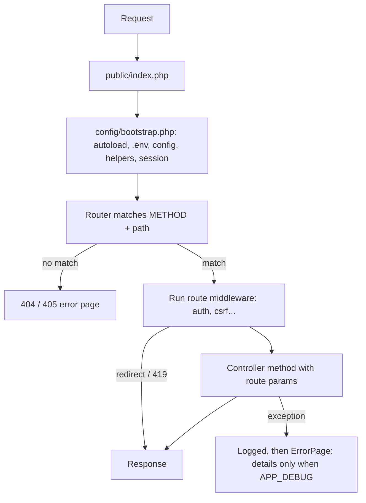

# BongoMVC Documentation

BongoMVC is a lightweight PHP MVC framework with **zero required dependencies**. It needs no Composer and no `vendor/` folder: clone it, set `.env`, and run it. Composer packages and Node tooling are optional. If `vendor/autoload.php` exists, BongoMVC loads it; otherwise nothing changes.

Built in:

| Area | What you get |
| --- | --- |
| Routing | `'GET /products/{id}' => [Controller, method, [middleware]]`, 404/405 handling |
| Middleware | `auth`, `guest`, `csrf` (and your own) |
| Views | Template directives: `@extends`, `@section`, `@yield`, `@set`, `@include`, `{{ }}`, `{!! !!}` |
| Database | PDO query builder, models, pagination, aggregates, joins |
| Schema & migrations | PHP migrations with a schema builder; each run is tracked in the database; rollback |
| Sessions | Flash messages, old input, CSRF tokens |
| Validation | `required`, `email`, `min`, `max`, `unique`, `exists`, `confirmed`, … |
| Auth & security | Login/logout, peppered Argon2id password hashes, AES-256-GCM encryption keyed by `APP_KEY`, login throttling |
| Testing | `php bongo test`: unit + HTTP tests on a separate test database |
| Logging | Built-in daily log files in `storage/logs`, levels, secret masking; framework events logged automatically |
| CLI | `php bongo serve / migrate / migrate:status / migrate:rollback / make:migration / db:seed / key:generate / log:clear / test` |

The repository is a **fresh skeleton**: a welcome page, sign-in/sign-out, a system status page and the framework itself. No application code ships with it. The e-commerce test application used to exercise the framework lives on the `demo/ecommerce` branch.

---

## 1. Requirements

| Requirement | Notes |
| --- | --- |
| PHP **8.0+** | Tested on 8.3 |
| Extensions | `pdo_mysql`, `openssl`; `curl` only for `php bongo test` |
| MySQL 5.7+ / 8 or MariaDB 10.3+ | |
| Apache `mod_rewrite` (optional) | Only if not using `php bongo serve` |

---

## 2. Quick start

```bash
git clone <repo-url> BongoMVC && cd BongoMVC
cp .env.example .env              # Windows: copy .env.example .env
# edit .env: APP_NAME, APP_URL, DB_* values
php bongo key:generate          # writes APP_KEY to .env
php bongo migrate               # create tables (tracked in the `migrations` table)
php bongo db:seed               # creates one user to sign in with
php bongo serve                 # http://127.0.0.1:8000
```

Seeded login: **admin@example.com / password**. Change it before going live.

### `.env` keys

| Key | Purpose |
| --- | --- |
| `APP_NAME` | Shown in the UI (default `BongoMVC`) |
| `APP_ENV` | `local`, `testing`, `production` |
| `APP_DEBUG` | `true` shows error details. Defaults to on unless `APP_ENV=production`. |
| `APP_URL` | Base URL. The router strips its path from each request; `url()`/`asset()` build links from it. **Must match how you open the site.** |
| `APP_PORT` | Default port for `php bongo serve` |
| `APP_KEY` | Secret key for password peppering and encryption. Generated by `key:generate`. **Never commit it, never change it on a live site.** |
| `DB_HOST`, `DB_PORT`, `DB_DATABASE`, `DB_USERNAME`, `DB_PASSWORD` | MySQL connection |
| `DB_TEST_DATABASE` | Database for `php bongo test`. Default `<DB_DATABASE>_test`. |
| `LOG_CHANNEL` | `daily` (default), `single` or `none` |
| `LOG_LEVEL` | Lowest level written. Default `debug`, or `info` in production. |
| `LOG_DAYS` | Days to keep daily log files. Default 14; 0 keeps them forever. |
| `LOG_PATH` | Log directory. Default `storage/logs`. |

Values may be quoted (`APP_NAME="My Shop"`). Real environment variables override `.env`.

### Apache

Point the vhost `DocumentRoot` at `public/`; `public/.htaccess` routes everything to `index.php`.

---

## 3. Directory structure

```
bongo                    CLI entry point (php bongo <command>)
config/
  bootstrap.php          Boots everything: autoload, .env, config, helpers, error logging, session
  app.php                Name, env, debug, url, middleware aliases
  database.php           Connections
  logging.php            Log channel, level, path, retention
public/
  index.php              Front controller: Router + error handling
  asset/                 CSS / JS
routes/web.php           Route table
app/                     Application code (namespace App\)
  Http/Controllers/      HomeController, AuthController, SystemController
  Http/Middleware/       Authenticate, RedirectIfAuthenticated, VerifyCsrfToken
  Models/                User
  Helpers/commonHelper.php  App helpers (dd())
database/
  migrations/            PHP migrations (tracked in the `migrations` table)
  seeders/DatabaseSeeder.php
resources/views/         Templates (dot notation: auth.login → auth/login.php)
storage/logs/            Log files (git-ignored)
system/                  Framework core (namespace System\)
  Auth/                  Auth, LoginThrottle
  Database/              Connection, DB, QueryBuilder, Model, Migration, Migrator
  Database/Schema/       Schema, Blueprint, ColumnDefinition, Expression
  Http/                  Request, Session, HttpException, ErrorPage
  Log/                   Logger, Log
  Routing/Router.php
  Security/              Key, Hash, Crypt
  Support/helpers.php    Framework helpers
  Testing/               TestCase, HttpTestCase, TestResponse, Runner
  Validation/Validator.php
  View/                  ViewEngine, ViewCompiler, SectionManager
tests/
  Unit/                  Framework unit tests
  Feature/               HTTP tests against the running app
```

---

## 4. Request lifecycle



---

## 5. Routing and middleware

```php
// routes/web.php
$admin = ['auth', 'csrf'];

return [
    'GET /products'              => ['ProductController', 'index', $admin],
    'POST /products'             => ['ProductController', 'store', $admin],
    'GET /products/{id}/edit'    => ['ProductController', 'edit', $admin],
    'POST /products/{id}'        => ['ProductController', 'update', $admin],
    'POST /products/{id}/delete' => ['ProductController', 'destroy', $admin],
];
```

- Methods: `GET`, `POST`, `ANY`. A key with no method means `ANY`.
- `{name}` matches one path segment. Values are passed to the controller method in order: `edit($id)`.
- A path that matches with the wrong method returns **405**. No match returns **404**.
- Delete/update actions use `POST` forms. A `GET` request can never change data.
- The last page shown with `GET` is remembered in the session, so `back()` works without a `Referer` header.

**Middleware** are classes with a `handle(): void` method. They either return or stop the request with `redirect()` or an exception. Register an alias in `config/app.php`:

```php
'middleware' => [
    'auth'  => App\Http\Middleware\Authenticate::class,            // not logged in → /login (remembers the page)
    'guest' => App\Http\Middleware\RedirectIfAuthenticated::class, // logged in → /
    'csrf'  => App\Http\Middleware\VerifyCsrfToken::class,         // POST without a valid _token → 419
],
```

---

## 6. Controllers, requests, validation

```php
namespace App\Http\Controllers;

use App\Models\Product;
use System\Http\Request;

class ProductController extends Controller
{
    public function index()
    {
        $products = Product::query()->where('status', 'active')->orderBy('id', 'DESC')->paginate(10);
        echo $this->view('products.index', ['products' => $products, 'q' => Request::query('q')]);
    }

    public function store()
    {
        // On failure: errors + old input are flashed and the user is sent back
        $data = $this->validate([
            'name'  => 'required|string|max:150',
            'sku'   => 'required|max:50|unique:products,sku',
            'price' => 'required|numeric|min:0',
        ]);

        Product::create($data);
        flash('success', 'Product created.');
        redirect(url('/products'));
    }

    public function edit($id)
    {
        $product = Product::find((int) $id) ?? abort(404, 'Product not found');
        // ...
    }
}
```

**Request:** `Request::all()`, `Request::input('key', $default)`, `Request::only([...])`, `Request::query('key')`, `Request::method()`, `Request::path()`. String input is trimmed, and empty strings count as missing.

**Validation rules:** `required`, `nullable`, `string`, `email`, `numeric`, `integer`, `min:n`, `max:n` (length for text, value for `numeric`/`integer`), `in:a,b`, `confirmed` (needs `<field>_confirmation`), `unique:table,column[,ignoreId]`, `exists:table,column`. `Validator::make($data, $rules)` returns `field => first error`.

---

## 7. Views

```php
@extends('layouts.admin')
@set('title', 'Products')

@section('content')
    <?php foreach ($products['data'] as $product): ?>
        <p>{{ $product->name }} – {{ money($product->price) }}</p>
    <?php endforeach; ?>

    <form method="POST" action="<?= url('/products') ?>">
        <?= csrf_field() ?>
        <input name="name" value="{{ old('name') }}" class="<?= error('name') ? 'is-invalid' : '' ?>">
        <div>{{ error('name') }}</div>
    </form>

    @include('partials.pagination')
@endsection
```

| Syntax | Meaning |
| --- | --- |
| `@extends('layouts.admin')` | Render inside a layout |
| `@section('x') … @endsection` / `@yield('x')` | Define / print a section |
| `@set('x', 'text')` | Set a section to a short string |
| `@include('partials.flash')` | Render a partial with the current variables |
| `{{ $value }}` | Escaped output |
| `{!! $html !!}` | Raw output (trusted HTML only) |

Rendered output is never compiled again, so user data such as `{{ phpversion() }}` prints as plain text. Error pages can be customised in `resources/views/errors/{404,405,419,...}.php`.

---

## 8. Database

### Query builder

```php
use System\Database\DB;

DB::table('products')->get();                                   // stdClass rows
DB::table('products')->where('price', '>', 10)->first();
DB::table('products')
    ->select('products.*', 'categories.name AS category')
    ->leftJoin('categories', 'categories.id', '=', 'products.category_id')
    ->whereIn('status', ['active'])
    ->whereRaw('products.name LIKE ? OR products.sku LIKE ?', ["%$q%", "%$q%"])
    ->orderBy('products.id', 'DESC')
    ->paginate(15);   // ['data', 'total', 'per_page', 'current_page', 'last_page']

DB::table('orders')->where('status', '!=', 'cancelled')->sum('total');
DB::table('users')->where('role', 'customer')->count();

$id = DB::table('categories')->insertGetId(['name' => 'Books', 'slug' => 'books']);
DB::table('categories')->where('id', $id)->update(['name' => 'Novels']);
DB::table('categories')->where('id', $id)->delete();

DB::raw('SELECT * FROM users WHERE email = ?', [$email]);      // arrays for SELECT, bool otherwise
```

Safety rules:
- Values are always bound with `?`.
- Operators and `ASC`/`DESC` are whitelisted.
- `update()` and `delete()` **refuse to run without a `where()`**. Pass `true` to really affect every row.
- Column and table names are not escaped, so never pass user input as an identifier.

### Models

```php
class Product extends System\Database\Model
{
    protected static $table = 'products';   // optional: default = lowercase class + "s"
}

Product::all();  Product::find(3);  Product::where('status', 'active')->get();
Product::whereIn('id', [1, 2])->get();  Product::create([...]);  Product::query()->latest()->limit(5)->get();
```

### Migrations

Migrations are PHP files in `database/migrations/`, run in filename order:

```php
<?php

use System\Database\Migration;
use System\Database\Schema\Blueprint;
use System\Database\Schema\Schema;

return new class extends Migration
{
    public function up(): void
    {
        Schema::create('products', function (Blueprint $table) {
            $table->id();
            $table->foreignId('category_id')->nullable()->references('categories')->onDelete('set null');
            $table->string('name', 150);
            $table->string('sku', 50)->unique();
            $table->decimal('price', 10, 2)->default(0);
            $table->enum('status', ['active', 'draft'])->default('active');
            $table->text('description')->nullable();
            $table->timestamps();
        });
    }

    public function down(): void
    {
        Schema::dropIfExists('products');
    }
};
```

**Column types:** `id`, `foreignId`, `string(len)`, `char(len)`, `text`, `longText`, `integer`, `tinyInteger`, `bigInteger`, `decimal(p, s)`, `float`, `boolean`, `enum([...])`, `json`, `date`, `dateTime`, `timestamp`, `timestamps()`.

**Modifiers:** `nullable()`, `default(v)`, `unsigned()`, `unique()`, `index()`, `useCurrent()`, `useCurrentOnUpdate()`, `comment()`, `after('col')`, `references('table', 'col')`, `onDelete('cascade' | 'set null' | 'restrict')`, `onUpdate(...)`.

**Table-level methods:** `index([...])`, `unique([...])`, and, inside `Schema::table()`, `dropColumn`, `dropIndex`, `dropForeign`, `renameColumn`.

**Schema:** `create`, `table` (alter), `drop`, `dropIfExists`, `rename`, `hasTable`, `hasColumn`.

**Tracking.** Every migration that runs is recorded in the `migrations` table with its name, batch number and time. Each `migrate` run is one batch.

```bash
php bongo make:migration create_posts_table   # new file with up()/down() stubs
php bongo migrate                             # run pending migrations as a new batch
php bongo migrate:status                      # Ran / Pending, batch, time for every migration
php bongo migrate:rollback                    # undo the last batch (down(), newest first)
php bongo migrate:rollback --step=2           # undo the last 2 batches
php bongo migrate:fresh --seed                # drop ALL tables, migrate, seed (asks for the DB name)
```

```
Migration                                       Status   Batch  Ran at
2026_10_01_000001_create_users_table            Ran      1      2026-10-02 00:54:13
2026_10_01_000006_create_login_attempts_table   Pending
```

---

## 9. Authentication and security

```php
use System\Auth\Auth;

Auth::attempt($email, $password);  // true + logged in, or false
Auth::check();  Auth::user();  Auth::id();  Auth::logout();
auth()->name;                      // helper
```

**Passwords are hashed, never encrypted.** A password can't be turned back into text, by anyone:

```
stored = Argon2id( HMAC-SHA256(password, key derived from APP_KEY) )
```

- A stolen database alone can't be cracked offline; the attacker also needs `APP_KEY`.
- Each hash has its own salt, so two identical passwords give different hashes.
- Old hashes are upgraded automatically on login.
- **Changing `APP_KEY` makes every stored password invalid.** Generate the key once and keep it secret and backed up.

Use `System\Security\Hash::make()` / `Hash::check()` for passwords.

**Encryption, for data you need to read back** (API tokens, personal data). Not for passwords.

```php
use System\Security\Crypt;

$encrypted = Crypt::encrypt('+880 1700 000000');  // AES-256-GCM, fresh IV each time
$plain     = Crypt::decrypt($encrypted);           // needs the same APP_KEY; tampering is detected
```

**Login protection**
- **Brute force:** 5 failed attempts per email + IP lock that pair for 15 minutes (`LoginThrottle`, `login_attempts` table).
- **Account guessing:** the same error message for an unknown email and a wrong password, and the same password-check cost, so response time doesn't reveal which emails exist.
- **Sessions:** the session ID and CSRF token are regenerated on login and logout, and the session ID again after a password change. Cookies are `HttpOnly` and `SameSite=Lax`, plus `Secure` on HTTPS.
- **CSRF:** every state-changing form carries `csrf_field()`, and `csrf` middleware rejects missing or forged tokens with 419.

In production, also serve the site over **HTTPS**, set `APP_ENV=production`, and keep `.env` outside version control (it's already git-ignored).

---

## 10. Logging

Logging is built into the framework. No package is needed.

```php
use System\Log\Log;

Log::info('Order {id} shipped to {city}', ['id' => 42, 'city' => 'Dhaka']);
Log::error('Payment failed', ['order' => 42, 'exception' => $e]);   // adds class, message, file:line and trace
logger('Quick debug line', ['x' => 1]);                            // debug level
logger()->warning('Disk almost full');
```

Each entry is one line in `storage/logs/bongo-YYYY-MM-DD.log`:

```
[2026-10-02 14:03:11] local.INFO: Order 42 shipped to Dhaka {"id":42,"city":"Dhaka"}
[2026-10-02 14:05:40] local.WARNING: Failed login for admin@example.com {"email":"admin@example.com","ip":"127.0.0.1"}
```

- **Levels**, lowest to highest: `debug`, `info`, `notice`, `warning`, `error`, `critical`, `alert`, `emergency`. Anything below `LOG_LEVEL` is skipped.
- **Placeholders:** `{key}` in a message is replaced from the context. The context itself is appended as JSON.
- **Secrets are masked:** context keys such as `password`, `token`, `secret`, `key` or `cookie` are written as `********`, at any depth.
- **Logging never breaks a request.** If the file can't be written, the line goes to PHP's own error log instead.
- **Retention:** daily files older than `LOG_DAYS` are deleted automatically. `php bongo log:clear` removes them all.

**What the framework logs automatically**

| Event | Level |
| --- | --- |
| Uncaught exception (with trace, method and path) | error |
| PHP warnings and notices; fatal errors at shutdown | warning / notice / critical |
| HTTP 403 and 419 (bad CSRF token); 404 and 405 | warning; debug |
| Failed login, and a lockout after too many attempts | warning |
| Login and logout (user id, IP) | info |
| Database connection failure | critical |
| Each migration run or rolled back; `migrate:fresh` dropping tables | info; warning |

Tests write to `storage/logs/testing/` instead, so they never mix with your app's logs.

---

## 11. Helpers

| Helper | Description |
| --- | --- |
| `env($key, $default)` | `.env` value (`true`/`false`/`null` converted) |
| `config('app.name')` | Config by dot notation (every `config/*.php` file is loaded) |
| `url('/path')`, `route('/path')`, `asset('asset/x.css')` | Absolute URLs from `APP_URL` |
| `view($name, $data)` | Render a view to a string |
| `request()`, `request('key')` | Input |
| `session('key')`, `flash('key', 'msg')`, `flash('key')` | Session and flash messages |
| `old('field', $default)`, `error('field')`, `errors()` | Form state after validation |
| `csrf_token()`, `csrf_field()` | CSRF |
| `auth()` | Logged-in user or `null` |
| `redirect($url)`, `back()` | Redirect and stop |
| `abort(404, 'msg')` | Stop with an HTTP error page |
| `response($data, 'json', 200)` | JSON or HTML response and stop |
| `e($value)` | HTML-escape |
| `money($n)`, `is_active('/prefix')` | Formatting and nav helpers |
| `base_path('x')` | Absolute project path |
| `logger()`, `logger('msg', $context)` | The logger, or write a debug line |
| `dd(...$vars)` | Debug dump and stop |

---

## 12. Testing

```bash
php bongo test            # all tests
php bongo test Auth       # only tests whose Class::method contains "Auth"
```

- The runner uses **its own database**, `DB_TEST_DATABASE` (default `<DB_DATABASE>_test`). It creates, migrates and seeds that database on every run, and refuses to run against the main database.
- It uses a **temporary random `APP_KEY`**, so your real key isn't needed and is never touched.
- `tests/Unit/*Test.php` extend `System\Testing\TestCase` and call the framework directly.
- `tests/Feature/*Test.php` extend `System\Testing\HttpTestCase`. They send real HTTP requests to the app on a throwaway `php -S` server, with cookies kept per test like one browser.

```php
class ProductTest extends System\Testing\HttpTestCase
{
    public function setUp(): void
    {
        parent::setUp();
        $this->loginAsAdmin();
    }

    public function testCreate(): void
    {
        // submit() loads the form page first and sends its CSRF token
        $this->submit('/products/create', '/products', ['name' => 'Mug', 'sku' => 'M-1', 'price' => '5', 'stock' => '1', 'status' => 'active'])
            ->assertRedirect('/products');
        $this->get('/products')->assertStatus(200)->assertSee('Mug');
        $this->assertSame('Mug', $this->db('products')->where('sku', 'M-1')->first()->name);
    }
}
```

**Assertions:**
- On a test: `assertTrue`, `assertFalse`, `assertSame`, `assertEquals`, `assertNotSame`, `assertNull`, `assertCount`, `assertContains`, `assertNotContains`, `assertArrayHasKey`, `assertThrows`.
- On a response: `assertStatus`, `assertRedirect('/path')`, `assertSee`, `assertDontSee`, plus `->location()`, `->csrfToken()` and `->header()`.

---

## 13. Test application (e-commerce)

To exercise the framework the way a real project would, the **`demo/ecommerce`** branch contains a full e-commerce admin built on BongoMVC. It has a dashboard, products, categories, orders, customers and profile pages, plus its own migrations, seeder and HTTP tests. The skeleton on `master` stays free of application code.

```bash
git checkout demo/ecommerce
php bongo migrate:fresh --seed     # use a separate database for it
php bongo test
```
